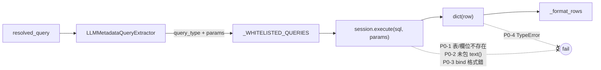
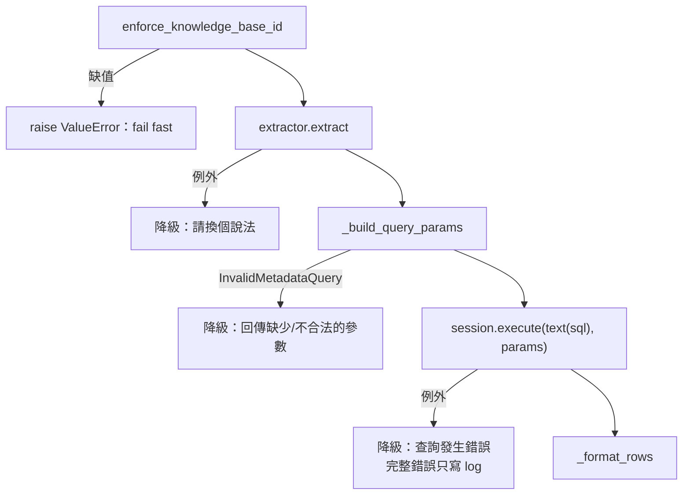

# Code review：`app/routing/branches/metadata.py`

> **狀態：P0-1 ～ P0-4、P1-1 已修（commit `abbaaf2`）；P1-2 ～ P1-4（commit `cf214d9`）、P2（commit `bf85be7`）已修；Postgres 與真實 LLM 的實測之後另外進行。**
> Review 日期：2026-10-15。
> 對照版本：SQLAlchemy 2.0.51（`uv.lock`）。以下結論來自閱讀程式碼，**未實際執行**。

## Context

Review 對象是 `app/routing/branches/metadata.py`（METADATA 分支）：用白名單參數化查詢，
從 PostgreSQL 查文件 metadata。對照檔案：`app/models/document.py`、`app/db/session.py`、
`app/agent/state.py`、`app/routing/branches/common.py`。

現況：這個 branch **在 runtime 一定會失敗**，四種查詢沒有一種能成功執行。
白名單 + 參數綁定的整體設計方向正確，問題在於 SQL 和實際的 DB schema、
SQLAlchemy 2.0 API 都對不上。



---

## 發現清單（依嚴重度排序）

### [x] P0-1｜表名和欄位都不存在

`metadata.py:41-63` 的 SQL 與 ORM 定義不一致：

- ORM 表名是 `documents`（`app/models/document.py:20`），SQL 寫的是 `document`。
- `document_chunk` 表在 `app/models/` 中不存在。
- `documents` 沒有 `title`、`author`、`document_type`、`version`、`created_at` 欄位；
  實際有的是 `filename`、`file_extension`、`created_dt` 等。

→ 四種查詢都會出現 `UndefinedTable` 或 `UndefinedColumn` 錯誤。

**已決定（2026-10-15）**：不寫 migration，`_WHITELISTED_QUERIES` 改查 `documents` 的現有欄位；
`BY_VERSION` 也改查 `documents`，不再用 `document_chunk`。

#### P0-1 修法計畫

##### 1. 欄位對照

| query type | 原本查的 | 改成 | 參數 |
|---|---|---|---|
| `BY_DATE_RANGE` | `created_at` | `created_dt` | `start_date`, `end_date`（不變） |
| `BY_DOCUMENT_TYPE` | `document_type` | `file_extension` | `document_type` → 改名 `file_extension` |
| `BY_VERSION` | `document_chunk.version` | `documents` 中同 KB、同 `filename` 的多筆上傳 | `document_id` → 改成 `filename` |
| `BY_AUTHOR` | `author` | **見下方「待決定」** | — |

所有查詢共用的輸出欄位：`id, filename, file_extension, created_dt`。
`title` 一律改用 `filename`。

##### 2. `BY_VERSION` 的定義

`documents` 沒有 version 欄位，所以把「版本」定義成：**同一個 KB 裡，同一個 `filename` 的每一次上傳就是一個版本**，
依 `created_dt` 排序。版本號在 SQL 裡用 window function 算出來，SQL 仍是固定常數：

```sql
SELECT id, filename, file_extension, content_hash, file_size_bytes, created_dt,
       ROW_NUMBER() OVER (ORDER BY created_dt ASC) AS version
FROM documents
WHERE knowledge_base_id = :knowledge_base_id
  AND tenant_id = :tenant_id
  AND user_id = :user_id
  AND filename = :filename
ORDER BY created_dt DESC
LIMIT :limit
```

參數從 `document_id` 改成 `filename` 的理由：使用者用自然語言問問題時不會知道 UUID，
LLM 抽得出檔名，抽不出 `document_id`。

> 前提（未查證）：上傳 endpoint 不會擋掉同名檔案的重複上傳。若之後加了 dedup，或改成覆寫舊紀錄，這個定義就要重新檢討。

##### 3. 待決定：`BY_AUTHOR`

`documents` 沒有 author 欄位。唯一接近的是 `created_by`，但有兩個問題：

- 上傳 endpoint（`app/api/v1/endpoints/knowledgeBases.py:118-133`）**從來沒有寫入 `created_by`**，查了一定是空的。
- 所有查詢都已經用 `user_id = 目前使用者` 過濾，查得到的文件全部是自己上傳的，「依作者查」在現在的隔離規則下沒有意義。

**已決定：移除 `BY_AUTHOR`**；同時上傳 endpoint 改成寫入 `created_by = current_user.username`
（只改 code，沒有 schema 變更，不需要 migration；既有資料列的 `created_by` 仍是 NULL）。

原本的建議：**先從 `MetadataQueryType` 和白名單移除 `BY_AUTHOR`**。之後如果 KB 改成多人共用，再加回來，
並同時讓上傳時寫入 `created_by`。替代方案是改成 `BY_FILENAME`（`filename ILIKE :pattern`），
但這算新功能，不放進 P0-1。

##### 4. 要改的地方

1. `metadata.py:33-38`：`MetadataQueryType` 移除 `BY_AUTHOR`（看第 3 點的決定）。
2. `metadata.py:41-63`：依第 1、2 點重寫 `_WHITELISTED_QUERIES`。
3. `metadata.py:92-97`：extractor 的 instructions 改成新的參數名稱：
   `BY_DATE_RANGE(start_date, end_date) / BY_DOCUMENT_TYPE(file_extension: pdf|md|docx) / BY_VERSION(filename)`。
4. `BY_DOCUMENT_TYPE` 綁定前先把參數正規化：轉小寫、去掉開頭的 `.`（例如 `.PDF` → `pdf`），
   因為上傳時存的 `file_extension` 是小寫、不含點。
5. `metadata.py:1-12`：docstring 刪掉 `document`/`document_chunk`。

##### 5. 順便處理（成本低）

- 每條 SQL 都加 `AND deleted_at IS NULL`，順便解掉 P1-1。

##### 6. 依賴與驗證

- **P0-1 不能單獨驗證**：P0-2 到 P0-4 沒修好之前，SQL 根本送不出去。建議 P0-1 到 P0-4 放在同一個變更一起做，
  所以上面的 SQL 已直接改用 `:name` bind 格式（P0-3）。
- 測試（新增 `tests/routing/test_metadata_branch.py`）：
  - unit：注入 fake extractor，確認每種 query type 都選到對的 SQL；extractor 塞了別的 `knowledge_base_id`/`tenant_id` 時，參數仍被覆蓋。
  - integration（需要 dev Postgres）：對白名單裡的每一條 SQL 跑 `EXPLAIN`，確認表名、欄位都存在。這能防止 schema 改了，白名單沒跟著改。
  - integration：同一個 `filename` 上傳兩次，`BY_VERSION` 要回傳 2 筆，`version` 分別是 2、1。

---

### [x] P0-2｜`session.execute()` 傳入純字串

`metadata.py:139`。這是 SQLAlchemy 2.0（`session.py` 用了 `future=True`），直接傳 `str` 會拋：

```
ArgumentError: Textual SQL expression ... should be explicitly declared as text(...)
```

**修法**：`session.execute(text(sql), params)`。

---

### [x] P0-3｜bind 參數格式錯誤

`%(name)s` 是 psycopg 原生的寫法；SQLAlchemy 的 `text()` 要用 `:name`。這點要和 P0-2 一起改。

---

### [x] P0-4｜`dict(row)` 在 SQLAlchemy 2.0 會失敗

`metadata.py:141`。在 2.0，`Row` 的行為像 tuple，`dict(row)` 會拋 `TypeError` 或 `ValueError`。

**修法**：

```python
result = await session.execute(text(sql), params)
rows = [dict(r) for r in result.mappings().all()]
```

---

### [x] P1-1｜沒有過濾 soft delete 的資料

`documents` 有 `deleted_at` 欄位，但四條 SQL 都沒加 `AND deleted_at IS NULL`，
已刪除的文件會被查出來。

---

### [x] P1-2｜沒有逐一檢查 extractor 回傳的 `params`

`metadata.py:66-68`、`131-137`：

- `params: dict` 沒有任何 schema。LLM 漏了某個參數（例如 `BY_AUTHOR` 沒給 `author`）時，
  SQLAlchemy 會在執行時拋 bind 錯誤，整個 graph 就掛了。
- **修法**：每種 query type 定義一個 Pydantic model（例如 `ByAuthorParams(author: str)`），
  或至少按 query type 只挑出允許的 key；缺參數時回一段友善的訊息。
- **推論（未實測）**：Gemini structured output 對沒有型別的 `dict` 支援不好
  （`additionalProperties` 問題），`params` 很可能總是回空的。

---

### [x] P1-3｜日期範圍的邊界

`metadata.py:50`。LLM 給的若是 `2026-10-15` 這種日期，而欄位是 timestamp，
`BETWEEN ... AND '2026-10-15'` 會漏掉當天 00:00 之後的資料。

**修法**：改成 `created_dt >= :start_date AND created_dt < :end_date_exclusive`
（`end_date` + 1 天），並先把日期 parse 成 `date` 型別再綁定。

---

### [x] P1-4｜沒有錯誤處理

extractor（LLM）出錯或資料庫出錯時，例外會直接往上拋，整個 graph 中斷。
建議和其他分支統一做法：捕捉錯誤、在 `trace` 記下來，然後回一個降級的答案。

---

### [x] P2-1｜`_format_rows` 直接輸出 dict repr

`metadata.py:104-108`。輸出裡會有 `UUID(...)`、`datetime(...)` 這類字樣，可讀性差，
應該格式化成檔名、作者、日期等欄位。

### [x] P2-2｜`sql_documents` 存的是 raw dict

裡面有 `UUID` 和 `datetime`，會被 checkpointer 序列化。建議先轉成 JSON 友善的型別，或定義一個 schema。

### [x] P2-3｜雜項

- `metadata.py:100-103` 有多餘的空行。
- module docstring 裡寫的 `document`/`document_chunk` 要跟著 P0-1 一起改。

---

## 實作結果（2026-10-15）

改動檔案：

- `app/routing/branches/metadata.py`：移除 `BY_AUTHOR`；白名單改查 `documents` 現有欄位，抽出共用的 `_SCOPE`（含 `deleted_at IS NULL`）；
  bind 改 `:name`；`session.execute(text(sql), params)`；用 `result.mappings().all()` 轉 dict；新增 `_normalize_params()` 正規化 `file_extension`。
- `app/api/v1/endpoints/knowledgeBases.py`：建立 `Document` 時寫入 `created_by=current_user.username`。
- `tests/routing/test_metadata_branch.py`（新增）。

驗證：`pytest tests/routing tests/auth` → **26 passed**（Windows `.venv`，SQLAlchemy 2.0.51）。

- unit（fake session）：`BY_AUTHOR` 已不被接受；extractor 塞的 `knowledge_base_id`/`tenant_id`/`user_id` 會被覆蓋；`" .PDF "` → `pdf`；rows 轉成 dict。
- schema guard：用 `Document.__table__` 在 **SQLite** 建表，實際執行每條白名單 SQL；`BY_VERSION` 排除 soft delete 與其他 KB 後回傳 `[(d2, 2), (d1, 1)]`。

限制：

- 沒有對 Postgres 實測（worktree 只有 `.env.prod`，刻意不連）。SQLite 能驗證表名、欄位與 window function，
  但驗不到 Postgres 特有行為，例如 `uuid` 欄位和字串參數比較、`timestamptz` 和日期字串比較。Postgres 實測之後另外進行。
- 依指示沒有跑 migration；這次改動也不需要 migration。

## 實作結果：P1-2 ～ P1-4（2026-10-15）



- **P1-2**：`MetadataQueryRequest` 的 `params: dict` 改成固定型別欄位
  （`start_date`/`end_date: date`、`file_extension`、`filename`，皆 optional）。
  - `_REQUIRED_FIELDS` + `_build_query_params()` 依查詢類型檢查必填欄位，**只回傳該類型 SQL 用得到的 key**。
  - `file_extension` 必須是 `pdf`/`md`/`docx`（與上傳 endpoint 一致）；正規化移到 model 的 `field_validator`。
  - request model 沒有 `knowledge_base_id`/`tenant_id`/`user_id` 欄位，LLM 多給的 key 會被 Pydantic 丟掉。
- **P1-3**：SQL 改成半開區間 `created_dt >= :start_date AND created_dt < :end_date_exclusive`（`end_date + 1 天`）；
  `start_date > end_date` 視為不合法請求。extractor prompt 加入今天日期，讓 LLM 能解析「上週」這類相對日期。
- **P1-4**：三種失敗都降級，回傳 `answer` + 空的 `sql_documents`，原因寫進 `trace`，做法和 `RouterNode` 一致。
  - DB 錯誤訊息含 SQL 與參數，只用 structlog `logger.exception` 記錄，`trace` 只留例外型別。
  - 缺 `knowledge_base_id` 照樣 raise：那是租戶邊界，不能降級。
- extractor prompt 改了，依既有規則把 `ROUTER_VERSION` 遞增為 `metadata-v2`。

驗證：`pytest tests/routing tests/auth` → **35 passed**（新增測試涵蓋：只送出所選類型的參數、缺參數/不支援類型/日期顛倒時不查 DB、
extractor 與 DB 失敗的降級、DB 錯誤不進 trace、缺 KB 仍 fail fast、SQLite 上 `end_date` 當天 15:00 的資料有被查到）。

未查證：

- Gemini structured output 能否正確產出 `date` 欄位（JSON schema `format: date`），沒有用真實 LLM 測過。
- Postgres 上 `timestamptz >= date` 的比較依 DB session 的 `TimeZone` 決定一天的邊界；若 session 不是使用者時區，
  邊界會有時差。目前沒有使用者時區資料，先接受這個限制。

## 實作結果：P2（2026-10-15）

- **P2-1**：`_format_rows()` 依查詢類型輸出可讀文字（以下輸出取自 `tests/routing/test_metadata_branch.py` 的斷言）：

  ```
  a.pdf 共找到 1 個版本（新到舊）：
  - v1：2026-10-05 15:00 上傳，2.0 KB
  ```

  ```
  找到 2 份文件（新到舊）：
  - f0.pdf（PDF，2026-10-05 15:00 上傳）
  ```

  回傳筆數達到 `limit` 時，加一行「只列出最新的 N 筆」。時間照 DB 回傳的值顯示，沒有轉成使用者時區。
- **P2-2**：`sql_documents` 經 `_to_jsonable()` 把 `UUID` 轉成 `str`、`date`/`datetime` 轉成 ISO 字串，測試用 `json.dumps` 確認可序列化。
  目前沒有其他程式讀 `sql_documents`，所以沒有另外定義 schema。
- **P2-3**：多餘空行與 docstring 已在先前改動中處理；另外移除沒人使用的 `QueryExecutor` Protocol
  （舊版 `PsycopgQueryExecutor` 的遺留，執行層已改用 `AsyncSessionLocal`）。

驗證：`pytest tests/routing tests/auth` → **37 passed**。

`app/routing/PLAN.md` 的 M-INT6 段落原本寫著「`BY_VERSION` 暫時移除」，已更新成目前的實作。

## 做得好的地方

- SQL 全部是常數，LLM 只能從 enum 裡選，從結構上杜絕了 text-to-SQL injection。
- `knowledge_base_id`、`tenant_id`、`user_id` 放在 `**request.params` 展開**之後**才覆蓋，
  順序正確，LLM 塞進來的值會被蓋掉。
- 三個欄位一起過濾，比只過濾 `knowledge_base_id` 更穩妥。

## 待辦

1. [x] 決定 P0-1 的方向（補欄位寫 migration，或改用現有欄位）。
2. [x] 修 P0-2 到 P0-4，讓查詢能跑通，並補測試。
3. [x] 處理 P1（soft delete、參數 schema、日期邊界、錯誤處理）。
4. [x] P2 收尾。
5. [x] 更新 `app/routing/PLAN.md` 中過時的 METADATA 說明。
