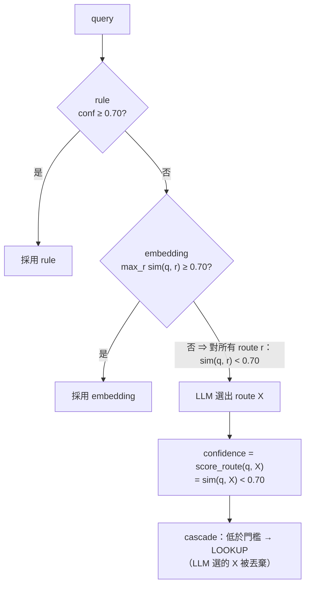
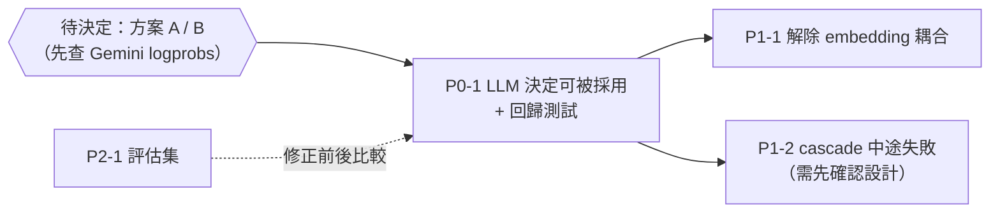

# Cascade router：LLM 層的決定永遠被丟棄

> **狀態：尚未開始修正。**
> 發現日期：2026-10-15（review META 分支時順帶發現，見 [meta-branch-review-20261015.md](meta-branch-review-20261015.md)）。
> 查證日期：2026-10-15。§2 的結論已用假 embedding 模擬實測（Python 3.12.13，程式碼在 §2.2）；
> 真實 Gemini embedding 下的分佈、延遲數字**未實測**。

## Context

`CascadeRouter`（`app/routing/router/cascade.py`）依序跑 rule → embedding → LLM，任一層
`confidence >= CONFIDENCE_THRESHOLD`（0.70）就短路；三層都不到門檻就保底 LOOKUP。設計意圖是：
rule / embedding 負責快速處理有把握的問題，**語意模糊的問題交給最準的 LLM 層**。

問題：LLM 層的 confidence 是用 embedding 相似度算的，而能走到 LLM 層的問題，embedding 相似度
一定已經低於門檻。所以 **LLM 層每次被呼叫都要花錢、增加延遲，但它的決定從來不會被採用**。
實際上 routing 只有三種結果：rule 命中、embedding 命中、LOOKUP 保底。

對照檔案：`app/routing/router/cascade.py`、`llm.py`、`embedding.py`、`fallback_chain.py`、`base.py`、
`app/routing/taxonomy.py`、`app/agent/graphs/routed_rag.py`（`RouterNode`、`select_branch`）。

---

## 1. 為什麼 LLM 層的決定不會被採用



逐步對照程式碼：

1. `EmbeddingRouter.route()`（`embedding.py:144-163`）的 confidence 是**所有 route 中最高的**相似度
   `max_r max_{example∈r} cos(q, example)`。
2. cascade 只有在這個值 < 0.70 時才會呼叫 LLM 層（`cascade.py:38-43`）。
3. `LLMRouter.route()`（`llm.py:114-115`）的 confidence 是 `score_route(q, X)`
   = `max_{example∈X} cos(q, example)`（`embedding.py:134-142`），也就是**某一個 route** 的相似度。
4. 某一個 route 的相似度 ≤ 所有 route 的最高相似度 < 0.70，所以 LLM 層的 confidence 必定 < 0.70。
5. cascade 回傳 `DEFAULT_ROUTE`（LOOKUP）。就算 cascade 放行，`select_branch()`（`routed_rag.py:146-150`）
   也會因為 confidence < 0.70 再強制改成 LOOKUP。

前提：cascade 的 embedding 層與 LLM 層的 scorer 用同一組範例、同一個 embedding 模型。
預設建構（`CascadeRouter()` → `EmbeddingRouter()` 與 `LLMRouter()` 內部的 `EmbeddingRouter()`）
就是這種情況，兩者都用 `ROUTE_EXAMPLES` 與 `text-embedding-004`。唯一的例外是 embedding API
對同一段文字回傳不同向量（推論，機率極低，未查證）。

### 1.1 Fallback chain 也有同樣問題，而且更糟

`FallbackChainRouter`（`fallback_chain.py`）在 cascade 丟例外時使用，順序是 LLM → embedding → rule。

- LLM 層成功時，confidence 一樣是 embedding 相似度。`RouterNode` 會直接用這個 decision，但
  `select_branch()` 低於 0.70 就改成 LOOKUP。所以 LLM 的決定只有在 embedding 相似度剛好 ≥ 0.70 時才會被採用，
  而這種情況 embedding 層本身就能判斷了。
- **故障耦合**：`LLMRouter` 算 confidence 時要呼叫 embedding API。如果故障的是 embedding API，
  LLM 層會跟著失敗，fallback 直接掉到 rule；如果故障的是 Gemini LLM，cascade 到 LLM 層才丟例外，
  前面已經跑過的 rule / embedding 結果全部浪費，fallback 又重跑一次。

---

## 2. 實測

### 2.1 結果

用假 embedding（每段文字以字串為 seed 產生 8 維 Gaussian 隨機向量）模擬 2000 個 query，對每個走到
LLM 層的 query，讓假 LLM 依序選擇 6 個 route，各跑一次完整的 `CascadeRouter`：

```
queries reaching LLM layer: 1015; non-LOOKUP LLM decisions that survived cascade: 0
```

1015 個 query × 5 個非 LOOKUP route = 5075 次 LLM 決定，**沒有一次被採用**。
隨機向量只用來產生「embedding 層沒把握」的情境；§1 的推導不依賴向量分佈，所以結論對真實 embedding 也成立。

### 2.2 重現程式

在 repo 根目錄執行（`sys.path.insert(0, ".")` 讓 `app` 可以 import）。修正時改寫成
`tests/routing/test_cascade_llm_layer.py` 的回歸測試（見 §4 P0-1 第 4 步）。

```python
import asyncio
import random
import sys

sys.path.insert(0, ".")
from app.routing.router.cascade import CascadeRouter
from app.routing.router.embedding import EmbeddingRouter
from app.routing.router.llm import LLMRouter, _LLMRouteOutput
from app.routing.router.rule import RuleRouter
from app.routing.taxonomy import Route, RouterContext


class FakeEmb:
    # 同一段文字永遠回傳同一個向量，模擬確定性的 embedding API
    def __init__(self):
        self.cache = {}

    async def embed(self, texts):
        out = []
        for t in texts:
            if t not in self.cache:
                rnd = random.Random(t)
                self.cache[t] = [rnd.gauss(0, 1) for _ in range(8)]
            out.append(self.cache[t])
        return out


class FakeLLM:
    # 永遠選指定的 route，模擬 with_structured_output 的回傳
    def __init__(self, route):
        self.route = route

    async def ainvoke(self, messages):
        return _LLMRouteOutput(route=self.route)


async def main():
    ctx = RouterContext(tenant_id="t", knowledge_base_id="k", resolved_history=[])
    emb = FakeEmb()
    reached_llm = llm_won = 0
    for i in range(2000):
        q = f"query {i}"
        e = EmbeddingRouter(embeddings=emb)
        if (await e.route(q, ctx)).confidence >= 0.70:
            continue  # embedding 層已短路，不會走到 LLM 層
        reached_llm += 1
        for r in Route:
            llm = LLMRouter(structured_model=FakeLLM(r), confidence_scorer=EmbeddingRouter(embeddings=emb))
            d = await CascadeRouter(rule=RuleRouter(), embedding=e, llm=llm).route(q, ctx)
            if d.route is r and r is not Route.LOOKUP:
                llm_won += 1
    print(f"queries reaching LLM layer: {reached_llm}; non-LOOKUP LLM decisions that survived cascade: {llm_won}")


asyncio.run(main())
```

---

## 3. 影響

- **準確度**：rule 沒命中、embedding 相似度又不到 0.70 的問題（換句話說、口語、長問句），全部被當成 LOOKUP。
  GLOBAL / METADATA / MULTI_HOP / NO_RETRIEVAL / META 只有在說法接近 `ROUTE_EXAMPLES` 例句時才會被分對。
- **成本與延遲**：這些問題每次都多一次 LLM 呼叫和一次 embedding 呼叫（`score_route`），結果卻不會改變。
  程式碼註解估計 LLM 層約 500ms（未實測）。
- **觀測誤導**：LangSmith 上看得到 LLM 層的 `reasoning`，容易以為 LLM 有參與決策。

---

## 4. 修正計畫

### [ ] P0-1｜讓 LLM 層的決定真的能被採用

根本原因是「用比較弱的 embedding 層去否決比較強的 LLM 層」。兩個方向：

| | 方案 A：LLM 是最後一層，結果直接採用 | 方案 B：改用 logprobs 當 confidence |
|---|---|---|
| 做法 | LLM 層成功回傳就採用它的 route，不再跟門檻比較；confidence 仍記錄 embedding 分數供觀測 | 從 LLM 輸出 route token 的 logprob 換算 confidence，維持「每層都跟門檻比較」 |
| 符合 `RouteDecision.confidence` 的規則？ | 符合（confidence 仍是 embedding 分數），但「confidence 決定是否採用」的語意改變 | 符合（docstring 明列 logprobs） |
| 前提 | 無 | Gemini 在 `with_structured_output` 下能否回傳 logprobs **未查證** |
| LLM 選錯時 | 直接走錯分支 | 低 logprob 時退回 LOOKUP |
| 實作量 | 小 | 中到大（要查 API、改 structured output 解析） |

**待決定**：A 或 B。建議先查 B 的前提；查不到可用的 logprobs 就採 A。

方案 A 的實作步驟（B 的步驟等查證後再補）：

1. **把「是否採用」的判斷集中在 router 層**：`RouteDecision` 新增 `accepted: bool`（或改由 cascade / fallback 回傳已套用門檻的結果），
   語意是「這個 route 可以直接分派」。
   - rule / embedding：`accepted = confidence >= threshold`。
   - LLM：成功回傳就 `accepted = True`。
2. **`select_branch()` 不再自己比門檻**：改看 `accepted`（或只看 route），避免 router 放行後又被 graph 層否決。
   `NoOpRouter` 回傳 `accepted=True`，ablation 行為不變。
3. **`FallbackChainRouter`**：低於門檻、且不是 LLM 層的結果，要退回 LOOKUP（目前是靠 `select_branch()` 兜底，第 2 步拿掉後要搬到這裡）。
4. **回歸測試** `tests/routing/test_cascade_llm_layer.py`：把 §2.2 改成測試，斷言 embedding 沒把握時，
   LLM 選的非 LOOKUP route 會被採用；另外測 fallback chain 的同一情境。
5. 遞增 `cascade.py`、`llm.py`、`fallback_chain.py` 的 `ROUTER_VERSION`（semantic cache / prompt cache 的 key 綁版本，會自然失效）。

### [ ] P1-1｜LLM 層不該依賴 embedding API 才能回傳

採方案 A 後，LLM 層的 embedding 分數只用於觀測。`score_route()` 失敗時應該記錄後繼續（confidence 記 0.0），
不要讓整個 LLM 層丟例外，解除 §1.1 的故障耦合。

### [ ] P1-2｜cascade 中途失敗時，不要整段重跑

LLM 層丟例外時，`RouterNode` 改走 fallback chain，rule / embedding 又重跑一次。可以讓 cascade 自己 catch
LLM 層的例外並回傳 embedding 層的結果（低於門檻就 LOOKUP），只有 rule / embedding 也失敗時才交給 fallback chain。

> 這條會改變 `cascade.py` docstring 裡「信心不足」與「故障復原」刻意分開的設計，修之前要先確認是否接受。

### [ ] P2-1｜建立 routing 評估集

修正前後都沒有數據可以比較「只用 LLM」、「修好的 cascade」的準確率與延遲。`taxonomy.py` docstring 提到的
`eval/annotator_agreement.py` 在 repo 裡**不存在**。建議：

- 收集至少數十條真實問題並標註 route（6 類都要有，特別是不像 `ROUTE_EXAMPLES` 例句的說法）。
- 量測：各層命中比例、整體準確率、P50 / P95 延遲、每請求 LLM 呼叫次數。
- 有數據後再決定要不要簡化成只用 LLM（`with_structured_output`）。

---

## 不在本 plan 範圍

- `LLMRouter._default_model_factory` 寫死 `gemini-2.5-flash`、`GeminiEmbeddingsClient` 寫死 `text-embedding-004`，
  沒有走 `LLMFactory` / `EmbeddingFactory` 與 `.env` 設定（`CLAUDE.md` 的 `EMBEDDING_MODEL` 是 `gemini-embedding-001`）。
- `SpeculativeExecutor`（`speculative.py`）尚未接進 graph，不受影響。

## 建議執行順序


