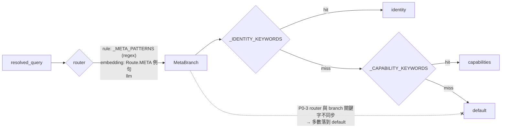
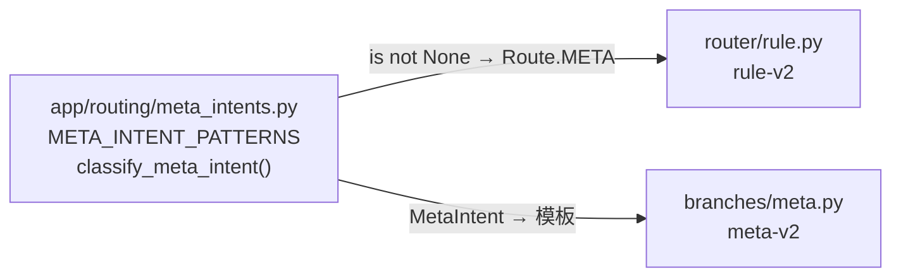
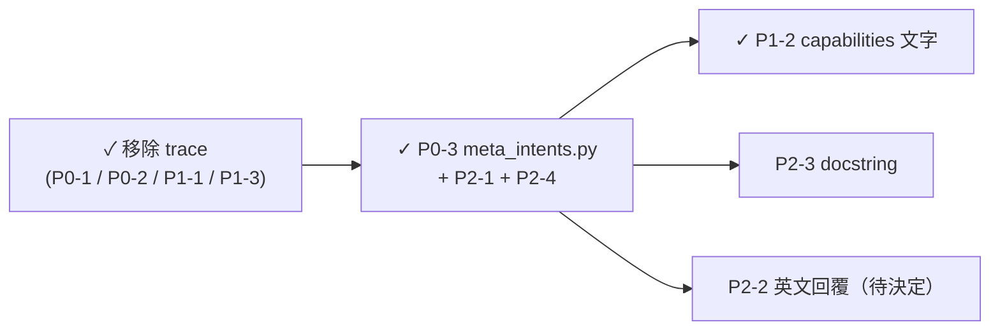

# Code review：`app/routing/branches/meta.py`

> **狀態：已移除 trace 回傳（commit `1bd1f49`，P0-1、P0-2、P1-1、P1-3 因此結案）；P0-3、P2-1、P2-4 已修（commit `ff0e023`）；P1-2 已修；P2-2、P2-3 尚未修正。**
> Review 日期：2026-10-15。
> P0-3 的結論已用 `tests/routing/test_meta_branch.py` 實測（Python 3.12.13、pytest 9.1.1，`tests/` 全部 148 passed）；其餘結論來自閱讀程式碼，未實際執行。

## Context

Review 對象是 `app/routing/branches/meta.py`（META 分支）：系統性問題（「你能做什麼」、「你是誰」）
用固定模板回覆，**不呼叫 LLM**。分支的用途說明見 [what-meta-branch-does-20261015.md](../../route/meta/what-meta-branch-does-20261015.md)。

對照檔案：`app/routing/router/rule.py`、`app/routing/router/embedding.py`、`app/routing/router/llm.py`、
`app/routing/taxonomy.py`、`app/agent/graphs/routed_rag.py`、`app/agent/state.py`、
`app/routing/branches/metadata.py`、`app/api/v1/endpoints/chats.py`。

Review 時的現況：程式本身不會 crash，但**大部分被 router 送進來的 META 問題都拿到最沒用的 `default` 回覆**；
trace 回傳功能到不了，就算到得了也回傳錯的東西，還會把內部錯誤訊息洩漏給使用者。trace 功能已決定移除（見下方決策）。



---

## 決策：移除 META 的 trace 回傳（2026-10-15）

原本設計是使用者在聊天中問「debug / 追蹤」時，META 回傳 `state.trace`，讓開發者不用翻 log 就能看到路由決策。
這個功能有三個問題（原 P0-1、P0-2、P1-1，內容保留在下方作為紀錄），而且它是 debug 功能、不是終端使用者功能：
`.env.dev` 已開啟 LangSmith tracing（`LANGCHAIN_TRACING_V2=true`），每次 run 的節點輸入輸出、最終 state 的
`trace` 欄位都看得到，比聊天介面回傳的字串完整。

**已做的變更**：

- `meta.py`：刪除 `_TRACE_KEYWORDS`、`_format_trace()` 與 trace 分支；module docstring 註明不回傳 trace 的理由。
- `taxonomy.py`：`Route.META` docstring 移除「或回傳 trace」。
- `app/routing/PLAN.md:103`：驗收步驟改成在 LangSmith 檢查 `trace` 欄位。
- `RoutedAgentState.trace` 欄位**保留**：各節點仍會寫入，作為 LangSmith / log 的診斷資料。

---

## 發現清單（依嚴重度排序）

### [x] P0-1｜trace 回傳沒有權限控管，會洩漏內部錯誤訊息（已因移除 trace 結案）

`meta.py` 原本只要 query 含 `trace` / `debug` / `追蹤` / `路由紀錄`，就把 `state.trace` 整段回給使用者。
`RouterNode`（`routed_rag.py:118`）寫入的內容包含 exception 訊息：

```python
trace.append(f"route: router failed ({type(exc).__name__}: {exc}), degrading to fallback_chain")
```

`exc` 可能是 Gemini / HTTP client 的錯誤訊息（內含 quota 細節等，**推論，未查證實際內容**），不該給一般使用者看。

> 後續注意：`trace` 仍包含 exception 字串。若之後有任何地方把 `trace` 回給 client（例如 SSE event 或 API response），這個問題會重新出現。

### [x] P0-2｜trace 路徑實際上到不了（已因移除 trace 結案）

三層 router 都沒有對應 trace 類問題：`rule.py` 的 `_META_PATTERNS`、`embedding.py` 的 `Route.META` 例句、
`llm.py` 的 META 說明都只涵蓋「你能做什麼、你是誰」。`app/routing/PLAN.md:103` 的驗收步驟因此無法通過，已改寫。

### [x] P0-3｜router 與 branch 的關鍵字各寫一份，不同步

router 用 regex（`rule.py`）與例句（`embedding.py`），branch 用另一組 substring（`meta.py` 的 `_IDENTITY_KEYWORDS`、`_CAPABILITY_KEYWORDS`）。
被 router 判成 META 卻在 branch 落到 `default` 的例子（修正前依規則手動推導；修正後這些句子都已列入測試並通過）：

| query | router 命中 | branch 結果 | 應該是 |
|---|---|---|---|
| `你是什麼？` | `你是(誰\|什麼)` | default | identity |
| `你可以幫我做什麼` | `你(能\|可以).{0,6}(做…)` | default（不含 `你可以做什麼` 這個連續字串） | capabilities |
| `你能提供哪些服務` | 同上 | default | capabilities |
| `我可以問你什麼` | `我可以問你什麼` | default | capabilities |
| `這個系統有哪些功能` | `系統.{0,6}(有\|能).{0,6}功能` | default（`哪些功能` ≠ `什麼功能`） | capabilities |
| `What can you help me with?` | `what can you (do\|help)` | capabilities | capabilities ✓ |
| `你是用什麼模型？`（embedding 例句） | embedding | default | identity |

**修法**：

1. 新增 `app/routing/meta_intents.py`（`routing` 底下，router 與 branch 都能 import，不產生 `routing → agent` 依賴），
   定義：

   ```python
   class MetaIntent(str, Enum):
       IDENTITY = "identity"
       CAPABILITIES = "capabilities"

   META_INTENT_PATTERNS: dict[MetaIntent, list[re.Pattern]] = {...}

   def classify_meta_intent(query: str) -> MetaIntent | None: ...
   ```

2. `rule.py` 的 `_META_PATTERNS` 改成由 `META_INTENT_PATTERNS` 組出來，遞增 `rule.py` 的 `ROUTER_VERSION`。
3. `meta.py` 改用 `classify_meta_intent()`，刪掉兩組 `_*_KEYWORDS` 與 `_matches()`。
4. 英文 pattern 加 word boundary 並用 `re.IGNORECASE`。
5. 測試：把 `rule.py` 每條 META pattern 的代表句、`embedding.py` 的 `Route.META` 例句全部丟進
   `MetaBranch`，斷言**沒有一句**落到 `default`。這條測試是防止之後再次不同步的主要手段。

#### P0-3 實作結果（2026-10-15）



- 新增 `app/routing/meta_intents.py`：`MetaIntent`（`IDENTITY`、`CAPABILITIES`）、`META_INTENT_PATTERNS`、
  `classify_meta_intent()`。dict 順序即優先序，IDENTITY 先。
- `rule.py`：刪除 `_META_PATTERNS`，改用 `classify_meta_intent(query) is not None`；`ROUTER_VERSION` → `rule-v2`。
- `meta.py`：刪除 `_IDENTITY_KEYWORDS`、`_CAPABILITY_KEYWORDS`、`_matches()`；`_FIXED_REPLIES` 改用 `MetaIntent` 當 key，
  `default` 抽成 `_DEFAULT_REPLY`（給 embedding / LLM 判成 META 但 pattern 沒命中的情況）；`ROUTER_VERSION` → `meta-v2`。
- 為了涵蓋 embedding 例句，pattern 比 `rule-v1` **擴大**了：
  - IDENTITY 新增 `你是?用(什麼|哪一?個|哪種)模型`、`\bwhat model are you\b`。
  - CAPABILITIES 的「系統…功能」新增 `支援`。
  - 英文 pattern 加上 `\b` word boundary。
  因為 rule 命中會以 0.95 短路 cascade，測試另外斷言**其他 5 類的所有 embedding 例句**、以及
  「這份文件提到什麼功能？」、「第三章描述了系統的哪些功能需求？」都**不會**命中 META。
- 已知限制（沿用 `rule-v1` 的行為，未修）：`Who are you guys planning to hire?` 仍會命中 IDENTITY，
  因為 `who are you` 沒有錨定句尾。實際查詢中出現機率低，暫不收緊。

---

### [x] P1-1｜trace 只包含「本輪」，內容對使用者沒意義（已因移除 trace 結案）

`state.trace` 是本次 graph run 的紀錄，使用者問「debug」時看到的是「debug 這句話本身」的路由紀錄，
不是上一題的。

> 後續注意：`trace: list[str]` 沒有 reducer、每個節點都是 `state.trace + [...]`。若之後
> `RoutedGraphFactory.build()` 改成 `compile(checkpointer=...)`，`trace` 可能跨輪無限累積
> （推論，要實測 LangGraph 對未在 input 中提供的欄位是否沿用 checkpoint 值）。這跟 META 無關，但仍需處理。

### [x] P1-2｜capabilities 回覆描述了不存在的功能

`meta.py` 的 `_FIXED_REPLIES["capabilities"]` 宣稱能「查詢文件的**作者**/日期等屬性」，但 METADATA 分支目前只支援
`BY_DATE_RANGE` / `BY_DOCUMENT_TYPE` / `BY_VERSION`（`metadata.py:46-48`），`documents` 表沒有 author 欄位
（見 [metadata-branch-review-20261015.md](../finished/metadata-branch-review-20261015.md) P0-1）。
「跨文件摘要」依賴 GLOBAL 的 document summary，`docs/review-checklist/router-module.md` 也註明 ingestion
還沒產生 summary。

**修法**：

- 文字改成實際可用的功能：依上傳日期 / 檔案類型 / 同檔名的上傳版本查文件。
- 移除「作者」；GLOBAL 是否列出，等 summary 生成落地後再決定（先寫成「對知識庫內容做摘要」並在 code comment 標註依賴）。
- 在 `MetaIntent.CAPABILITIES` 旁加 comment：新增/移除 route 或 METADATA query type 時要同步更新這段文字。

#### P1-2 實作結果（2026-10-15）

查證時發現 `app/` 裡沒有任何地方寫入 `Document.summary`（搜尋 `summarize_document` 無結果），
`fetch_document_summaries()` 又只取 `summary IS NOT NULL` 的文件，所以 GLOBAL 目前**一律**回
`_NO_SUMMARIES_MESSAGE`。因此改成**完全不列摘要**，而不是原計畫的「先寫成對知識庫內容做摘要」。

`_FIXED_REPLIES[MetaIntent.CAPABILITIES]` 改為逐行列出實際可用的功能：

| 回覆文字 | 對應 route |
|---|---|
| 回答知識庫文件裡的具體內容 | LOOKUP |
| 比較多份文件，或回答需要串連多處內容的問題 | MULTI_HOP |
| 依上傳日期、檔案類型（pdf / md / docx），或同一檔名的歷次上傳版本查文件 | METADATA（`BY_DATE_RANGE` / `BY_DOCUMENT_TYPE` / `BY_VERSION`） |
| 直接回答不需要查知識庫的常識性問題 | NO_RETRIEVAL |

- 程式碼 comment 記錄上述對應，以及 GLOBAL 不列的原因；ingestion 開始產生 summary 後要補回。
- `meta.py` 的 `ROUTER_VERSION` → `meta-v3`。
- `meta.py` 不 import `metadata.py`（後者依賴 DB / LLM），改由測試
  `test_capabilities_reply_only_claims_supported_metadata_queries` 守住同步：`_ALLOWED_FILE_EXTENSIONS`
  每個副檔名都要出現在回覆裡，且回覆不得含「作者」、「摘要」。`tests/` 全部 149 passed。

### [x] P1-3｜substring 比對造成誤判（trace 部分已結案，其餘併入 P0-3）

原本 trace 檢查排第一且用 substring，`你能做什麼樣的 traceability 分析？` 會被當成 trace 問題。
移除 trace 後這個誤判不存在；identity / capabilities 的 substring 問題由 P0-3 的 regex 改寫一併處理。

---

### [x] P2-1｜`_matches()` 的雙重比對多餘

`_matches()` 同時比 `query` 和 `query_lower`，但所有關鍵字本來就是小寫或中文，比 `query_lower` 就夠了。
已隨 P0-3 刪除，英文 pattern 改用 `re.IGNORECASE`。

### [ ] P2-2｜回覆語言固定為中文

`who are you` / `What can you help me with?` 會拿到中文回覆。最小修法：`_FIXED_REPLIES` 改成
`{intent: {"zh": ..., "en": ...}}`，依 query 是否含 CJK 字元選擇。

> **待決定**：產品是否需要英文回覆；不需要就跳過這條。

### [ ] P2-3｜module docstring 混入變更歷史

`meta.py` docstring 的「修正職責接反問題：這個檔案先前放的是 `sql_query_node`…」是 commit 歷史，
應移除，只留這個 branch 的職責說明。`routed_rag.py:1-14` 的 docstring 同樣問題，順手一起清。

### [x] P2-4｜沒有測試

已新增 `tests/routing/test_meta_branch.py`（不碰 LLM/DB，直接建 `RoutedAgentState` 呼叫）：

- 每條 pattern 的代表句：`classify_meta_intent()` 回對 intent、`MetaBranch` 回對模板、`RuleRouter` 判成 `Route.META`。
- `embedding.py` 的 `Route.META` 例句全部不落 `_DEFAULT_REPLY`。
- 其他 5 類 embedding 例句與兩句「文件提到功能」的反例都不命中 META（防 rule pattern 過寬）。
- 移除 trace 的回歸測試：`state.trace` 含 exception 訊息時，問「debug 給我看路由追蹤」只拿到 `_DEFAULT_REPLY`。
- 輸出形狀：`documents == []`、`trace` 附加 `meta:` 那一行。

P1-2 修改 capabilities 文字時，這支測試比對的是 `_FIXED_REPLIES[...]` 本身，不需跟著改。

---

## 不在本 plan 範圍（但會影響 META 的實際效果）

以下是 routed graph 與 API 層的整合問題，不只影響 META，另開 plan 處理：

- `chats.py:28-29`：`STATUS_NODES` / `ANSWER_NODES` 沒有 `meta`（也沒有其他 routed 分支），
  META 的 `answer` 不會送到 client，存進 DB 的 `full_answer` 是空字串。`app/routing/PLAN.md:85-88` 已列出這項待辦。
- `chats.py:42`：建立的是 `LookupAgentState`，不是 `RoutedAgentState`；`trace` / `route` 欄位不存在。
- 所有 routed 分支都沒有把回答 append 進 `chat_history`（沒有回傳 `AIMessage`），下一輪 resolver 看不到 META 的回答。
- `model_used` 沒寫入；`PLAN.md:88` 建議 fallback 為 `f"router:{route}"`。

## 建議執行順序



1. ~~移除 trace 回傳~~（已完成，commit `1bd1f49`）。
2. ~~P0-3 抽出 `meta_intents.py`，同時處理 P2-1、P2-4~~（已完成，commit `ff0e023`）。
3. ~~P1-2 文字修正~~（已完成）；P2-3 docstring；P2-2 視決定而定。
4. `uv run pytest tests/routing` 全綠。
