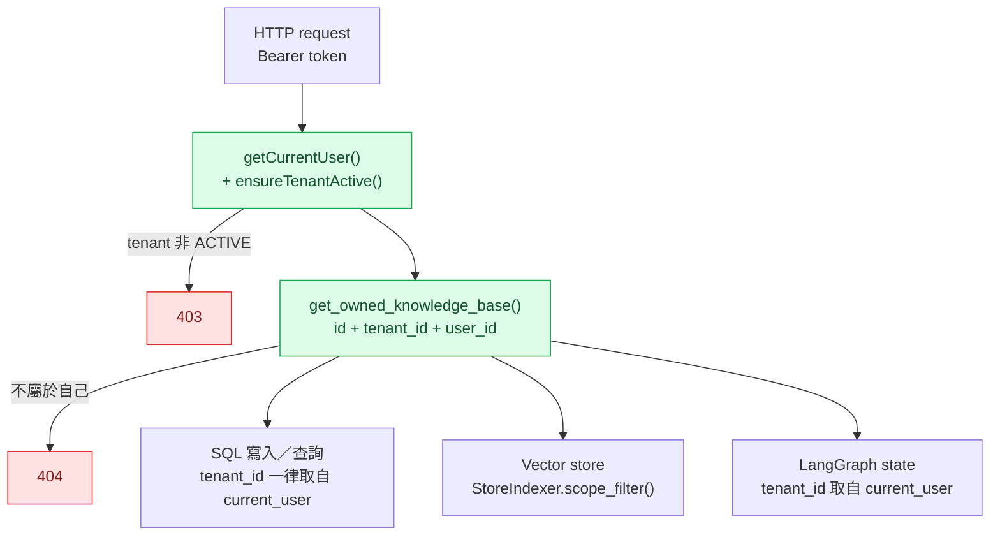
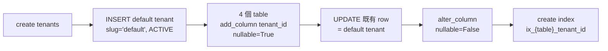
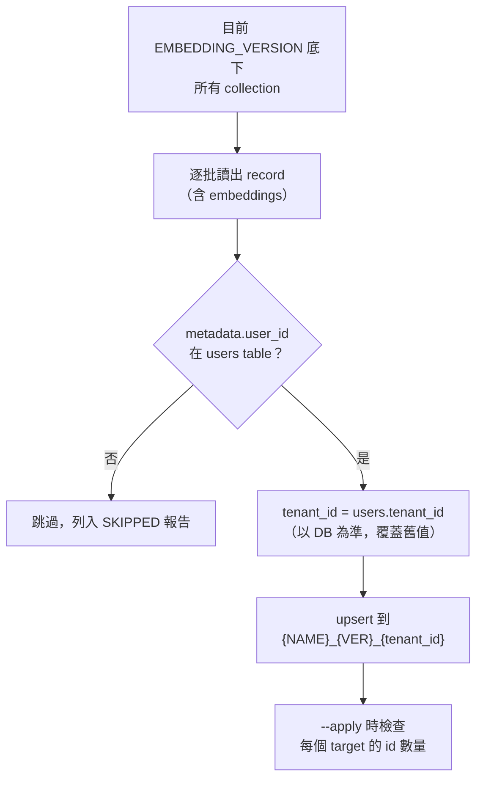
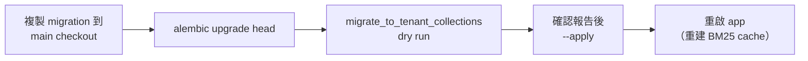

# 修正 `tenant_id` 漏填與 tenant scoping

> 建立日期：2026-10-14。Branch：`worktree-tenant-id-fixes`（base：master `42420cf`）。
> 查證日期：2026-10-14。Python 3.12.13、chromadb 1.5.9、SQLAlchemy 2.0.51、FastAPI 0.140.0、pytest 9.1.1。

## Context

`PARTITION_METHOD` 預設改成 3（每個 tenant 一個 collection）之後，vector store 這條路徑已經把 `tenant_id` 帶齊（`StoreIndexer.scope_filter()`、`Collection_manager`、BM25 cache key、retriever），但 DB 寫入、users endpoints、migration 和既有資料都還沒跟上。全面掃過 `app/`、`migrations/`、`scripts/` 後，依嚴重度分成四級：

| 級別 | 問題類型 | 結果 |
|---|---|---|
| 🔴 Critical | `tenant_id` 是 `nullable=False`，漏填會違反 NOT NULL，功能直接壞掉 | 寫入失敗 |
| 🟠 High | 查詢沒有用 tenant／ownership 過濾 | 可以跨 tenant 讀取或修改 |
| 🟡 Medium | 既有資料沒有遷移、auth 沒考慮 tenant | 舊資料查不到、帳號有歧義 |
| 🟢 Low | 命名與一致性 | 不影響安全 |

## 修正後的 tenant 邊界

原則：`tenant_id` 和 `user_id` 只能來自 `current_user`。Client 傳進來的 `knowledge_base_id` 一定要先經過 `get_owned_knowledge_base()` 驗證過，才能拿去用。

---

## 🔴 Critical：漏填 `tenant_id`

> **狀態：✅ 程式碼已完成（commit `341b4ba`）。🟡 Migration 已寫好，但還沒放進 main checkout。**

| # | 位置 | 修正 |
|---|---|---|
| C1 | `users.py` `register` | `UserCreate` 新增 `tenant_slug`，查 `tenants` table（必須是 ACTIVE 且未刪除），查不到就回 400 |
| C2 | `knowledgeBases.py` `createKnowledgeBase` | 補上 `tenant_id=current_user.tenant_id` |
| C3 | `chats.py` 兩筆 `AsistantMessage` | 補上 `tenant_id`。原本這段在 SSE stream 裡，會在 answer 已經送出後才失敗 |
| C4 | `knowledgeBases.py` `uploadDocument` 的 `Document` | 補上 `tenant_id` |
| C5 | Init migration 沒有 `tenants` table，也沒有 `tenant_id` column | 新增 migration `b6019841bba0_add_tenants.py` |

**Tenant slug** 是 `Tenant` model 原本就有的欄位，例如 `taiwan-mobile`，是比 UUID 好記、比 `name` 穩定的識別字串。Register 用它找出要加入的 tenant。

### C5 migration 的做法

`migrations/` 被 `.gitignore`，所以這支 migration **沒有進 git**，檔案目前在 worktree 的 `migrations/versions/b6019841bba0_add_tenants.py`。

4 個 table 是 `users`、`AsistantKnowledgeBases`、`AsistantMessages`、`documents`。先加 nullable column 再 backfill，最後才改成 NOT NULL，所以已經有資料的 DB 也能直接跑。

> ⚠️ 未在實際 DB 上執行過。如果 DB 曾經手動加過 `tenant_id`，`add_column` 會失敗。

---

## 🟠 High：缺少 tenant scoping

> **狀態：✅ 已完成（commit `341b4ba`）。H3 的 branch 本身仍跑不起來，見〈待辦〉。**

| # | 問題 | 修正 |
|---|---|---|
| H1 | `GET /users` 撈出所有 tenant 的 user；`GET /user/{id}` 沒有 scope，而且參數 type 寫成 `int` | 兩者都加 `User.tenant_id == currUser.tenant_id`；參數改成 `UUID` |
| H2 | `/update`、`/email`、`/password` 用 body 裡的 `user.id` 找人，任何人都能改別人的帳號 | 新增 `ensure_self()`，不是本人就回 403 |
| H3 | Metadata branch 的 whitelisted SQL 只過濾 `knowledge_base_id` | 4 條 SQL 都加上 `tenant_id`、`user_id` 條件，參數一律從 state 覆蓋，不用 extractor 給的值 |
| H4 | 沒有任何地方驗證 `knowledge_base_id` 屬於 `current_user` | 新增 `app/services/knowledgeBaseService.py` 的 `get_owned_knowledge_base()`，接到 `/upload`、`/query`、`/chat` |

### 為什麼 H4 要另外開一個檔案

`/upload`、`/query` 在 `knowledgeBases.py`，`/chat` 在 `chats.py`。如果把檢查寫在其中一個 endpoint 檔，另一個 router 就得反過來 import 它。如果每個 endpoint 各寫一份，以後改其中一份時另外兩份會不一致。這和 `StoreIndexer.scope_filter()` 是同一個設計：tenant 邊界只在一個地方定義。

`/upload` 的檢查刻意放在 `try` **外面**，因為那個 `try` 的 `except Exception` 會把 404 變成 500。KB 不屬於自己時回 404 而不是 403，這樣不會透露那個 id 是否存在。

---

## 🟡 Medium：資料遷移與 auth

> **狀態：✅ 已完成（commit `3076535`）。**

### M1 + M2：Chroma 舊資料

兩個問題同時存在：

1. 舊的 chunk 沒有 `tenant_id` metadata，現在 `scope_filter()` 要求這個欄位，所以這些 chunk 會查不到。
2. 資料還留在 per-user（`{NAME}_{VER}_{user_id}`）或全域（`{NAME}_{VER}`）collection，但 app 現在只讀 `{NAME}_{VER}_{tenant_id}`。

新增 `scripts/migrate_to_tenant_collections.py`，一次處理這兩個問題：

- 預設是 dry run，加 `--apply` 才會寫入。
- 已經在正確 collection 的 record 會原地更新 metadata，所以可以重跑。
- 不重新 embed；來源 collection 保留，確認沒問題後再手動刪除。

### M3：Login 用 username 有歧義

`username` 不是 unique，不同 tenant 可以同名，原本的 `.first()` 會隨便挑一個。

- `UserLogin` 新增 optional 的 `tenant_slug`。用 username 登入時必須帶，否則回 400；用 email 登入不受影響，因為 email 全域 unique。
- `register` 和 `/update` 會擋掉「同一個 tenant 內重複的 username」。

### M4：檢查 tenant 狀態

`jwtService.py` 新增 `ensureTenantActive()`，tenant 不是 ACTIVE 或已刪除就回 403：

- **每個 request** 的 `getCurrentUser()` 都會檢查，所以停用 tenant 之前發出去的 token 也會立刻失效。
- Login 也會檢查。這個檢查放在密碼驗證**之後**，密碼錯的人看不到 tenant 的狀態。

---

## 驗證結果

| 項目 | 結果 |
|---|---|
| 改過的 modules `py_compile` 與 import | ✅ |
| `tests/scripts`（含新增 6 個 `test_migrate_to_tenant_collections.py`） | ✅ 11 passed |
| 全部 tests | 32 passed、11 failed |

11 個 failed 都在 `tests/rag/`，原因是 `ModuleNotFoundError: No module named 'rank_bm25'`。`rank_bm25` 和 `flashrank` 都沒列在 `pyproject.toml`，所以新建的 venv 不會有。失敗的 tests 都在這次沒有動過的 `app/rag`，和這次的修改無關。

**未驗證**：

- 沒有實際啟動 API 跑過 register、login、upload、chat。
- Auth 相關的修改（H1、H2、H4、M3、M4）沒有 test 覆蓋。
- Migration 沒有在實際 DB 上執行過。

## 部署順序

Script 要讀 `users.tenant_id`，所以一定要先跑 migration。

---

## 待辦

### 🟠 H3 的尾巴：metadata branch 本身跑不起來

Tenant 條件已經加上去，但這個 branch 實際上還沒被保護到，因為它根本跑不起來：

- Table 名寫成 `document`、`document_chunk`，實際是 `documents`；`document_chunk` 這個 table 不存在。
- `title`、`author`、`document_type`、`version` 這些 column 在 `Document` model 裡都沒有。
- Raw SQL 沒有包 `text()`，參數又用 psycopg 的 `%(x)s` 格式，SQLAlchemy 不接受。

這需要重新設計查詢類型（BY_AUTHOR、BY_VERSION 在現有 schema 下沒有資料可查），要先決定方向。建議改成用 `documents` 現有的欄位查，例如 `filename`、`file_extension`、`created_dt`、`status`，並改用 SQLAlchemy `select()`。

### 其他

- [ ] 把 migration 複製到 main checkout 並執行。
- [ ] DB 加上 `(tenant_id, username)` unique constraint。目前只在 application 層檢查，兩個 request 同時註冊同名時還是可能都通過。
- [ ] Init migration 漏了 `documents.summary` column（model 有，`global_summary` branch 會查它），要先確認 DB 的實際狀態再補。
- [ ] 補 auth 相關的 tests。
- [ ] 把 `rank_bm25`、`flashrank` 加進 `pyproject.toml`。

### 🟢 Low（不影響安全）

> **狀態：L1、L3、L4 ✅ 已完成（2026-10-14，未 commit）。L2 決定不改。**

- [x] **L1**：storage key 從 `users/{user_id}/...` 改成 `tenants/{tenant_id}/users/{user_id}/{kb_id}/...`，`upload_file()` 多了 `tenant_id` 參數。以後換成 S3 時，可以用 prefix 對單一 tenant 做 lifecycle 或刪除。已上傳的檔案不需要搬移，因為 `documents.storage_key` 存的是完整 key，`download_file()` 照 DB 裡的 key 去讀。
- [x] **L3**：`UserResponse`、`KnowledgeBaseCreateResponse`、`DocumentResponse` 都加上 `tenant_id`。
- [x] **L4**：`app/routing/PLAN.md` 的 RouterContext 映射改成 `tenant_id = state.tenant_id`，並寫明真正的租戶邊界在哪三個地方。
- **L2 不改**：checkpointer `thread_id` 維持 `{user_id}::{kb_id}`。`user_id` 是全域唯一的 UUID，加上 tenant 也不會讓隔離更強。反而改了之後，現有對話會找不到原本的 checkpoint，等於所有對話記憶都會不見。
