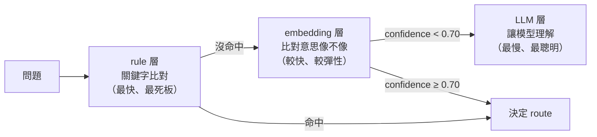
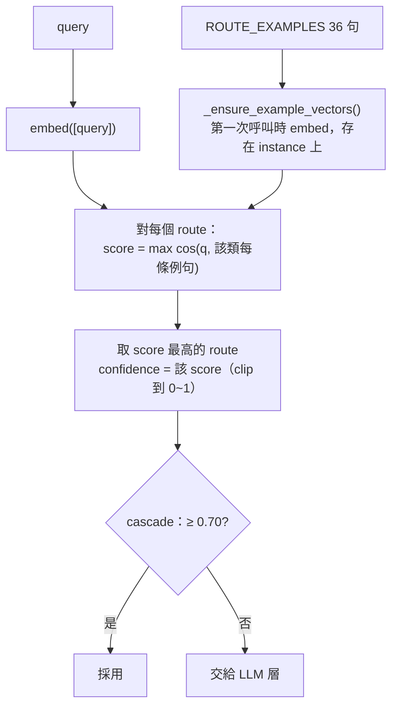
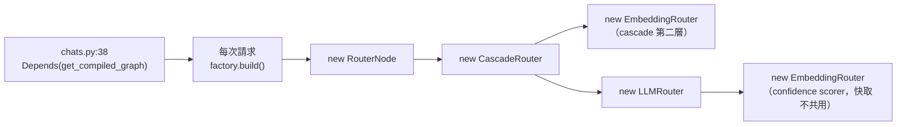

# Embedding router 解析

> 查證日期：2026-10-16。內容依閱讀 `app/routing/router/embedding.py`、`cascade.py`、`llm.py`、
> `app/agent/graphs/routed_rag.py`、`app/agent/dependencies.py`、`app/api/v1/endpoints/chats.py` 整理。
> 第 3.1 節的數字用第 5 節的程式以假 embedding 實測（Python 3.12.13）；真實 Gemini 的延遲、費用與相似度分佈**未實測**。
> 標示「推論」的段落未經驗證。

`EmbeddingRouter` 是 cascade 的第二層（rule → embedding → LLM）。它把 query 與 `ROUTE_EXAMPLES`
（6 類 × 6 句 = 36 句）逐句比 cosine 相似度，**最像哪一句，就判成那一句所屬的 route**。
這是 1-NN（最近鄰），不是拿每類的平均向量（centroid）來比。

相關：
- [rule-router-20261016.md](rule-router-20261016.md)：cascade 第一層
- [why-llm-layer-never-wins-20261016.md](why-llm-layer-never-wins-20261016.md)：`score_route()` 如何讓 LLM 層失效

---

## 1. 白話說明：它在做什麼

一句話：**它判斷使用者的問題屬於哪一類**，方法是看「這個問題最像哪一句範例」。

### 1.1 為什麼要分類

系統對不同類型的問題有不同的處理方式（route）：

| route | 問題類型 | 處理方式 |
|---|---|---|
| LOOKUP | 查某個具體內容 | 到知識庫找相關段落 |
| GLOBAL | 要整體摘要 | 讀所有文件的摘要 |
| METADATA | 問文件屬性（作者、日期） | 查資料庫欄位 |
| MULTI_HOP | 要比較、要多步查詢 | 分多次檢索 |
| NO_RETRIEVAL | 一般常識 | LLM 直接回答 |
| META | 問系統本身 | 回傳固定模板 |

回答之前要先決定走哪一條路，這就是 router 的工作。

### 1.2 怎麼判斷：比對範例句

程式裡事先為每一類寫好 6 句範例（`ROUTE_EXAMPLES`），例如：

- **GLOBAL**：「這批文件整體在討論什麼主題？」、「這些文件加起來大概在講什麼？」……
- **LOOKUP**：「這份合約的付款條件是什麼？」、「我們的退款政策內容是什麼？」……

使用者問問題時，router 會：

1. 把問題和 36 句範例都轉成 **embedding**（一串數字，代表句子的意思；意思越接近，數字越接近）。
2. 算出問題和每一句範例的**相似度**（0～1，越接近 1 越像）。
3. 找出**最像的那一句**，判成那一句所屬的類別，並把相似度當作 confidence。

### 1.3 例子

> 以下相似度數字是說明用的假設值，不是實測。

使用者問：「**這些報告整體在說什麼？**」

| 範例句 | 類別 | 相似度 |
|---|---|---|
| 這些文件加起來大概在講什麼？ | GLOBAL | **0.85** ← 最像 |
| 這批文件整體在討論什麼主題？ | GLOBAL | 0.80 |
| 我們的退款政策內容是什麼？ | LOOKUP | 0.40 |
| … | … | … |

結果：**GLOBAL，confidence 0.85**。

### 1.4 和前後兩層的關係



- **rule 層**只看字面：問題裡要真的出現「作者是誰」這類字才會命中。
- **embedding 層**看意思：「這些報告整體在說什麼」和範例的字不同，但意思接近，一樣認得出來。這是它比 rule 層強的地方。
- 最高相似度不到 0.70，代表和所有範例都不夠像，embedding 層沒把握，交給 LLM 層
  （但 LLM 層的決定實際上不會被採用，見 [why-llm-layer-never-wins-20261016.md](why-llm-layer-never-wins-20261016.md)）。

**比喻**：新進客服人員手上有一張「常見問題範例表」。客人來問，他翻表找最像的一題，照那一題的類別轉給對應部門；
表上沒有一題夠像，就去請教資深同事（LLM 層）。

---

## 2. 流程



- 是否採用不是這一層決定的：`route()` 只回傳原始分數，由 cascade 拿去和 `CONFIDENCE_THRESHOLD`（0.70）比。
- `score_route(query, X)`（`embedding.py:134-142`）只算單一 route X 的分數，給 `LLMRouter` 當 confidence。
  這正是 LLM 層的決定永遠不會被採用的根源。
- 分數相同時，dict 順序在前的 route 勝出（`>` 而非 `>=`）；所有分數都 ≤ 0 時回傳 LOOKUP、confidence 0。

## 3. 問題

### 3.1 範例向量的快取沒有作用（已實測）

`_ensure_example_vectors()` 的 docstring 寫「只算一次並快取」，但快取存在 **instance** 上，而 instance 每次請求都重建：



以計數用的假 embedding 跑 3 次請求：

| 情境 | 同一個 instance | 每次請求新建（現況） |
|---|---|---|
| embedding 層短路 | 4 次呼叫、embed 39 段文字 | 6 次呼叫、**111 段** |
| 一路走到 LLM 層 | 8 次呼叫、embed 78 段文字 | 12 次呼叫、**222 段** |

結論：現況下**每次請求都重新 embed 36 句例句**；走到 LLM 層時是兩組例句共 72 句再加 2 次 query。
快取只對單次請求內的重複呼叫有效。docstring 寫的「~20ms」未實測，也沒有把重新 embed 例句的成本算進去。

### 3.2 query 被 embed 兩次

走到 LLM 層時，`route()` embed 一次 query，`score_route()` 又 embed 同一個 query 一次（3.1 表中每次請求 2 次 query 即此）。

### 3.3 `self._threshold` 沒有被用到

建構子存了 `threshold`（`embedding.py:116`），但整個 class 都沒有讀它，實際比門檻的是 cascade。
這是 dead code，容易讓人以為改這個參數會有效果。

### 3.4 0.70 門檻沒有校準（推論，未實測）

- 門檻是絕對的 cosine 值，但不同 embedding 模型的相似度分佈差異很大；真實 Gemini 下 0.70 偏嚴還是偏鬆，**目前沒有數據**。
- 沒有考慮第一名與第二名的差距（margin）：GLOBAL 0.71、LOOKUP 0.70 這種幾乎分不出來的情況，也會被當成有把握直接採用。
- 每類只有 6 句，換個說法的問題容易每句都不夠像，放大了 LLM 層失效的影響。

### 3.5 例句設計（推論）

- **與 rule 層重疊**：META / METADATA 的例句（「你是誰？」、「這份文件的作者是誰？」）多數會先被 rule 層攔下，
  在 embedding 層真正派上用場的只有換個說法的版本。
- **類別之間字面太接近**：LOOKUP 的「這份合約的付款條件是什麼？」與 MULTI_HOP 的「這兩份合約的付款條件哪裡不一樣？」
  幾乎相同，1-NN 對這種情況很敏感。

### 3.6 模型寫死

- embedding 模型寫死為 `text-embedding-004`（`embedding.py:88`），沒有走 `EmbeddingFactory` 與 `.env` 的
  `EMBEDDING_MODEL`（`gemini-embedding-001`）。修正計畫 plan 已將此列為範圍外。
- query 用 `aembed_documents` embed，task type 是文件而非 query / classification；對分數的影響未查證。

## 4. 修改時的注意事項

- 修改 `ROUTE_EXAMPLES` 必須遞增 `ROUTER_VERSION`（目前 `embedding-v1`）。
- 測試時注入假的 `EmbeddingsClient`，不要打真的 API。
- `cosine_similarity()` 也被 `routing/cache/semantic_cache.py` 重用，改它會影響 semantic cache。

## 5. 實測程式

在 repo 根目錄執行，參數是 query。在這組假 embedding 下，`query 0`（embedding confidence 0.685）會走到 LLM 層，
`query 3`（0.795）在 embedding 層短路：

```python
import asyncio
import random
import sys

sys.path.insert(0, ".")
from app.routing.router.cascade import CascadeRouter
from app.routing.router.embedding import EmbeddingRouter
from app.routing.router.llm import LLMRouter, _LLMRouteOutput
from app.routing.router.rule import RuleRouter
from app.routing.taxonomy import Route, RouterContext


class CountingEmb:
    # 計算 embed 被呼叫幾次、總共 embed 幾段文字；同一段文字永遠回傳同一個向量
    def __init__(self):
        self.calls = 0
        self.texts = 0

    async def embed(self, texts):
        self.calls += 1
        self.texts += len(texts)
        out = []
        for t in texts:
            rnd = random.Random(t)
            out.append([rnd.gauss(0, 1) for _ in range(8)])
        return out


class FakeLLM:
    async def ainvoke(self, messages):
        return _LLMRouteOutput(route=Route.GLOBAL)


def new_cascade(emb):
    # 與預設接線相同：cascade 的 EmbeddingRouter 和 LLMRouter 的 scorer 是兩個不同 instance
    return CascadeRouter(
        rule=RuleRouter(),
        embedding=EmbeddingRouter(embeddings=emb),
        llm=LLMRouter(structured_model=FakeLLM(), confidence_scorer=EmbeddingRouter(embeddings=emb)),
    )


async def main():
    ctx = RouterContext(tenant_id="t", knowledge_base_id="k", resolved_history=[])
    q = sys.argv[1]

    emb = CountingEmb()
    shared = new_cascade(emb)
    for _ in range(3):
        await shared.route(q, ctx)
    print(f"same instance, 3 requests: embed calls={emb.calls}, texts embedded={emb.texts}")

    emb = CountingEmb()
    for _ in range(3):
        await new_cascade(emb).route(q, ctx)
    print(f"new instance per request, 3 requests: embed calls={emb.calls}, texts embedded={emb.texts}")


asyncio.run(main())
```

輸出：

```
$ python probe.py "query 0"
same instance, 3 requests: embed calls=8, texts embedded=78
new instance per request, 3 requests: embed calls=12, texts embedded=222

$ python probe.py "query 3"
same instance, 3 requests: embed calls=4, texts embedded=39
new instance per request, 3 requests: embed calls=6, texts embedded=111
```
