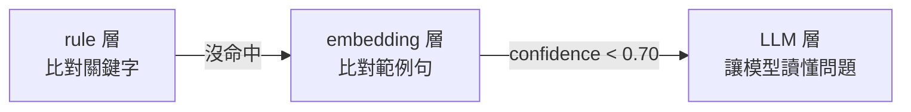
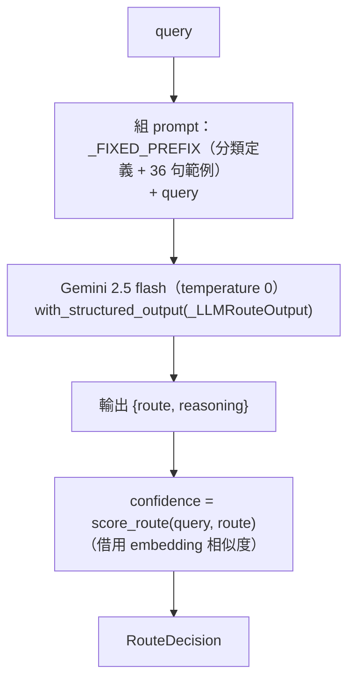
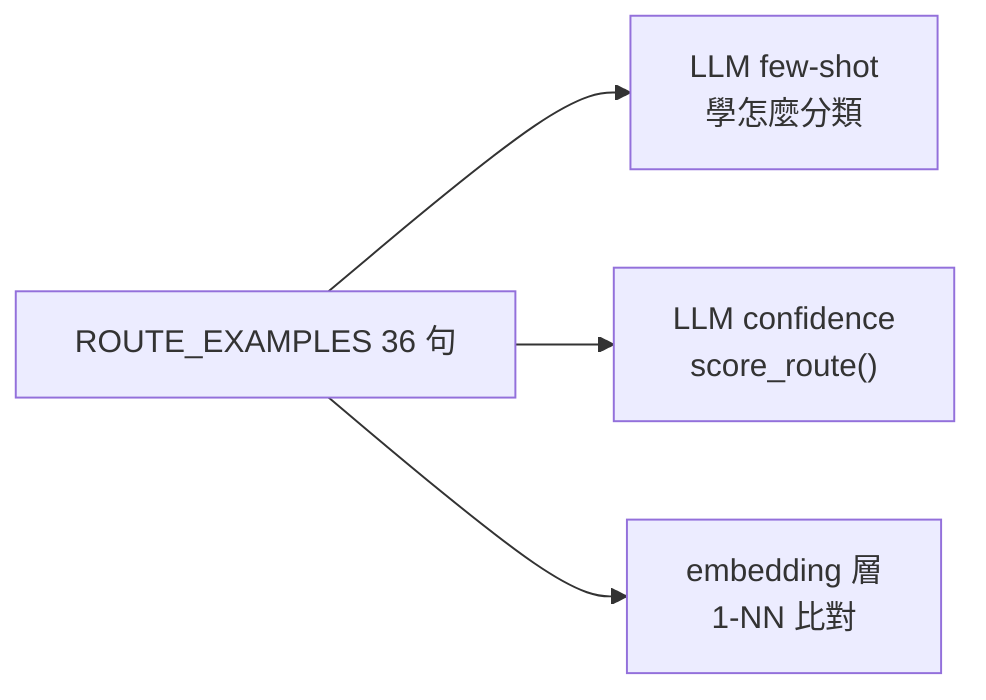

# LLM router 解析

> 查證日期：2026-10-16。內容依閱讀 `app/routing/router/llm.py`、`app/routing/cache/prompt_cache.py`、
> `cascade.py`、`fallback_chain.py` 整理。第 2 節的 prompt 長度與 3.5 節的 schema 欄位順序用第 5 節的程式實測（Python 3.12.13）；
> **沒有呼叫 Gemini API**，延遲、準確度、prompt cache 的最小 token 門檻都未實測。標示「推論」的段落未經驗證。

相關：
- [rule-router-20261016.md](rule-router-20261016.md)：cascade 第一層
- [embedding-router-20261016.md](embedding-router-20261016.md)：cascade 第二層，也是本層 confidence 的來源
- [why-llm-layer-never-wins-20261016.md](why-llm-layer-never-wins-20261016.md)：本層的決定為什麼永遠不會被採用

---

## 1. 白話說明：它在做什麼

一句話：**它把問題直接交給 Gemini，請 Gemini 判斷屬於哪一類**。

前兩層都是「比對」：rule 層比對關鍵字，embedding 層比對範例句。LLM 層則是讓模型**真正讀懂問題**，
所以理論上最準，但也最慢（docstring 寫約 500ms，未實測），而且每次呼叫都要花錢。

延續 embedding router 文件的比喻：新進客服翻「常見問題範例表」找不到夠像的題目時，去請教的那位**資深同事**，就是 LLM 層。



## 2. 流程（`app/routing/router/llm.py`）



1. **固定前綴 `_FIXED_PREFIX`**：module 載入時組一次，內容是 6 類 route 的定義（`_SYSTEM_INSTRUCTIONS`）
   加上 `ROUTE_EXAMPLES` 的 36 句 few-shot 範例。實測 1422 字元、49 行。
2. **structured output**：`with_structured_output(_LLMRouteOutput)` 強制模型只能輸出 `route`（6 選 1 的 enum）
   和選填的 `reasoning`，不會回傳自由文字。
3. **confidence 不讓 LLM 自報**：schema 刻意不放 confidence 欄位，改用 `EmbeddingRouter.score_route()`
   算 query 與 LLM 選中那一類範例的相似度。docstring 的理由是「LLM 自報的信心不可靠」。
4. **prompt cache（選用）**：傳入 `PromptCache` 時，固定前綴快取在 Gemini 端，之後每次只送 query；
   快取失敗就靜默退回整段都送（`_resolve_cached_content()`）。

## 3. 問題

### 3.1 決定永遠不會被採用（最嚴重）

第 2 節第 3 步本來是為了避開 LLM 自報信心，結果讓 LLM 層完全失效：走到這一層時 embedding 相似度必定 < 0.70，
借來的 confidence 也就必定 < 0.70。詳見 [why-llm-layer-never-wins-20261016.md](why-llm-layer-never-wins-20261016.md)。

### 3.2 prompt cache 從來沒有啟用（已查證）

整個 `app/` 沒有任何地方建立 `PromptCache(...)`；`cascade.py:33` 和 `fallback_chain.py:32` 都是直接 `LLMRouter()`，
所以 `prompt_cache` 永遠是 `None`，第 2 節第 4 步在 production 是 dead code。

就算接上了也可能沒用：`prompt_cache.py` 的 docstring 自己寫了 `_FIXED_PREFIX` 大概率不到 Gemini explicit caching
的最小 token 門檻（實際門檻未查證）。

### 3.3 每次呼叫都重建 model

`route()` 每次都呼叫 `_model_factory()` new 一個 `ChatGoogleGenerativeAI`，再包一層 `with_structured_output`。
加上 graph 本身每次請求都重建（見 [embedding-router-20261016.md](embedding-router-20261016.md) 3.1 節），這一層沒有任何東西被重用。

### 3.4 模型寫死

- 寫死 `gemini-2.5-flash`（`llm.py:87`），沒有走 `LLMFactory` 與 `.env` 的 `LLM_MODEL_NAME`。修正計畫 plan 已列為範圍外。
- confidence scorer 用的 embedding 也寫死為 `text-embedding-004`。

### 3.5 schema 欄位順序：先決定、後解釋（推論）

實測 schema 欄位順序是 `['route', 'reasoning']`。模型依序生成，所以**先輸出 route、再寫 reasoning**，
reasoning 只是事後解釋，對判斷沒有幫助。把 `reasoning` 放前面等於讓模型先想再答，可能較準，但未實測。

### 3.6 few-shot 和 confidence 用同一組例句



LLM 越能發揮價值的問題（越不像範例），confidence 反而越低。這個設計在結構上就和 LLM 層存在的目的互相矛盾。

### 3.7 其他

- **`ctx` 沒有被使用**：對話歷史不會傳給 LLM。應是刻意的，上游 resolver 已把追問改寫成完整問句。
- **沒有 timeout / retry**：例外直接往外丟，由 `RouterNode` 改走 fallback chain（設計如此）；
  但 Gemini 呼叫沒有設逾時，延遲沒有上限（推論）。

## 4. 修改時的注意事項

- 修改 `_SYSTEM_INSTRUCTIONS` 或 few-shot 都要遞增 `ROUTER_VERSION`（目前 `llm-v1`）；prompt cache 的 key 綁這個版本。
- 修改 `ROUTE_EXAMPLES` 會**同時**影響 embedding 層、LLM few-shot、LLM confidence 三處。
- 測試時注入 `structured_model`（提供 async `ainvoke(messages) -> _LLMRouteOutput`）與假的 `confidence_scorer`，不要打真的 API。

## 5. 實測程式

在 repo 根目錄執行：

```python
import sys

sys.path.insert(0, ".")
from app.routing.router.llm import _FIXED_PREFIX, _LLMRouteOutput

print(f"_FIXED_PREFIX: {len(_FIXED_PREFIX)} chars, {len(_FIXED_PREFIX.splitlines())} lines")
print("schema field order:", list(_LLMRouteOutput.model_json_schema()["properties"]))
```

輸出：

```
_FIXED_PREFIX: 1422 chars, 49 lines
schema field order: ['route', 'reasoning']
```
