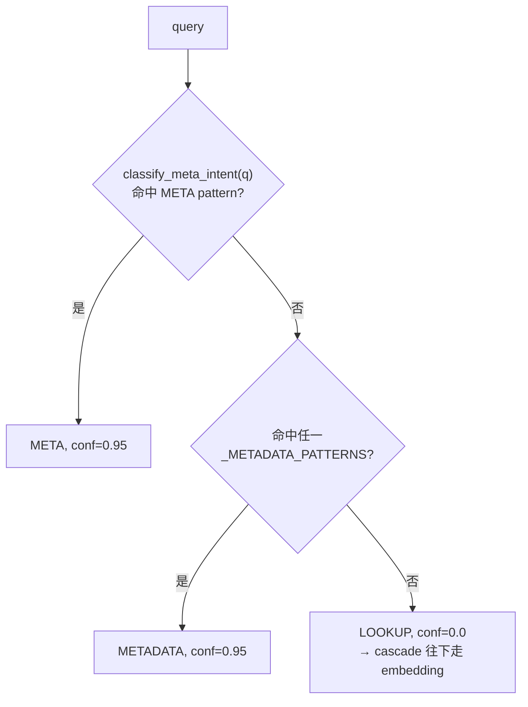
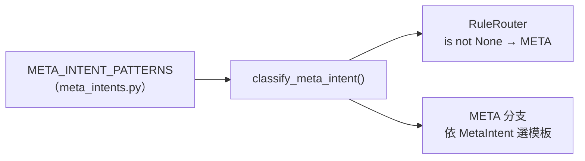

# Rule router 解析

> 查證日期：2026-10-16。內容依閱讀 `app/routing/router/rule.py`、`app/routing/meta_intents.py`、
> `app/routing/router/cascade.py` 整理。第 4 節的結果用第 7 節的程式實測（Python 3.12.13）；其餘為閱讀程式碼的結論。

`RuleRouter` 是 cascade 的第一層（rule → embedding → LLM），**不呼叫任何模型**，只用 regex 比對 query。
設計原則（`rule.py` docstring）：只攔截不需要語意理解就能判斷的問題，其他一律交給下一層，不在這裡猜。

相關：LLM 層的問題見 [why-llm-layer-never-wins-20261016.md](why-llm-layer-never-wins-20261016.md)。

---

## 1. 流程



- 只有三種輸出，confidence 只有兩個值：**0.95（`_RULE_CONFIDENCE`）或 0.0**。rule 層沒有「有點把握」，要嘛短路、要嘛完全放手。
- 0.95 > `CONFIDENCE_THRESHOLD`（0.70），所以 rule 一命中，cascade 立刻回傳，embedding / LLM 層都不會執行。
- META 先判斷；同時命中時以 META 為準。

## 2. META pattern（`app/routing/meta_intents.py`）

META 的 pattern 不在 `rule.py` 裡，而是與 META 分支（`branches/meta.py`）共用 `classify_meta_intent()`。
這是刻意的：以前兩邊各寫一份（rule 用 regex、branch 用 substring），router 判成 META 的問題到了分支卻落到 `default` 回覆。



| 子意圖 | pattern |
|---|---|
| IDENTITY | `你是(誰\|什麼)`、`你是?用(什麼\|哪一?個\|哪種)模型`、`who are you`、`what model are you` |
| CAPABILITIES | `你(能\|可以).{0,6}(做\|提供\|回答\|協助)`、`系統.{0,6}(有\|能\|支援).{0,6}功能`、`我可以問你什麼`、`what can you (do\|help)` |

pattern 必須錨定在「你」/「系統」這類指向系統本身的字；不能加 `什麼功能` 這種裸片語，
否則「這份文件提到什麼功能」會被誤判成 META（`meta_intents.py` docstring）。

## 3. METADATA pattern（`rule.py:25-34`）

8 條 regex，涵蓋：作者是誰、誰寫／上傳／建立／修改的、上傳／發布日期或時間、什麼時候發布、`版本(號)?`、檔案／文件類型、
`file type`、日期格式 `\d{4}[-/年]\d{1,2}`。

## 4. 實測

| query | 結果 | 判斷 |
|---|---|---|
| 你是誰 / 你能幫我做什麼 | META 0.95 | ✅ |
| 這份報告的作者是誰 / 這份文件的上傳日期 / 這份文件的版本號 | METADATA 0.95 | ✅ |
| 這份文件提到什麼功能 | LOOKUP 0.0 | ✅ 錨定設計有效 |
| 總結所有文件 | LOOKUP 0.0 | ✅ 交給下一層 |
| **新版本的退款政策有什麼改變** | METADATA 0.95 | ❌ 是內容問題 |
| **2026年1月的營收是多少** | METADATA 0.95 | ❌ 是內容問題 |
| **合約 2025/12 到期後怎麼續約** | METADATA 0.95 | ❌ 是內容問題 |
| **who wrote this document** | LOOKUP 0.0 | ❌ 漏判 |
| **when was this uploaded** | LOOKUP 0.0 | ❌ 漏判 |

## 5. 問題

1. **METADATA pattern 太寬，誤判後無法修正。** `版本(號)?` 和日期 regex 沒有像 META 那樣錨定，
   query 裡只要出現「版本」或日期就命中。confidence 又是 0.95，cascade 直接短路，embedding / LLM 層沒有機會修正。
2. **英文覆蓋不足。** METADATA 的英文 pattern 只有 `file type`，「who wrote / when uploaded」都會漏判，
   只能靠 embedding 層；embedding 沒把握時，因為 LLM 層的決定不會被採用，最後變成 LOOKUP。
3. **confidence 是寫死的常數。** 「作者是誰」這種強訊號與「query 裡剛好有個日期」這種弱訊號拿到一樣的 0.95。

## 6. 修改時的注意事項

- 修改任何 pattern（包括 `meta_intents.py`）都要遞增 `rule.py` 的 `ROUTER_VERSION`（目前 `rule-v2`）。
- 目前只有 `tests/routing/test_meta_branch.py` 用到 `RuleRouter`；**METADATA pattern 沒有專門的 router 測試**。

## 7. 實測程式

在 repo 根目錄執行：

```python
import asyncio
import sys

sys.path.insert(0, ".")
from app.routing.router.rule import RuleRouter
from app.routing.taxonomy import RouterContext

QUERIES = [
    "你是誰",
    "你能幫我做什麼",
    "這份報告的作者是誰",
    "這份文件的上傳日期",
    "這份文件的版本號",
    "新版本的退款政策有什麼改變",
    "2026年1月的營收是多少",
    "合約 2025/12 到期後怎麼續約",
    "這份文件提到什麼功能",
    "who wrote this document",
    "when was this uploaded",
    "總結所有文件",
]


async def main():
    ctx = RouterContext(tenant_id="t", knowledge_base_id="k", resolved_history=[])
    r = RuleRouter()
    for q in QUERIES:
        d = await r.route(q, ctx)
        print(f"{q!r:40} -> {d.route.value:10} {d.confidence}")


asyncio.run(main())
```
