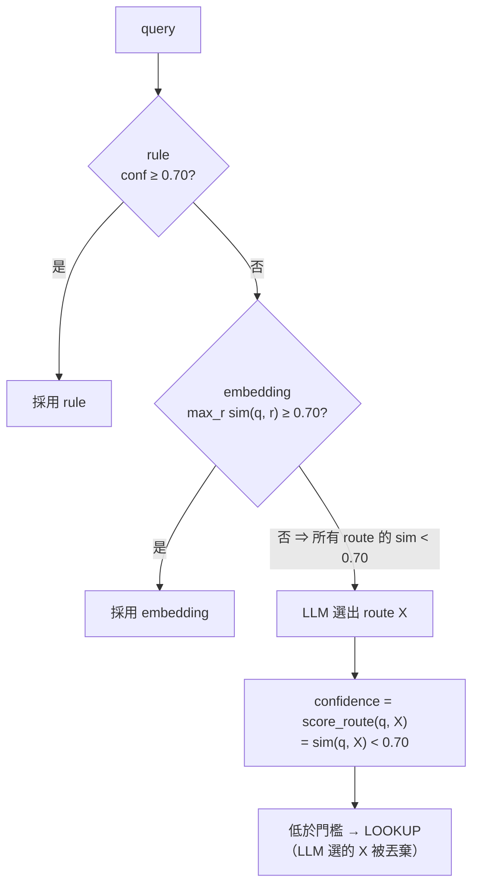
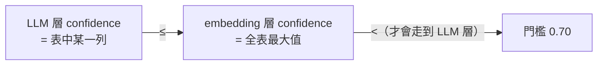

# Cascade router 的 LLM 層為什麼永遠不會被採用

> 查證日期：2026-10-16。內容依閱讀 `app/routing/router/cascade.py`、`llm.py`、`embedding.py`、
> `fallback_chain.py`、`app/agent/graphs/routed_rag.py` 整理。第 5 節的數字以假 embedding 模擬實測
> （Python 3.12.13）；真實 Gemini embedding 下的分佈未實測。
> 修正計畫見 [cascade-llm-layer-dead-20261016.md](../../../plans/in-progress/cascade-llm-layer-dead-20261016.md)。

**一句話**：LLM 層的 confidence 不是 LLM 給的，而是查 embedding 層剛算過、而且已經確定不及格的那張相似度表，
所以必定低於門檻，LLM 的決定一定會被丟棄。

---

## 1. 前提：每一層都要過同一個門檻

`CascadeRouter.route()`（`cascade.py:37-49`）依序跑 rule → embedding → LLM：
某一層 `confidence >= 0.70`（`CONFIDENCE_THRESHOLD`）就採用它；三層都不到就保底 LOOKUP。



所以 LLM 選得再對，**confidence 不到 0.70 也不會被採用**。

## 2. 兩層的 confidence 是怎麼算的

**embedding 層**（`embedding.py:144-163`）：對每個 route，算 query 與該 route 所有例句的最高相似度，
再取**所有 route 中最高的**那個當 confidence。

**LLM 層**（`llm.py:113-119`）：LLM 只負責選 route，confidence 另外用 embedding 算：

```python
output = await structured_model.ainvoke(messages)          # LLM 選出 route X
confidence = await self._confidence_scorer.score_route(query, output.route)
```

`score_route(query, X)`（`embedding.py:134-142`）＝ query 與 **route X** 例句的最高相似度。

## 3. 具體例子

> 以下相似度數字是說明用的假設值，不是實測。

使用者問：「這個知識庫大概在講什麼？」

embedding 層算出 query 對每個 route 的最高相似度：

| route | 最高相似度 |
|---|---|
| LOOKUP | 0.52 |
| GLOBAL | **0.61** |
| METADATA | 0.40 |
| … | … |

1. embedding 層取全表最大值 0.61，< 0.70，沒把握，交給 LLM 層。
2. LLM 判斷應該走 **GLOBAL**（判斷正確）。
3. `score_route(query, GLOBAL)` 查的就是上表 GLOBAL 那一列 → 0.61。
4. 0.61 < 0.70 → 回傳 LOOKUP，LLM 的決定被丟棄。

## 4. 為什麼是必然，不是運氣



- 任何一列都不可能大於全表最大值。
- 會走到 LLM 層，就代表全表最大值已經 < 0.70。
- 因此 LLM 不管選哪個 route，confidence 一定 < 0.70。

前提是兩層用同一組例句（`ROUTE_EXAMPLES`）與同一個 embedding 模型；預設建構 `CascadeRouter()` 就是如此。
唯一的例外是 embedding API 對同一段文字回傳不同向量（推論，未查證）。

就算 cascade 放行，`select_branch()`（`routed_rag.py:136-140`）也會因為 confidence < 0.70
再強制改成 LOOKUP，等於第二道否決。

## 5. 實測

用假 embedding（每段文字以字串為 seed 產生 8 維 Gaussian 隨機向量）跑 2000 個 query；
對每個走到 LLM 層的 query，讓假 LLM 依序選 6 個 route，各跑一次完整的 `CascadeRouter`：

```
queries reaching LLM layer: 1015; non-LOOKUP LLM decisions that survived cascade: 0
```

1015 × 5 個非 LOOKUP route = 5075 次 LLM 決定，**0 次被採用**。
隨機向量只用來製造「embedding 層沒把握」的情境；第 4 節的推導不依賴向量分佈。
重現程式見修正計畫 §2.2。

## 6. Fallback chain 也一樣

`FallbackChainRouter`（`fallback_chain.py`）在 cascade 丟例外時使用，順序是 LLM → embedding → rule。

- LLM 層成功時 confidence 一樣是 embedding 相似度；`select_branch()` 低於 0.70 就改成 LOOKUP。
  LLM 的決定只有在 embedding 相似度剛好 ≥ 0.70 時才會被採用——而這種情況 embedding 層自己就能判斷。
- **故障耦合**：LLM 層算 confidence 要呼叫 embedding API。embedding API 故障時，LLM 層也跟著失敗。

## 7. 影響

- **準確度**：rule 沒命中、說法又不像例句的問題（換句話說、口語、長問句）全部被當成 LOOKUP。
- **成本與延遲**：這些問題每次都多一次 LLM 呼叫和一次 embedding 呼叫，結果卻不會改變。
- **觀測誤導**：LangSmith 上看得到 LLM 層的 `reasoning`，容易以為 LLM 有參與決策。

實際上 routing 只有三種結果：**rule 命中、embedding 命中、LOOKUP 保底**。
