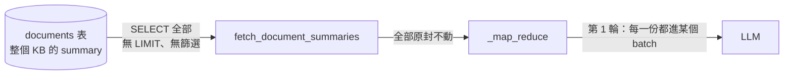
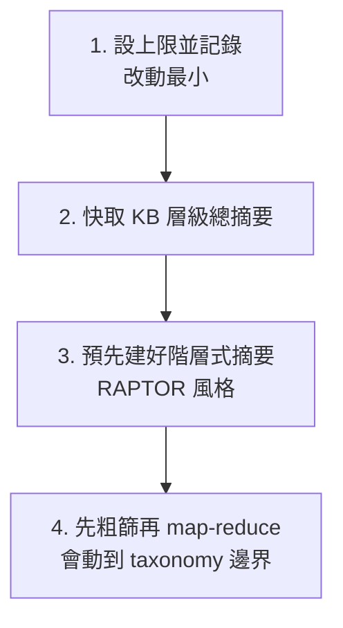

# GLOBAL 分支為什麼讀遍所有摘要，以及代價

> 查證日期：2026-10-13
> 依據：閱讀 [`global_summary.py`](../../../app/routing/branches/global_summary.py) 原始碼，**未實際執行**。文中的呼叫次數是依程式邏輯推算，不是實測值。

相關筆記：
- [`_map_reduce` 逐行導讀](map-reduce-walkthrough-20261013.md)：這些摘要進入 `_map_reduce` 後怎麼被合併
- [文件摘要存哪裡](document-summary-storage-20261007.md)：為什麼摘要放 SQL 欄位而不放 vector store

---

## 結論

**對，每一份摘要都會被 LLM 讀過一次**，沒有任何依 query 的篩選。



## 證據

### 1. 撈的是整個 KB 的摘要

```python
async def fetch_document_summaries(tenant_id:str, user_id:str, knowledge_base_id: str) -> list[Chunk]:
    get_all_docs_stmt = select(Document.id, Document.summary).where(
        Document.knowledge_base_id == uuid.UUID(knowledge_base_id),
        Document.tenant_id == uuid.UUID(tenant_id),
        Document.user_id == uuid.UUID(user_id),
        Document.status == IngestionStatus.INDEXED,
        Document.deleted_at.is_(None),
        Document.summary.is_not(None)
    )
```

`WHERE` 只有兩種條件，**沒有 `LIMIT`，也沒有依 query 做任何篩選**：
- 範圍：同一個 tenant、user、knowledge_base。
- 狀態：`INDEXED`、沒被刪除、`summary` 不是 NULL。

### 2. 全部送進 `_map_reduce`

```python
summaries = await fetch_document_summaries(state.tenant_id, state.user_id, knowledge_base_id)
...
answer = await self._map_reduce(query, [s.content for s in summaries])
```

`GlobalSummaryBranch.__call__` 把所有 `summaries` 原封不動傳進去。`_map_reduce` 第 1 輪會把**每一份**都切進某個 batch，送給 LLM。

所以知識庫有 500 份文件，第 1 輪就要讀 500 份摘要。就算其中 450 份跟問題無關，也照樣花錢讀。

---

## 為什麼這樣設計

這是**刻意的**。GLOBAL 的定義（見 [`taxonomy.py`](../../../app/routing/taxonomy.py)）是「要歸納整批文件才能回答」，例如「這些文件整體在講什麼？」。這種問題本來就沒有「相關」和「不相關」之分，每份都算數；如果先用相似度挑一部分，答案就不再是「整體」了。

這也是 [文件摘要存哪裡](document-summary-storage-20261007.md) 決定把摘要放在 SQL 欄位、不放進 vector store 的原因：存取方式是「用 kb_id 撈全部」，不是「用語意找相似」。

---

## 代價：成本跟 KB 大小成正比

`batch_size=8` 時，每一輪剩下的段數是 ⌈n / 8⌉，所以：

| KB 文件數 | 每輪段數 | LLM 呼叫總數 |
|---|---|---|
| 50 | 50 → 7 → 1 | 7 + 1 = **8** |
| 500 | 500 → 63 → 8 → 1 | 63 + 8 + 1 = **72** |
| 5,000 | 5000 → 625 → 79 → 10 → 2 → 1 | 625 + 79 + 10 + 2 + 1 = **717** |

（照程式邏輯推算，未實測。）

每問一次 GLOBAL 問題就要付這麼多次 LLM call，而且同一個 KB 被問「整體在講什麼」時，**每次都從頭重算**，不會沿用上一次的結果。

---

## 常見的改法（依改動大小排序）



1. **設上限並記錄**：在 SQL 加上 `LIMIT`，或文件數超過門檻時寫進 `trace`。至少成本不會無上限地長。
2. **快取 KB 層級的總摘要**：ingestion 時（或 KB 有變動時）預先跑一次 map-reduce，把結果存起來。問題很籠統時直接用這份；問題有特定角度（例如「整體的資安風險」）時，再拿它當 context 回答。
3. **預先建好階層式摘要**（RAPTOR 風格）：ingestion 時就建好摘要樹，查詢時只讀上面幾層，不必每次從 500 份重算。
4. **先粗篩再 map-reduce**：只適用「在某個主題範圍內做歸納」的問題，例如「所有跟付款有關的條款整理一下」。但這其實比較接近 `MULTI_HOP` 或 LOOKUP 加上摘要，會模糊 GLOBAL 的邊界，要先想清楚 taxonomy 該怎麼劃分。

建議先做第 1 點：花費很小，但能擋住失控的成本。
