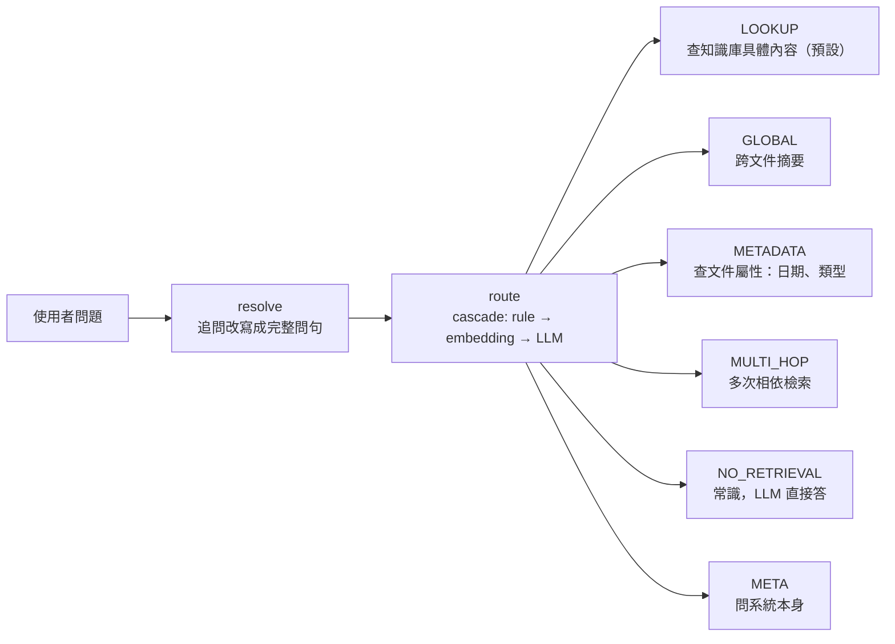
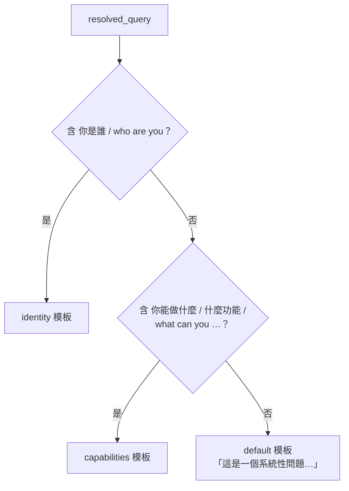
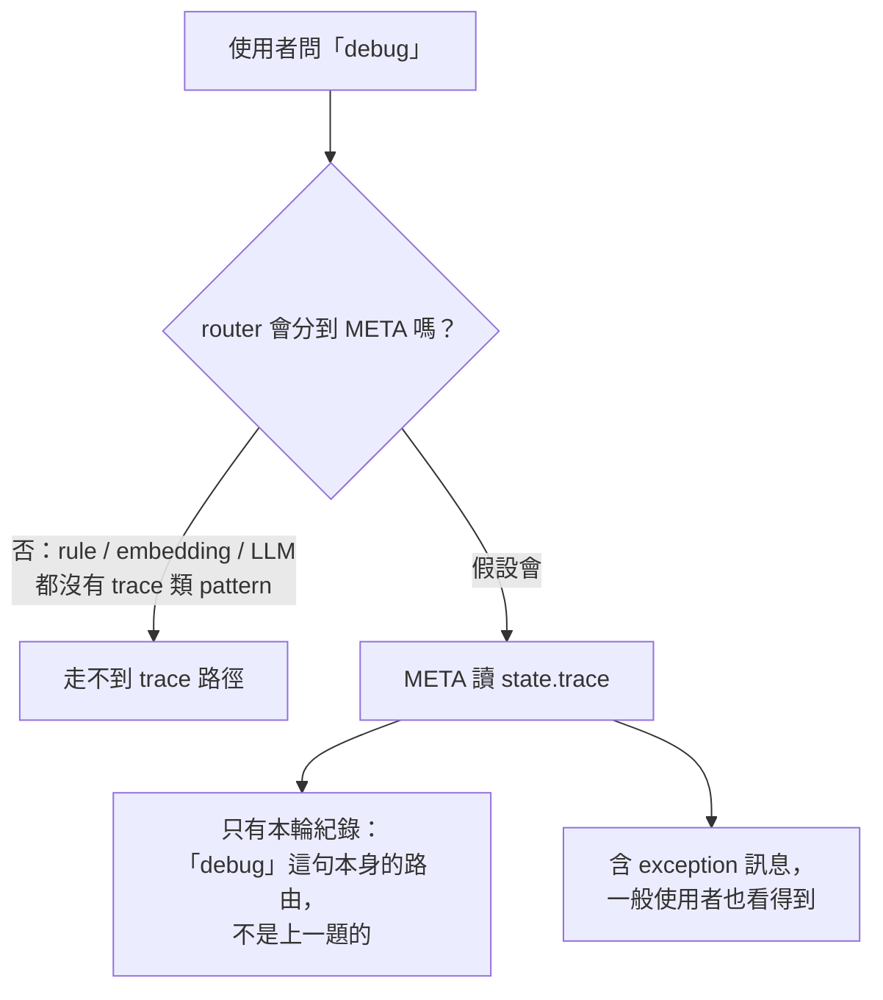

# META 分支是做什麼的

> 查證日期：2026-10-15。內容依閱讀 `app/routing/branches/meta.py`、`app/routing/taxonomy.py`、
> `app/routing/router/rule.py` 整理，**未實際執行**。

META 是 routing 六類 route 之一，專門回答**關於這個系統本身**的問題（「你能做什麼」、「你是誰」），
不是知識庫內容，也不是一般常識。

---

## 1. 在整條流程中的位置



## 2. 特點

- **不檢索**：不查知識庫，也不查資料庫。
- **不呼叫 LLM**：回答全部是寫死的模板字串，所以快、零成本，回答內容固定。
- **`documents` 永遠是空 list**：回答不附引用來源。

## 3. `meta.py` 的運作方式

對 `resolved_query` 做關鍵字 substring 比對，依序選一個回覆：



最後在 `trace` 附加一行 `meta: fixed-template reply, no generation`，標記這輪走了 META。

## 4. 跟 NO_RETRIEVAL 的差別

兩者都不檢索，差在問的對象：

- 「什麼是機器學習」→ 世界知識 → NO_RETRIEVAL，LLM 生成回答。
- 「你能做什麼」→ 這個系統 → META，固定模板回答。

邊界判準寫在 `app/routing/taxonomy.py` 的 `Route` docstring。

## 5. `trace` 與為什麼 META 不再回傳它

`RoutedAgentState.trace` 是 `list[str]`，graph 裡每個節點跑完都往裡面加一行，記錄這個問題被怎麼分派：

```
resolve: query resolved to standalone question
route=LOOKUP conf=0.82
```

router 出錯降級時，還會多出 `route: router failed (<ExceptionType>: <message>), degrading to fallback_chain` 這類行。

**原本的設想**（依 `taxonomy.py` 舊 docstring 與 `app/routing/PLAN.md` 推論）：開發者發現某題答錯時，
接著在聊天中問「debug」，META 就回傳路由紀錄，不用翻 log 就能看出是不是 router 分錯類。

**2026-10-15 移除**，原因：



而且這是 debug 功能，不是終端使用者功能。`.env.dev` 已開啟 LangSmith tracing，每次 run 的節點輸入輸出、
最終 state 的 `trace` 欄位都看得到，比聊天介面回傳的字串完整。

所以現在：

- META 只回 identity / capabilities / default 三種模板。
- `state.trace` 欄位保留，各節點照常寫入，給 LangSmith / log 使用。

## 6. 已知問題

router 判斷「這是 META」用一組規則（`rule.py` 的 regex、`embedding.py` 的例句），`meta.py` 判斷
「回哪個模板」用另一組 substring。兩組對不上，很多正確分到 META 的問題最後拿到 `default` 回覆。
完整發現與修法見 [meta-branch-review-20261015.md](../../plans/in-progress/meta-branch-review-20261015.md)。
