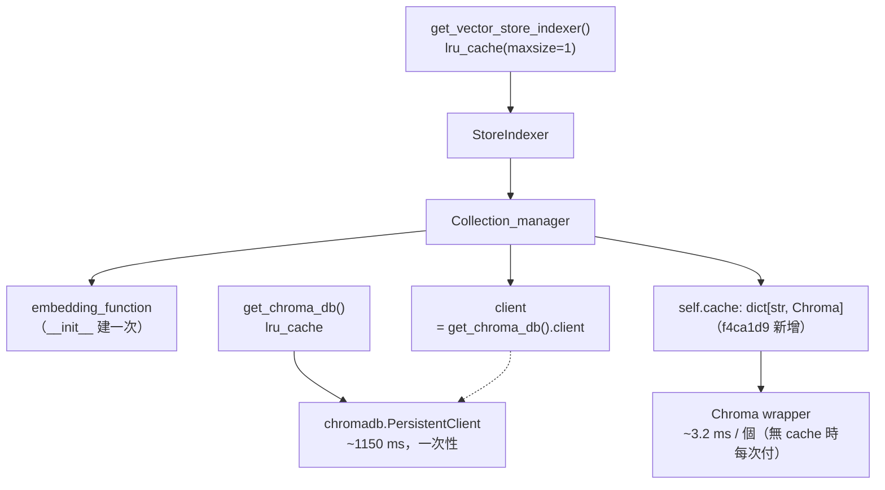
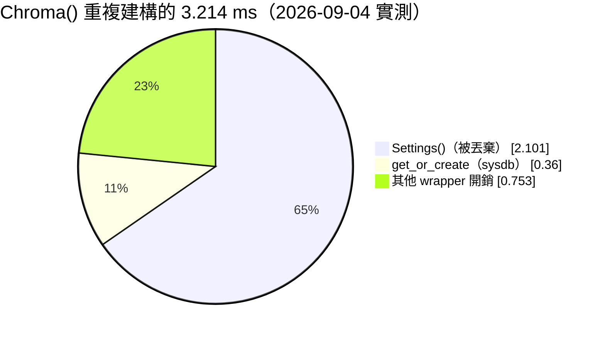
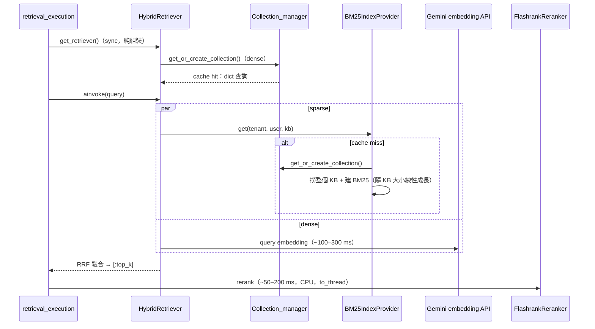
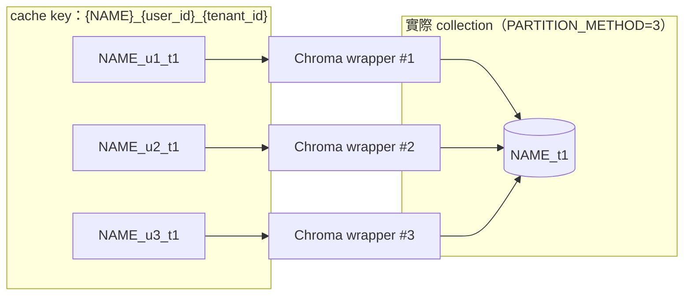

# `get_or_create_collection()` 每次呼叫的成本

> 查證日期：2026-10-09（程式碼現況）。量測數據為 2026-09-04 實測，見〈量測結果〉的環境說明。

回答「`StoreIndexer` 每個方法都重新叫一次 `get_or_create_collection()`，多呼叫幾次會不會很慢？」

**結論：**
- 量測時（無 cache）每次約 3 ms，不是瓶頸，當時判斷「先不要修」。
- 之後 `f4ca1d9`（2026-09-07）還是在 `Collection_manager` 加了 handle cache，現在重複呼叫只剩一次 dict 查詢。
- 這個 cache 目前**沒有上限**，key 也不隨 partition 策略收斂，見〈現況的 cache 與剩餘問題〉。

---

## 物件關係：哪些東西是 process-wide singleton



因為 `StoreIndexer` 是 singleton、它持有唯一的 `Collection_manager`，所以 `PersistentClient`、embedding function、以及 `self.cache` 實際上都是 process-wide。

---

## 量測結果（2026-09-04，無 cache 時）

```
PersistentClient()        :  1149.29 ms   ← 一次性，已被 lru_cache 擋住
Chroma() 第一次（建立）    :    15.18 ms
Chroma() 重複呼叫          :     3.214 ms  每次
  └ client.get_or_create():     0.360 ms  ← 真正的 sysdb round-trip
  └ Settings()            :     2.101 ms  ← 純浪費，見下
```

環境：Python 3.12.13 / Windows、`chromadb==1.5.8`、`langchain-chroma==1.1.0`、
`PersistentClient` 對本機 SQLite、collection 已存在、重複 300 次取平均。重現腳本見文末。

### 那 3.2 ms 花在哪

真正的 DB 查詢只佔 0.36 ms，其餘 2.9 ms 是 LangChain wrapper 的開銷，
其中 **2.1 ms 是 `Settings()`**（`langchain_chroma/vectorstores.py:351`）：

```python
_settings = client_settings or Settings()   # pydantic-settings，每次重讀 env
...
if client is not None:
    self._client = client                    # ← 我們走這條，_settings 直接被丟掉
```

我們有傳 `client=`，所以那個 `Settings()` 建完**完全沒被用到**。這是 LangChain 的問題，呼叫端繞不掉——
這也是 handle cache 真正省下的東西。剩下的 0.36 ms 是 `__ensure_collection()`（`vectorstores.py:420-427`）打進 chromadb 的 sysdb（SQLite）。



---

## 放進一個 request 的比例看

hybrid retrieval 一個 request 會呼叫兩次 `get_or_create_collection()`：dense 在 `StoreIndexer.get_dense_retriever()`（`app/vectorstore/StoreIndexer.py:42`）；
BM25 只有在 **cache miss** 時才經 `StoreIndexer.get_all_documents_in_kb()`（`StoreIndexer.py:53`）呼叫。



| 項目 | 量級 |
|---|---|
| `get_or_create_collection()` | 現在是 dict 查詢（推論：微秒級，未量測）；無 cache 時 ~3 ms / 次 |
| Gemini embedding API（query 向量化） | ~100–300 ms |
| BM25 cache miss（撈 KB + 建 index） | 隨 KB 大小線性成長；hit 時只剩 BM25 打分 |
| flashrank cross-encoder rerank | ~50–200 ms |
| generator LLM | 秒級 |

> 除了 `get_or_create_collection()` 的 3 ms 是實測，其餘量級是經驗估計，未在本專案量測。

結論不變：這 3 ms 從來不是瓶頸；同一條路上真正會痛的是 BM25 全量建置，而它現在也已經有 cache（見 `vectorstore-collection-partitioning-20261009.md`〈BM25 那條路會被分區策略放大〉）。

---

## 現況的 cache 與剩餘問題

`app/vectorstore/collection_manager.py:13-44`：

```python
self.cache: dict[str, Chroma] = {}

def _collection_name(self, user_id: str, tenant_id: str) -> str:
    return f"{settings.COLLECTION_NAME}_{user_id}_{tenant_id}"

def get_or_create_collection(self, user_id: str, tenant_id: str) -> Chroma:
    collection_name = self._collection_name(user_id, tenant_id)
    if collection_name in self.cache:
        return self.cache[collection_name]
    # ... 依 partition_strategy 建 Chroma(collection_name=實際名稱)
    self.cache[collection_name] = vector_store
    return vector_store
```



和 2026-09-04 版本建議的寫法相比，有三點落差：

1. **沒有上限。** 裸 `dict` 會隨 `(user_id, tenant_id)` 組合無限成長。舊版本就建議改用 `cachetools.LRUCache` 或類似的 bounded cache。
   `Chroma` 物件只是 handle（真正的 HNSW index 由 chromadb 的 segment manager 管），所以單個不大，但仍不該無界。
2. **cache key 與實際 collection 名稱脫鉤。** key 永遠是 `_{user_id}_{tenant_id}`，但實際名稱依策略而定（`:28,34,40`）。
   策略 1 / 3 下，同一個實體 collection 會被多個 key 各包一個 wrapper（上圖）。不影響正確性，只是浪費，也讓 cache 大小對齊 user 數而不是 collection 數。
   修法：讓 `_collection_name()` 直接回傳依策略算出的實際名稱，同時當 key 和建構參數。
3. **快取的是 handle，不是資料。** collection 被外部刪除後，快取的 handle 會失效，`get_or_create` 的自癒行為就沒了。
   目前程式沒有刪除 collection 的路徑，所以暫時沒事；之後加「刪除 tenant / user」功能時要一併清 cache。

另外 `self.cache` 的存取沒有 lock。dict 單一操作在 CPython 下是 atomic 的，最壞情況是並行 miss 各建一個 wrapper、後寫的覆蓋前者，結果等價（推論，未實測）。

---

## 重現方式

```python
import time, tempfile
import chromadb
from chromadb.config import Settings
from langchain_chroma import Chroma

path = tempfile.mkdtemp(prefix="chroma_bench_")
t0 = time.perf_counter()
client = chromadb.PersistentClient(path=path)
print(f"PersistentClient()        : {(time.perf_counter()-t0)*1000:8.2f} ms")

t0 = time.perf_counter()
Chroma(client=client, collection_name="bench", embedding_function=None)
print(f"Chroma() 1st (create)     : {(time.perf_counter()-t0)*1000:8.2f} ms")

N = 300
for label, fn in [
    ("Chroma() repeat        ", lambda: Chroma(client=client, collection_name="bench", embedding_function=None)),
    ("client.get_or_create() ", lambda: client.get_or_create_collection(name="bench", embedding_function=None)),
    ("Settings() alone       ", Settings),
]:
    t0 = time.perf_counter()
    for _ in range(N):
        fn()
    print(f"{label}  : {(time.perf_counter()-t0)/N*1000:8.3f} ms each  (x{N})")
```

> `embedding_function=None` 是刻意的——這條路徑只量 handle 建構成本，不碰 embedding。
> 注意不要在這個腳本裡呼叫 `add_texts()` / `similarity_search()`：
> 沒有 embedding function 時 chromadb 會退回自己的預設 ONNX 模型並從網路下載（約 80MB），
> 量到的會是下載時間而不是建構時間。
