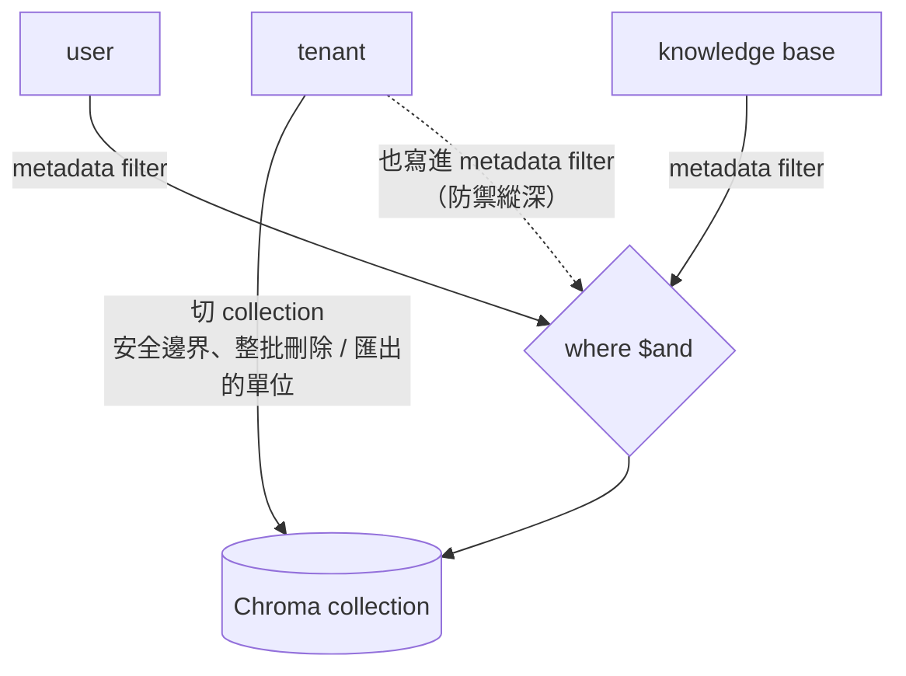
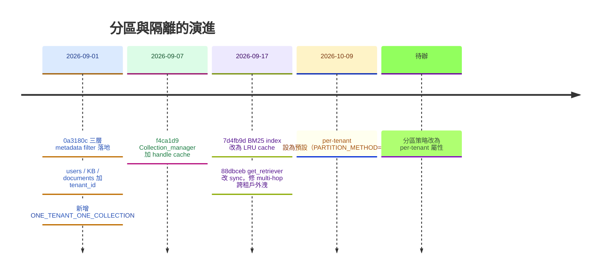
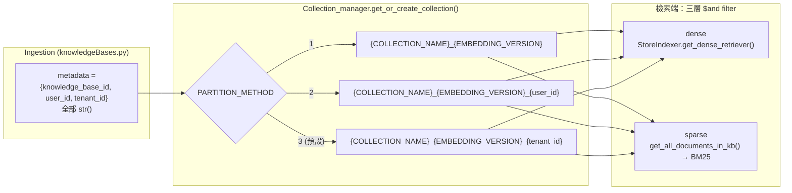
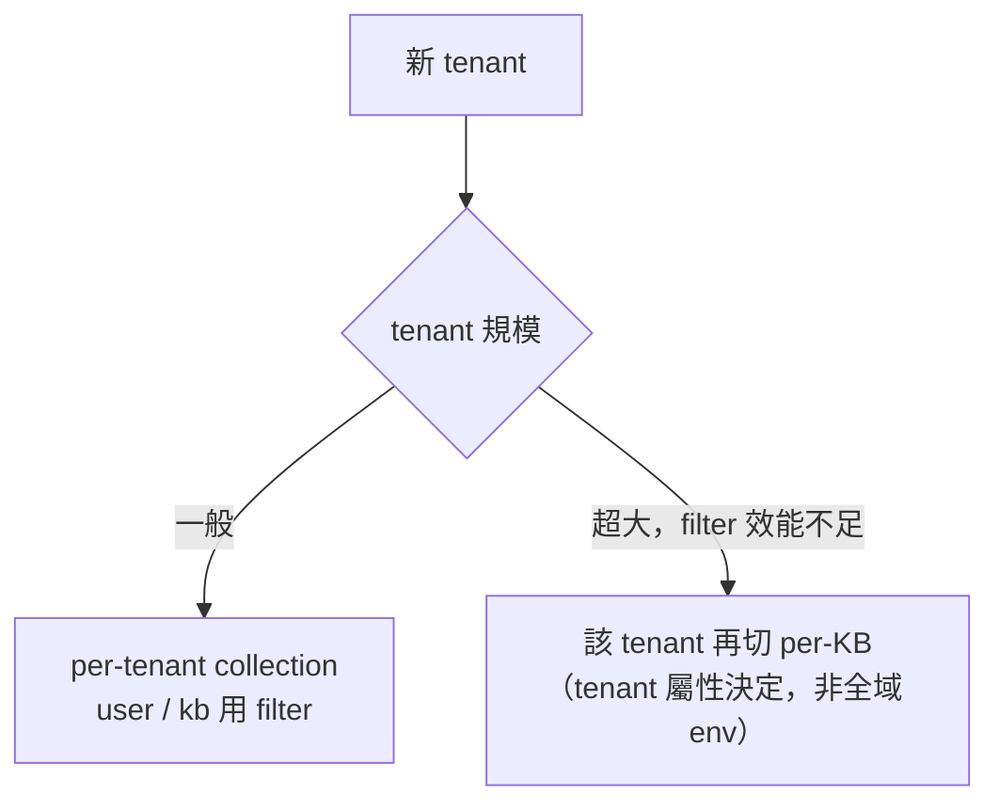
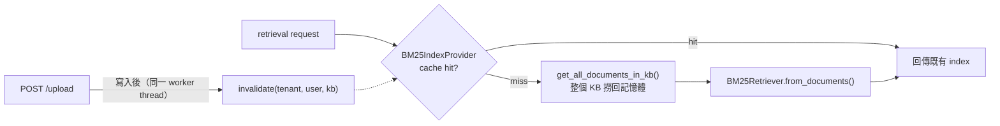

# Vector store 分區策略：collection 切分 + 三層 metadata filter

> 查證日期：2026-10-09（對照 commit `6991c34` 之後的 working tree）

適用於 `app/vectorstore/**` 與 `app/rag/retriever/**`，回答「有 tenant、user、knowledge base 三層時，Chroma collection 該怎麼切」。
程式碼現況的完整拆解見 `vectorstore-retriever-structure-20261009.md`。

## 規則

**用「需要硬隔離或需要獨立生命週期的最大單位」切 collection，比它小的一律用 metadata filter。**
推論：**collection 名字只是效能與生命週期的決策，不該是安全邊界。**

---

## 演進狀態

原本的問題（2026-09-04 版）是「分區鍵和過濾鍵綁在一起」：collection 名字由 `user_id` 決定、filter 只有 `knowledge_base_id`、DB 完全沒有 tenant。
之後依序修掉，現況如下：

| 落地步驟 | 狀態 | 位置 |
|---|---|---|
| ingestion 寫入三個 metadata key | ✅ 完成 | `app/api/v1/endpoints/knowledgeBases.py:87-91` |
| dense 檢索三層過濾 | ✅ 完成 | `app/vectorstore/StoreIndexer.py:28-44` |
| BM25 loader 三層過濾 | ✅ 完成 | `app/vectorstore/StoreIndexer.py:46-53` |
| DB 加 `tenant_id`（users / KB / documents） | ✅ 完成 | `app/models/user.py:21`、`asistantKnowledgeBase.py:28`、`document.py:42` |
| `ONE_TENANT_ONE_COLLECTION` 策略 | ✅ 完成（2026-10-09 起為預設） | `app/vectorstore/collection_manager.py:11` |
| `chats.py` 的 tenant 佔位換成真值 | ✅ 完成 | `app/api/v1/endpoints/chats.py:42` |
| 預設改為 per-tenant | ✅ 完成（2026-10-09，`PARTITION_METHOD=3`） | `app/core/config.py:18` |
| 分區策略改為 per-tenant 屬性 | ❌ 仍是全域 env var | `app/core/config.py:18` |
| collection 名帶 embedding 版本 | ✅ 完成（2026-10-09） | `collection_manager.py:39-49`（`_collection_name()`）、`config.py:23` |
| `where` 組裝收斂成單一守門函式 | ✅ 完成（2026-10-09） | `StoreIndexer.scope_filter()`，`StoreIndexer.py:11-21` |

---

## 現況：三層邊界由 filter enforce

三種策略下 query path **完全相同**——這就是第一步「把 filter 補完整」的價值：
不論 collection 怎麼切，每一筆讀出來的 chunk 都經過 tenant / user / kb 三層過濾，collection 名字從安全邊界退化成純效能決策。

| 邊界 | 現在靠什麼 enforce |
|---|---|
| tenant | metadata filter（`PARTITION_METHOD=3` 時另有 collection 硬隔離） |
| user | metadata filter（`PARTITION_METHOD=2` 時另有 collection 硬隔離） |
| kb | metadata filter |

> 所有值都必須是 `str` —— 型別錯 Chroma 不會 raise，只會靜默回 0 筆。見 `docs/id-type-convention-20260827.md`。

### sparse 與 dense 必須用同一組 filter

BM25 那半是先把整個 KB 撈回記憶體再建 index，filter 發生在撈資料的 `collection.get(where=...)`。
如果它只過濾 `knowledge_base_id`，在 `PARTITION_METHOD=1` 的共用 collection 下，sparse 會撈到 dense 看不到的文件——
所以 `StoreIndexer.get_all_documents_in_kb()` 的註解特別寫明三層都要，`BM25IndexProvider` 的 cache key 也用同一個三元組。

---

## 為什麼最終應該是 per-tenant

| 方案 | collection 數量 | 問題 |
|---|---|---|
| per-KB | 使用者數 × KB 數 | 成長最快；KB 是最常被建立 / 刪除的東西，等於一直在建立與摧毀 HNSW index |
| per-user（2026-10-09 前的預設） | 使用者數 | 對 to-C 產品無上限。Chroma 每個 collection 是獨立 index，數量到幾千就會開始痛（記憶體、載入時間）。而且 user 不是計費 / 合規邊界 |
| **per-tenant** | 付費組織數 | **有界**；而且它就是真正需要「整包刪掉」的單位 |

per-tenant 的另一個好處是刪除語意：GDPR 整租戶刪除 = drop collection（瞬間），而不是 scan-and-delete by metadata。

**例外**：單一 tenant 大到 filter 效能崩掉時，把**那個 tenant** 再往下切成 per-KB。
所以分區策略最終應該是**每個 tenant 可以不同的屬性**，而不是現在 `app/core/config.py:18` 那種全域 `PARTITION_METHOD`。

### 切換到 per-tenant 的剩餘工作

因為三層 filter 已經完成，切換本身只是改設定：`PARTITION_METHOD=3`。真正要處理的是**既有資料的遷移**——
現有 chunk 都在 `{COLLECTION_NAME}_{EMBEDDING_VERSION}_{user_id}` 裡，改設定後新 collection 是空的。需要一支一次性腳本把各 user collection 的資料搬到所屬 tenant 的 collection（推論，尚未實作與驗證）。

---

## 兩個實務細節

### 1. collection 名字帶 embedding 版本（2026-10-09 完成，計劃 Phase 5）

改 `EMBEDDING_MODEL` 或 `EMBEDDING_PROVIDE_TYPE` 時，新舊維度的向量若寫進同一個 collection，**搜尋結果會靜默劣化而不會報錯**。
現在 `_collection_name()`（`app/vectorstore/collection_manager.py:39-49`）在 `COLLECTION_NAME` 與 partition key 之間插入 `settings.EMBEDDING_VERSION`（預設 `"v1"`，`app/core/config.py:23`）：

| 策略 | collection 名 |
|---|---|
| 1 `GLOBAL_COLLECTION` | `{NAME}_v1` |
| 2 `ONE_USER_ONE_COLLECTION` | `{NAME}_v1_{user_id}` |
| 3 `ONE_TENANT_ONE_COLLECTION` | `{NAME}_v1_{tenant_id}` |

換模型時遞增 `EMBEDDING_VERSION`，新舊 collection 並存，可以逐個 tenant 遷移。
既有的無版本 collection 要用 `scripts/migrate_collection_names.py` 複製到新名稱（見計劃 Phase 5）。

### 2. BM25 那條路會被分區策略放大（已緩解）

原本 `HybridRetriever` 每個 request 都把整個 KB 的 chunk 載進記憶體重建 BM25 index。
現在由 `app/rag/retriever/bm25_index.py` 的 `BM25IndexProvider` 依 `(tenant_id, user_id, knowledge_base_id)` cache，上限 64 個 index，upload 時 `invalidate()`。

剩下的限制：

- cache miss 時仍是全量載入，KB 一大，第一次查詢仍會很慢。
- 每個 index 都把整個 KB 全文放在記憶體，64 個上限下的記憶體用量取決於 KB 大小（未量測）。
- cache 只存在單一 process，多 worker 時 `invalidate()` 只打得到一個 worker。

長期仍要考慮把 sparse retrieval 換成 Chroma 之外的持久化 index。

---

## 檢查清單（寫新 code 時）

- 我在寫 chunk 進 Chroma 嗎？→ `tenant_id` / `user_id` / `knowledge_base_id` 三個 metadata key 一個都不能少，而且都是 `str`。
- 我在組 `where` filter 嗎？→ 三層都要過濾，**不要**依賴 collection 名字當隔離。
- 我在寫入或刪除 chunk 嗎？→ 一定要呼叫 `get_bm25_index_provider().invalidate(...)`，否則 BM25 會繼續回舊資料。
- 我在決定 collection 名字嗎？→ 只考慮效能與生命週期，不要把它當安全邊界。
- 我在改 embedding model 嗎？→ collection 名字要換版本號，不能沿用。
- 我在 module-level singleton 上存 retriever 嗎？→ 不行，會把第一個 request 的 tenant scope 洩漏給所有人（`multi_hop.py:130-132` 的註解，`88dbceb` 修的就是這個）。

---

## 附註：已解決的舊問題

舊版本文件結尾記錄的「`retrieval_execution` 呼叫 `async def get_retriever()` 卻沒 `await`」——
`88dbceb` 把 `RetrieverFactory.get_retriever()` 改成 sync（`app/rag/retriever/base.py:7-12`），問題的前提已不存在。
推導見 `../retriever/return-runnable-or-not-20261007.md`。
