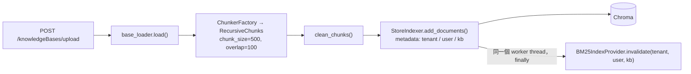
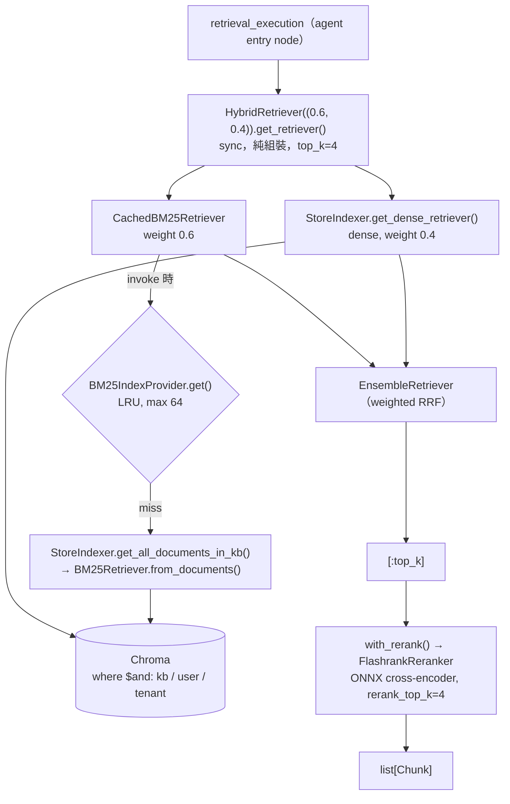
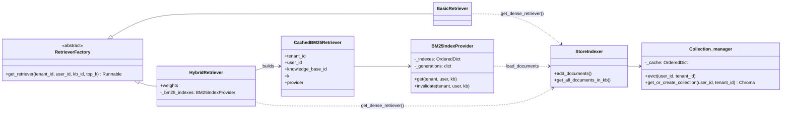
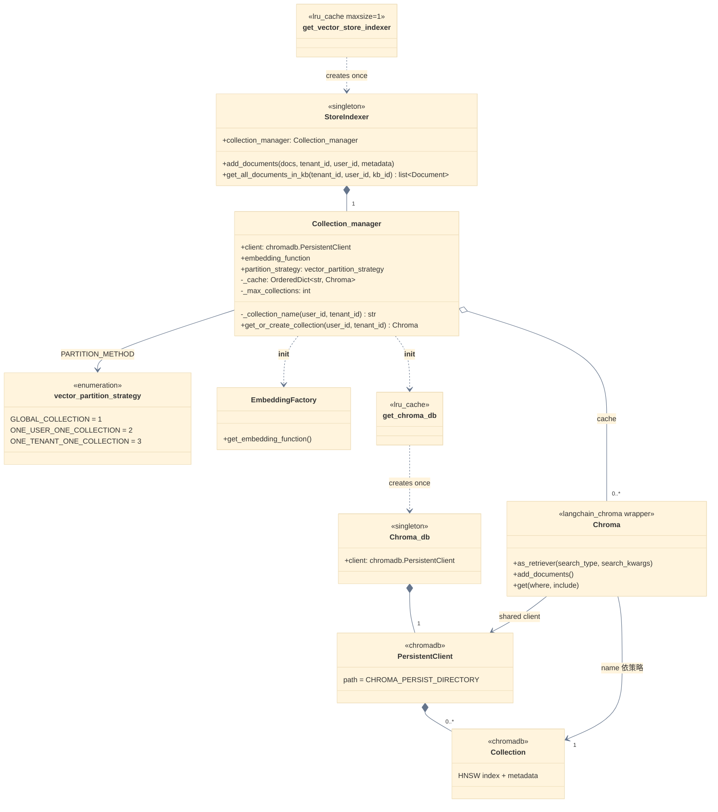
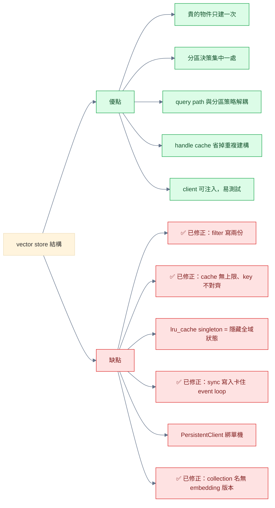
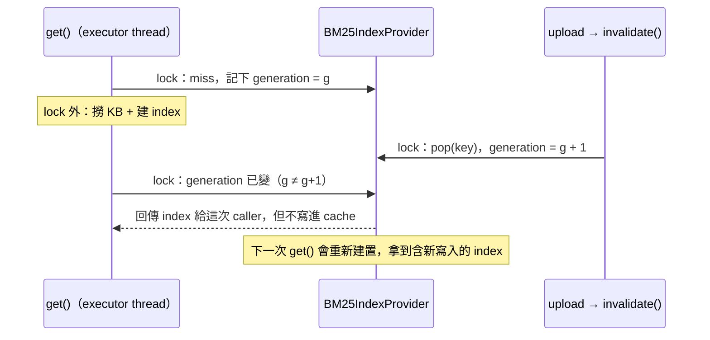
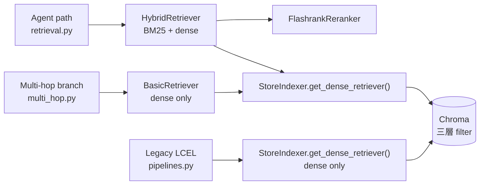
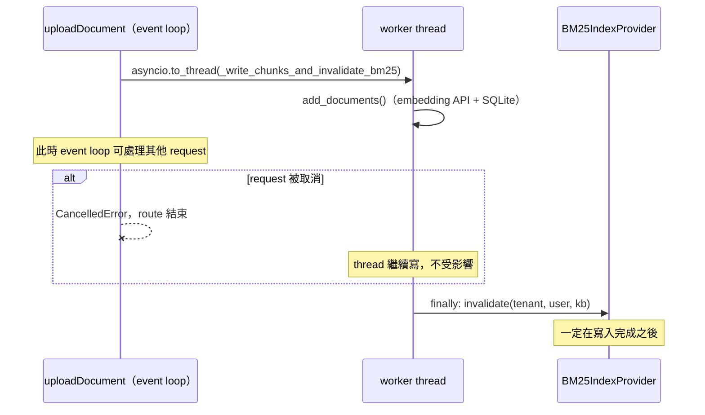
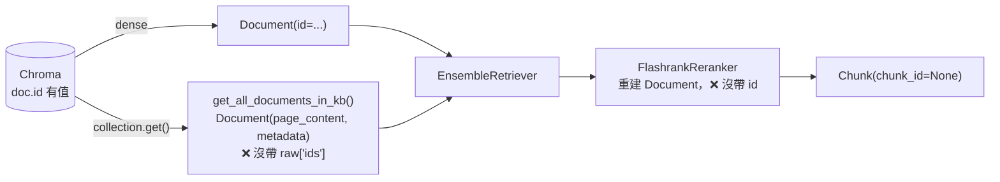

# Vector store 與 retriever 現況結構

> 查證日期：2026-10-09（對照 commit `6991c34` 之後的 working tree）

這份文件描述 `app/vectorstore/**`、`app/rag/retriever/**`、`app/rag/reranker/**` 目前**實際長什麼樣**，以及誰在消費它們。
關於「該怎麼切 collection」的設計決策與演進方向，見 `vectorstore-collection-partitioning-20261009.md`；
關於 `get_or_create_collection()` 每次呼叫的成本量測，見 `vectorstore-collection-handle-cost-20261009.md`；
關於 `get_retriever()` 為何回傳 `Runnable`，見 `../retriever/return-runnable-or-not-20261007.md`。
這裡只記現況與已知缺陷。

---

## 整體分層

### Ingestion



### Retrieval（agent 主線）



### 模組依賴



---

## Vector store 層（`app/vectorstore/`）

三個檔案，職責切得很乾淨。

### 物件關係



重點：

- **兩個 singleton 入口**：`get_vector_store_indexer()` 和 `get_chroma_db()`，都是 `lru_cache`，所以整個 process 只有一個 `StoreIndexer`、一個 `Collection_manager`、一個 `PersistentClient`。
- **`Chroma` wrapper 有多個、`PersistentClient` 只有一個**：每個 wrapper 都共用同一個 client 與 embedding function，只差在指向哪個 collection。
- **cache 的 key 就是實際 collection 名稱**（Phase 3 起）：由 `_collection_name()` 依 `vector_partition_strategy` 與 `EMBEDDING_VERSION` 算出，一個實體 `Collection` 只對應一個 `Chroma` handle。
- 外部有兩個進入點：
  - 走 `StoreIndexer` 的方法：ingestion（`add_documents`）、BM25 loader（`get_all_documents_in_kb`）。
  - dense 檢索：`get_dense_retriever()`，由 `HybridRetriever`、`BasicRetriever`、`pipelines.py` 直接呼叫（`hybrid_retriever.py:28`、`basic_retriever.py:11`）。

### 這個結構的優缺點



**優點**

1. **貴的物件只建一次。** `PersistentClient` 建構約 1150 ms、embedding function 視 provider 而定，兩者都靠 `lru_cache` singleton 擋住，整個 process 只付一次（量測見 `vectorstore-collection-handle-cost-20261009.md`）。
2. **分區決策集中一處。** 「collection 怎麼切」只寫在 `Collection_manager.get_or_create_collection()`，換策略只動一個 env var，不用改呼叫端。
3. **query path 與分區策略解耦。** dense 與 BM25 都用 tenant / user / kb 三層 `where` filter，不論 `PARTITION_METHOD` 是 1、2、3，隔離都由 filter 保證，collection 名字只是效能決策（見 `vectorstore-collection-partitioning-20261009.md`）。
4. **handle cache 省掉重複建構。** 原本每次呼叫約 3.2 ms（其中 2.1 ms 是被丟棄的 `Settings()`），現在重複呼叫只剩 dict 查詢。
5. **client 可注入。** `Collection_manager(client=...)` 接受外部 client，測試可以換成 in-memory chromadb。

**缺點**

1. ~~**三層 tenant filter 寫了兩份，其中一份在 vector store 層之外。**~~ **已修正（2026-10-09，計劃 Phase 1）。**
   原本 dense 的 filter 在 `app/rag/retriever/common.py` 的 `get_collection_retriever()` 組，BM25 的在 `StoreIndexer.get_all_documents_in_kb()` 組，兩份各自維護。
   現在 `get_collection_retriever()` 已刪除，兩條路都經過 `StoreIndexer.scope_filter()`（`StoreIndexer.py:11-21`），
   外部拿 dense 檢索改呼叫 `StoreIndexer.get_dense_retriever()`（`:28-44`），不必再自己取 `collection_manager`。
   `tests/vectorstore/test_store_indexer_scope.py` 用共用 collection（最壞情況）驗證 dense 與 sparse 看到的範圍一致、跨 tenant 看不到。
2. ~~**cache 無上限，key 與實際 collection 不對齊。**~~ **已修正（2026-10-09，計劃 Phase 3）。**
   原本裸 `dict` 隨 `(user_id, tenant_id)` 組合無限成長，策略 1 / 3 下多個 key 各包一個 wrapper 指向同一個 collection。
   現在是上限 256 的 LRU，key 用實際 collection 名稱，並加了 lock。
3. **`lru_cache` singleton 是隱藏的全域狀態。** `PARTITION_METHOD`、embedding 設定在第一次呼叫時就被凍結，改設定必須重啟 process；測試之間也要記得 `cache_clear()`，否則會互相污染（目前 `tests/` 裡沒有任何 `cache_clear()` 呼叫）。
4. ~~**sync 寫入卡住 event loop。**~~ **已修正（2026-10-09，計劃 Phase 2）。**
   原本 `uploadDocument`（`async def`）直接同步呼叫 `store.add_documents()`，embedding API 呼叫與 SQLite 寫入期間整個 FastAPI process 無法處理其他 request。
   現在改成 `await asyncio.to_thread(_write_chunks_and_invalidate_bm25, ...)`（`knowledgeBases.py:113`），寫入與 BM25 失效都在 worker thread 上執行。
   （檢索端本來就沒有這個問題：dense 走 `ainvoke`，BM25 由 `BaseRetriever` 丟進 executor。）
5. **`PersistentClient` 綁單機。** 資料存在本機 `./chroma_data`，多台機器無法共用；多個 worker process 同時開同一個目錄的安全性未查證（推論：chromadb 官方建議多 process 情境改用 client/server 模式 `HttpClient`）。
   要擴展時得換成 `chromadb.HttpClient`，所幸 `Collection_manager` 已支援注入 client，換的範圍只在 `client.py`。
6. ~~**collection 名字沒有 embedding 版本。**~~ **已修正（2026-10-09，計劃 Phase 5）。** 名稱加入 `EMBEDDING_VERSION`，換 model 時遞增版本即可讓新舊向量分開；既有資料用 `scripts/migrate_collection_names.py` 遷移。
7. **小問題。** ~~`StoreIndexer.retrieve()` 是死碼~~（Phase 7 已刪除）；命名風格不一致（`Chroma_db`、`Collection_manager`、檔名 `StoreIndexer.py`）。

### `client.py`

`Chroma_db` 包一個 `chromadb.PersistentClient(path=settings.CHROMA_PERSIST_DIRECTORY)`（`client.py:7`），
外面用 `@lru_cache` 的 `get_chroma_db()` 做 process-wide singleton。預設路徑 `./chroma_data`（`app/core/config.py:14`）。

---
### `collection_manager.py`

**唯一決定「collection 怎麼切」的地方。** `vector_partition_strategy` enum 三個值（`collection_manager.py:8-11`），
由 `settings.PARTITION_METHOD` 選：

| 值 | 策略 | collection 名 |
|---|---|---|
| 1 | `GLOBAL_COLLECTION` | `{COLLECTION_NAME}_{EMBEDDING_VERSION}` |
| 2 | `ONE_USER_ONE_COLLECTION`（預設） | `{COLLECTION_NAME}_{EMBEDDING_VERSION}_{user_id}` |
| 3 | `ONE_TENANT_ONE_COLLECTION` | `{COLLECTION_NAME}_{EMBEDDING_VERSION}_{tenant_id}` |

`get_or_create_collection(user_id, tenant_id)` 回傳的是 **LangChain 的 `Chroma` wrapper**（不是原生 chromadb collection），
embedding function 來自 `EmbeddingFactory`。

**handle cache**（`f4ca1d9` 加入，2026-10-09 Phase 3 改寫）。`self._cache` 是有上限的 LRU（`DEFAULT_MAX_COLLECTIONS = 256`），
key 就是 `_collection_name()` 算出的**實際 collection 名稱**（`collection_manager.py:39-46`），所以一個實體 collection 只對應一個 `Chroma` handle。
存取有 `threading.Lock`；`evict()`（`:69-72`）給之後的刪除功能用。細節見 `vectorstore-collection-handle-cost-20261009.md`〈現況的 cache〉。
因為 `Collection_manager` 由 `StoreIndexer` 持有、`StoreIndexer` 又是 singleton，這個 cache 實際上是 process-wide。

建構子可注入 `client`、`embedding_function`、`partition_strategy`、`max_collections`；沒傳時才讀 `settings` / `EmbeddingFactory`，測試因此不需要 API key。

---
### `StoreIndexer.py`
```
StoreIndexer 是 vector store 層唯一的讀寫入口：所有碰 Chroma 的讀取都在這裡套上 tenant filter
```
四個方法：

- `scope_filter()`（`StoreIndexer.py:11-21`）：tenant / user / kb 三層 `$and` filter 的唯一來源（Phase 1）。
- `add_documents()`（`StoreIndexer.py:23-26`）：把 caller 傳的 metadata 用 `metadata | doc.metadata` 合併進每個 chunk 後寫入。
- `get_dense_retriever()`（`StoreIndexer.py:28-44`）：回傳套好 `scope_filter()` 的 dense retriever（Phase 1，取代 `common.py` 的 `get_collection_retriever()`）。
- `get_all_documents_in_kb()`（`StoreIndexer.py:46-53`）：`where` 用 `scope_filter()` 同時過濾
  `knowledge_base_id` / `user_id` / `tenant_id`，現在是 **`BM25IndexProvider` 的 document loader**。
  程式碼裡的註解明確說了理由——dense 那半已經三層都過濾，sparse 這半不補齊的話會洩漏出 dense 看不到的文件。

`get_vector_store_indexer()` 是 `lru_cache(maxsize=1)` singleton。

---

## Retriever 層（`app/rag/retriever/`）

### `base.py`

`RetrieverFactory` ABC，唯一方法（`base.py:9-12`）。**已從 `async def` 改成 sync**（commit `88dbceb`）：

```python
# Sync on purpose: implementations only assemble a pipeline. Anything expensive
# (e.g. building a BM25 index) must be deferred to invoke time, not done here.
@abstractmethod
def get_retriever(self, tenant_id, user_id, knowledge_base_id, top_k: int = 8) -> Runnable: ...
```

回傳型別是 `Runnable` 而不是 `BaseRetriever`——所以實作可以自由在尾巴疊 `RunnableLambda`。
契約是「`get_retriever()` 只組裝，不做 I/O」，重活一律延到 invoke 時。

### dense 檢索入口：`StoreIndexer.get_dense_retriever()`

原本在 `common.py` 的 `get_collection_retriever()` 已搬進 `StoreIndexer`（計劃 Phase 1），`common.py` 只剩 `format_doc_to_string()` 給 legacy LCEL path 用。
dense 檢索現在由 `StoreIndexer.get_dense_retriever()`（`app/vectorstore/StoreIndexer.py:28-44`）提供，**租戶邊界在 `scope_filter()` 一處 enforce**：

```python
return collection.as_retriever(
    search_type=search_type,
    search_kwargs={"k": top_k, "filter": self.scope_filter(tenant_id, user_id, knowledge_base_id)},
)
```

`search_type` 可切 `similarity` / `mmr`。**刻意不支援額外 filter**（原本的 `extra_filter` 已於 2026-10-09 移除）：
`HybridRetriever` 的 BM25 那半是每個 `(tenant, user, kb)` 快取一份整個 KB 的 index，套不上額外條件；
只給 dense 加 filter 會讓兩半的範圍不一致。之後若需要「只查某份文件」，要連同 BM25 的事後過濾一起做。

### `basic_retriever.py`

純 dense，就是 `get_vector_store_indexer().get_dense_retriever(..., search_type="similarity")` 的薄包裝（`basic_retriever.py:7-13`）。
**現在有人用了**：`app/routing/branches/multi_hop.py:133` 每個 request 依 tenant scope 建一個
（註解特別寫明不能 cache 在 `self` 上，因為 `agentic_subgraph` 是 module-level singleton，會把第一個 request 的 tenant scope 洩漏給後續使用者）。

### `bm25_index.py`（新增，commit `7d4fb9d`）

把 BM25 index 建置從 `HybridRetriever.get_retriever()` 抽出來，變成 process 內的 LRU cache。兩個角色：

**`BM25IndexProvider`**（`bm25_index.py:42-88`）

- key 是 `(tenant_id, user_id, knowledge_base_id)` 三元組——三個都要，理由同 `get_all_documents_in_kb`。
- `OrderedDict` 做 LRU，上限 `DEFAULT_MAX_INDEXES = 64`（`:35`）；每個 index 都把整個 KB 的全文放在記憶體，所以必須有界。
- `None` 也是合法的 cache 值，代表 KB 是空的——`BM25Retriever.from_documents([])` 會 raise（`:71-72`）。
- 用 `threading.Lock` 而非 `asyncio.Lock`：`get()` 跑在 executor thread 上（見下）。
- 建置在 lock **外**進行（`:67-72`），大 KB 不會卡住其他 KB 的查詢；同 key 的並行 miss 可能各建一次，結果相同，接受這個重工。
- **generation counter 防 race condition**（`:54`, `:65`, `:74-81`）：`invalidate()` 會把該 key 的 generation +1；
  `get()` 建完後若發現 generation 已變，代表建置期間有寫入，這次結果照樣回給 caller，但**不寫進 cache**。
- `get_bm25_index_provider()` 是 `lru_cache(maxsize=1)` singleton；建構子可注入 `load_documents`，方便測試。

`get()` 與 `invalidate()` 交錯時的行為：



**`CachedBM25Retriever(BaseRetriever)`**（`bm25_index.py:96-118`）

- 欄位只有 tenant scope、`k` 和 `provider`，建構零成本。
- `_get_relevant_documents()` 才呼叫 `provider.get()`。因為只實作了 sync 版本，`ainvoke` 時 `BaseRetriever` 會自動丟進 executor，
  cache miss 的重活就自然離開 event loop——這正是 `get_retriever()` 能改成 sync 的原因。
- cache 裡的 index 是跨 request 共用的，所以用 `index.model_copy(update={"k": self.k})` 換 `k`，絕不直接改共用物件（`:114-116`）。

### `hybrid_retriever.py`

目前 agent 實際走的路（`hybrid_retriever.py:8-33`）：

1. 建 `CachedBM25Retriever`（只組裝，index 在 invoke 時才向 provider 拿）
2. `indexer.get_dense_retriever()` 拿 dense retriever（`indexer` 可由建構子注入，預設在 `get_retriever()` 時才取 singleton）
3. `EnsembleRetriever(retrievers=[bm25, dense], weights=self.weights)` 用 weighted RRF 融合；預設權重 `(0.5, 0.5)`
4. 尾巴接 `RunnableLambda(lambda docs: docs[:top_k])` 截斷——因為 ensemble 融合後筆數會超過 `top_k`

建構子可注入 `bm25_indexes: BM25IndexProvider`，預設用 process-wide singleton。

---

## Rerank（`app/rag/reranker/reranker.py`）

`Reranker` 是 `Protocol`，兩個實作：`PassthroughReranker`（只截斷 top_k，保留介面）與
`FlashrankReranker`（本地 ONNX cross-encoder）。幾個值得記住的設計：

- **模型選擇是量測出來的，不是看名字。** 檔頭註解記了在 5 題繁中 benchmark 上
  `ms-marco-MiniLM-L-12-v2` 拿 5/5，而名字聽起來多語的 MultiBERT 只有 3/5、flashrank 自己的預設 TinyBERT 只有 2/5（`reranker.py:12-16`）。
- `_get_ranker()` 用 `lru_cache` 快取 ONNX session（首次會從 HuggingFace 下載約 100MB），
  每個 request 建一次會慢到無法使用（`reranker.py:36-45`）。
- `rerank()` 用 `asyncio.to_thread()` 把 CPU-bound 推論丟出 event loop，否則會卡住整個 FastAPI process（`reranker.py:72-76`）。
- 只送 `page_content` 進模型，靠 index 對回原始 `Document`，metadata 保證原封不動；
  `relevance_score` 從 `numpy.float32` 轉成內建 `float` 才能序列化進 graph state（`reranker.py:78-96`）。
- `cache_dir` 明確指向 `~/.cache/flashrank`——flashrank 預設是 `/tmp`，在 Windows 上會解析成 `C:\tmp`（`reranker.py:18-20`）。
- `with_rerank()`（`reranker.py:99-109`）是組合器，接任何 `Runnable[str, list[Document]]`：

```python
RunnableParallel(query=RunnablePassthrough(), documents=retriever) | RunnableLambda(_rerank)
```

---

## 三條消費路徑



### Agent path（主線）

`app/agent/nodes/retrieval.py:10-22`。`HybridRetriever((0.6, 0.4))` 搭 `top_k=4`，再 `with_rerank(rerank_top_k=4)`。
`get_retriever()` 現在是 sync 呼叫（`:12-14`），只有 `pipeline_rerank.ainvoke(query)`（`:17`）需要 `await`；
node 本身仍是 `async def`，因為 `with_rerank()` 尾端是 async `RunnableLambda`，走 sync `.invoke()` 會 raise。
query 優先序是 `standalone_query → resolved_query → query`（`:16`）。

> 權重順序對應 `retrievers=[bm25, dense]`，所以 `(0.6, 0.4)` 是 **BM25 偏重**，不是 dense 偏重（舊版本文件寫錯）。

它同時是 graph 的 entry node，所以負責重設 `tool_calls_count` / `token_count` 的 per-run budget——
checkpointer 依 `thread_id` 存 state，不重設的話會跨輪累積、幾個訊息後就把預算用光。

輸出轉成 `Chunk`（定義在 `app/agent/state.py:10-17`，經 `app/routing/branches/common.py` re-export），
欄位為 `chunk_id` / `content` / `source` / `score` / `metadata`。

### Multi-hop branch

`app/routing/branches/multi_hop.py:124-135`。每一跳用 `BasicRetriever`（純 dense、`top_k=4`），沒有 BM25、沒有 rerank；
轉 `Chunk` 時只帶 `chunk_id` / `content`，**不帶 metadata**。

### Legacy LCEL path

`app/rag/pipelines.py:19-32`，給 `POST /api/v1/knowledgeBases/query` 用。
直接叫 `get_vector_store_indexer().get_dense_retriever()`，沒有 hybrid、沒有 rerank、model 寫死 `gemini-3.5-flash`。

---

## Ingestion 端的 metadata 契約與 cache 失效

`app/api/v1/endpoints/knowledgeBases.py:87-91` 在寫入前組出三個 key：

```python
metadata = {
    "knowledge_base_id": str(knowledge_base_id),
    "user_id": str(current_user.id),
    "tenant_id": str(current_user.tenant_id),
}
```

三個值都必須是 `str`——型別錯 Chroma 不會 raise，只會靜默回 0 筆。見 `docs/id-type-convention-20260827.md`。

寫入與失效包在 `_write_chunks_and_invalidate_bm25()`（`knowledgeBases.py:30-49`），由 route 用 `asyncio.to_thread` 丟到 worker thread（`:113`）：

- 寫入後在 `finally` 裡呼叫 `get_bm25_index_provider().invalidate(...)`：`add_documents` 中途失敗時 Chroma 可能已有部分寫入。
- 參數直接取自 `metadata`，保證和 BM25 loader 的過濾條件完全一致。
- **`invalidate()` 放在 thread 裡、而不是 `await` 之後**：request 被取消時，`await` 會立刻丟出 `CancelledError`，但 worker thread 會繼續寫。
  如果失效寫在 `await` 外面的 `finally`，它會比寫入先完成，期間若有 BM25 重建，就會把寫入前的 index 存進 cache（generation counter 擋不住，因為失效已經先發生了）。



實測（`tests/api/test_upload_indexing.py` 與一次性腳本）：取消 request 時，舊寫法的事件順序是 `write-start → invalidate → write-end`，新寫法是 `write-start → write-end → invalidate`。

---

## 已知缺陷



1. **`chunk_id` 在 agent path 永遠是 `None`。** `FlashrankReranker._rerank_sync()` 重新建 `Document(page_content, metadata)`
   時沒帶 `id`（`reranker.py:90-94`），`retrieval.py:18` 的 `doc.id` 因此全是 `None`。
   就算不經 rerank，BM25 那半也拿不到 id：`get_all_documents_in_kb()` 建 `Document` 時沒用 `raw["ids"]`（`StoreIndexer.py:52`）。
2. **rerank 只重排、不篩選。** agent path 的 `HybridRetriever` `top_k=4` 截斷後才送 reranker，reranker 也收斂到 4——
   cross-encoder 只能在 4 筆裡重排序，和 `FlashrankReranker` docstring 建議的「retriever 寬撈 8、reranker 收斂到 4」不符。
3. **BM25 cache 只存在單一 process。** 多 worker 部署時 `invalidate()` 只打得到收到 upload 的那個 worker，
   其他 worker 繼續用舊 index，直到被 LRU 淘汰或重啟（`bm25_index.py` 模組 docstring 已註明）。
4. **任何寫入 / 刪除 chunk 的新路徑都必須記得呼叫 `invalidate()`。** 目前只有 upload 這一處；之後加刪除文件 API 時容易漏。
5. **`Collection_manager.cache` 沒有上限**，key 數量隨 `(user_id, tenant_id)` 組合成長；且 key 不隨 partition 策略收斂（見上）。
6. ~~**`StoreIndexer.retrieve()` 是死碼**~~ **已刪除（2026-10-09，計劃 Phase 7）。**
7. **Legacy path 的 `__main__` 跑不起來**：`create_pipeline()` 沒帶必要參數（`pipelines.py:43`）。
