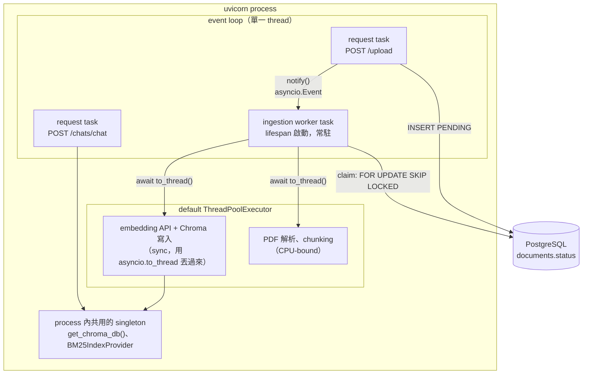
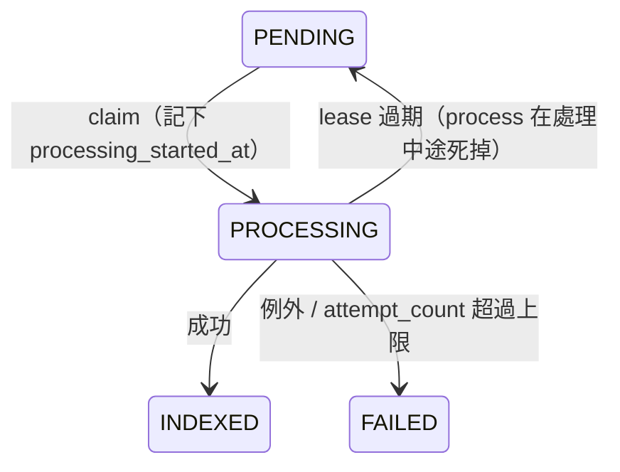

# Worker 和 API 跑在同一個 process

> 查證日期：2026-10-14。Windows 11、Python 3.12.13、FastAPI 0.140.0、Starlette 1.3.1、uvicorn 0.51.0。
> 背景：document ingestion 背景化的計畫（`docs/plans/in-progress/background-ingestion-20261014.md`）建議「Postgres 當 queue，worker 在 API process 的 lifespan 裡跑」。這篇說明這件事怎麼做到、為什麼可行，以及限制在哪。

## 結論

`uvicorn app.main:app` 只會啟動**一個 Python process**，裡面跑**一個 asyncio event loop**。每個 HTTP request 都是這個 loop 上的一個 coroutine。Worker 也只是另一個 coroutine：在 FastAPI 的 `lifespan` 裡用 `asyncio.create_task()` 掛上去，從 app 啟動跑到 app 關閉。

兩者能同時運作，靠的是 **cooperative multitasking**：worker 每遇到一個 `await`（等 DB、等 LLM、等 thread 做完），就把 loop 讓給 request。前提是 worker **不能在 loop 上做 blocking 或 CPU-bound 的工作**。

---

## 結構



### 時序：upload 之後 worker 怎麼接手

```mermaid
sequenceDiagram
    participant C as Client
    participant Loop as event loop
    participant API as upload coroutine
    participant W as worker coroutine
    participant TP as thread pool

    Note over W: 在 await wake.wait() 睡著，不佔 loop
    C->>API: POST /upload
    API->>API: await db.commit()（INSERT PENDING）
    API->>W: worker.notify()（Event.set）
    API-->>C: 202 PENDING
    Loop->>W: 下一輪排程把 worker 叫醒
    W->>W: await claim()（等 DB 時讓出 loop）
    W->>TP: await to_thread(add_documents)
    Note over Loop: worker 在等 thread，loop 可以處理其他 request
    TP-->>W: 完成
    W->>W: await db.commit()（INDEXED）
```

---

## 實作長相

接在現有的 `lifespan`（`app/main.py`）裡：

```python
@asynccontextmanager
async def lifespan(app: FastAPI):
    async with checkpointer_lifespan():
        worker = IngestionWorker()                 # 持有 asyncio.Event、Semaphore
        task = asyncio.create_task(worker.run())   # 掛到同一個 event loop
        app.state.ingestion_worker = worker        # upload endpoint 用來叫醒它
        try:
            yield                                  # app 開始接 request
        finally:
            worker.stop()
            task.cancel()                          # 關機時停掉 worker
            with suppress(asyncio.CancelledError):
                await task
```

```python
class IngestionWorker:
    async def run(self):
        while not self._stopping:
            await self._requeue_expired_leases()   # PROCESSING 超時 → 變回 PENDING
            while (doc_id := await self._claim_one()) is not None:   # FOR UPDATE SKIP LOCKED
                async with self._sem:              # 限制同時處理的文件數
                    await process_document(doc_id, deps=self._deps)
            try:                                   # 沒有工作：等通知，或 polling 逾時
                await asyncio.wait_for(self._wake.wait(), timeout=5)
            except asyncio.TimeoutError:
                pass
            self._wake.clear()

    def notify(self):                              # upload endpoint commit 之後呼叫
        self._wake.set()
```

Upload endpoint 在 `INSERT ... PENDING` commit 之後呼叫 `request.app.state.ingestion_worker.notify()`，worker 馬上醒來，不用等 polling。Polling 只是保底，用來撈「其他 process 寫入的工作」和「lease 過期的工作」。

> 上面兩段是設計草稿，還沒有實作進 `app/`。下一節的 demo 是實際執行過的最小版本。

---

## 實測

Demo 分兩部分：

1. 用 `TestClient` 跑一個帶 lifespan worker 的 FastAPI app，確認 worker 和 request 在同一個 process、thread、event loop，並量 `notify()` 叫醒 worker 的延遲。
2. 讓 request 每次等 50 ms 的 I/O，同時 worker 用五種方式做約 1 秒的工作，量 request 被拖慢多少（「extra latency」= 實際等待時間 − 50 ms）。

<details>
<summary>完整 demo（<code>demo.py</code>）</summary>

```python
"""Demo: an ingestion worker task and API requests on the same process / event loop."""
import asyncio
import os
import threading
import time
from contextlib import asynccontextmanager, suppress

from fastapi import FastAPI, Request
from fastapi.testclient import TestClient

seen = {}


class Worker:
    def __init__(self):
        self._wake = asyncio.Event()
        self.processed = []

    def notify(self):
        self._wake.set()

    async def run(self):
        seen["worker"] = (os.getpid(), threading.get_ident(), id(asyncio.get_running_loop()))
        while True:
            with suppress(asyncio.TimeoutError):
                await asyncio.wait_for(self._wake.wait(), timeout=5)
            self._wake.clear()
            self.processed.append(time.perf_counter())


@asynccontextmanager
async def lifespan(app: FastAPI):
    worker = Worker()
    task = asyncio.create_task(worker.run())
    app.state.worker = worker
    try:
        yield
    finally:
        task.cancel()
        with suppress(asyncio.CancelledError):
            await task


app = FastAPI(lifespan=lifespan)


@app.post("/upload")
async def upload(request: Request):
    seen["request"] = (os.getpid(), threading.get_ident(), id(asyncio.get_running_loop()))
    request.app.state.worker.notify()
    return {"status": "PENDING"}


def part1():
    with TestClient(app) as client:
        t0 = time.perf_counter()
        client.post("/upload")
        time.sleep(0.05)
        worker = app.state.worker
        lag_ms = (worker.processed[0] - t0) * 1000
    print("worker  (pid, thread, loop):", seen["worker"])
    print("request (pid, thread, loop):", seen["request"])
    print("same process / thread / loop:", seen["worker"] == seen["request"])
    print(f"notify -> worker woke up after {lag_ms:.1f} ms (polling timeout is 5000 ms)")


async def measure(job_name, job):
    """Run a 'worker job' (~1 s of work) while a 'request' waits on 50 ms of I/O, 15 times."""
    latencies = []

    async def requests():
        for _ in range(15):
            t = time.perf_counter()
            await asyncio.sleep(0.05)  # request waiting on its own I/O
            latencies.append((time.perf_counter() - t) * 1000 - 50)

    req_task = asyncio.create_task(requests())
    await asyncio.sleep(0.01)  # let the request loop start before the worker job
    await job()
    await req_task
    latencies.sort()
    print(f"{job_name:<36} extra request latency  median {latencies[len(latencies) // 2]:6.1f} ms  max {latencies[-1]:6.1f} ms")


async def io_job():
    for _ in range(10):
        await asyncio.sleep(0.1)  # e.g. await db / await llm.ainvoke


async def blocking_job():
    for _ in range(10):
        time.sleep(0.1)  # e.g. sync add_documents called directly on the loop
        await asyncio.sleep(0)  # yields between steps, but each step still blocks 100 ms


async def to_thread_job():
    for _ in range(10):
        await asyncio.to_thread(time.sleep, 0.1)  # sync I/O pushed to the thread pool


def cpu(n):
    x = 0
    for i in range(n):
        x += i * i
    return x


async def cpu_on_loop_job():
    cpu(30_000_000)  # CPU-bound work (e.g. PDF parsing) directly on the loop


async def cpu_to_thread_job():
    await asyncio.to_thread(cpu, 30_000_000)  # same work in a thread; still holds the GIL


async def part2():
    await measure("worker awaits I/O", io_job)
    await measure("worker blocks loop (time.sleep)", blocking_job)
    await measure("worker sync I/O in to_thread", to_thread_job)
    await measure("worker CPU-bound on loop", cpu_on_loop_job)
    await measure("worker CPU-bound in to_thread", cpu_to_thread_job)


if __name__ == "__main__":
    part1()
    print()
    asyncio.run(part2())
```

</details>

執行：`uv run python -I -W ignore demo.py`（`-W ignore` 只是隱藏 Starlette 對 `httpx` 的 deprecation warning）。

### 輸出（兩次執行）

```
worker  (pid, thread, loop): (30352, 9444, 2656963581024)
request (pid, thread, loop): (30352, 9444, 2656963581024)
same process / thread / loop: True
notify -> worker woke up after 1.2 ms (polling timeout is 5000 ms)

worker awaits I/O                    extra request latency  median   12.7 ms  max   13.9 ms
worker blocks loop (time.sleep)      extra request latency  median   13.7 ms  max  251.9 ms
worker sync I/O in to_thread         extra request latency  median    9.2 ms  max   14.7 ms
worker CPU-bound on loop             extra request latency  median   13.5 ms  max 3182.8 ms
worker CPU-bound in to_thread        extra request latency  median   29.5 ms  max   30.5 ms
```

```
worker  (pid, thread, loop): (33280, 29988, 2609036374864)
request (pid, thread, loop): (33280, 29988, 2609036374864)
same process / thread / loop: True
notify -> worker woke up after 1.1 ms (polling timeout is 5000 ms)

worker awaits I/O                    extra request latency  median   12.8 ms  max   14.2 ms
worker blocks loop (time.sleep)      extra request latency  median   13.5 ms  max  251.9 ms
worker sync I/O in to_thread         extra request latency  median    3.7 ms  max   17.6 ms
worker CPU-bound on loop             extra request latency  median   13.5 ms  max 3036.2 ms
worker CPU-bound in to_thread        extra request latency  median   29.4 ms  max   45.2 ms
```

### 怎麼讀

- **同一個 process / thread / loop：`True`**。Lifespan 裡 `create_task` 出來的 worker，和 request handler 用的是同一個 event loop。
- **`notify()` 約 1 ms 就叫醒 worker**，不用等 5 秒的 polling。
- **基準約 13 ms**：即使 worker 完全沒做事（`awaits I/O`），`asyncio.sleep(0.05)` 也會多等約 13 ms。推論是 Windows 預設 timer 解析度約 15.6 ms 造成的，和 worker 無關（未另外驗證）。後面幾列要和這個基準比。
- **在 loop 上 blocking（`time.sleep`）**：中位數正常，但最差的 request 多等了約 250 ms，因為 blocking 期間 loop 完全停住。
- **在 loop 上做 CPU-bound 工作**：最差的 request 多等了約 **3 秒**，等於整個 API 在這段時間完全沒有回應。這就是「PDF 解析不能直接在 loop 上跑」的原因。
- **sync I/O 丟進 `to_thread`**：和基準一樣，對 request 沒有可見影響。Embedding API 呼叫和 Chroma 寫入屬於這一類（主要在等網路／磁碟）。
- **CPU-bound 丟進 `to_thread`**：不會卡死，但每次 request 都多等約 16 ms（29.5 − 13）。原因是 GIL：thread 在跑純 Python 計算時握著 GIL，loop thread 每次要回來都得等 GIL 釋放（CPython 預設每 5 ms 切換一次）。

---

## 逐步追蹤：一個 worker + 三個 request 的執行順序

上面的數字只說明「會不會被拖慢」。這一節用一個比較複雜的情境，把 event loop **每一步在跑誰**印出來。

### 情境

一開始 `doc-A` 已經是 `PENDING`。Worker 處理一份文件的步驟和假設的耗時（ms）：

| 步驟 | 寫法 | 耗時 |
|---|---|---|
| claim | `await` DB | 50 |
| download | `await to_thread` | 100 |
| parse PDF | `await to_thread`（情境 2 改成直接在 loop 上跑） | 150 |
| summary | `await llm.ainvoke` | 300 |
| embed + Chroma | `await to_thread` | 200 |
| commit `INDEXED` | `await` DB | 50 |

Worker 處理期間，依序進來三個 request：

- **t=80 `chat`**：`await` retrieval 100 → `await` LLM 200 → 回應。
- **t=170 `health`**：沒有任何 `await`，直接回應。
- **t=250 `upload`**：`await` INSERT `doc-B` 30 → `notify()` worker → 回應 202。

耗時都用 `sleep` 模擬，這樣順序比較好看懂：`asyncio.sleep` 代表 async I/O，`asyncio.to_thread(time.sleep, …)` 代表丟進 thread pool 的 sync I/O，`time.sleep` 直接呼叫代表在 loop 上 blocking。

<details>
<summary>完整 demo（<code>timeline.py</code>）</summary>

```python
"""Demo: how the event loop interleaves an ingestion worker with several API requests.

Durations are fake (sleep) so the order is easy to follow:
  asyncio.sleep(x)              -> async I/O (DB, LLM ainvoke)
  asyncio.to_thread(sleep, x)   -> sync I/O pushed to the thread pool (embedding, Chroma, read file)
  time.sleep(x) on the loop     -> the mistake: blocking work directly on the loop
"""
import asyncio
import time

T0 = 0.0
seq = 0


def log(task, msg):
    global seq
    seq += 1
    print(f"{seq:>2}  {(time.perf_counter() - T0) * 1000:5.0f} ms  [{task:<9}] {msg}")


class FakeDB:
    def __init__(self):
        self.pending = ["doc-A"]  # doc-A was uploaded just before t=0


async def worker(db, wake, parse_on_loop):
    while True:
        while db.pending:
            doc = db.pending.pop(0)
            log("worker", f"claim {doc} -> await db (50)")
            await asyncio.sleep(0.05)
            log("worker", f"{doc}: download -> await to_thread (100)")
            await asyncio.to_thread(time.sleep, 0.10)
            if parse_on_loop:
                log("worker", f"{doc}: parse PDF ON THE LOOP (150) - nobody else can run")
                time.sleep(0.15)
            else:
                log("worker", f"{doc}: parse PDF -> await to_thread (150)")
                await asyncio.to_thread(time.sleep, 0.15)
            log("worker", f"{doc}: summary -> await llm.ainvoke (300)")
            await asyncio.sleep(0.30)
            log("worker", f"{doc}: embed + Chroma -> await to_thread (200)")
            await asyncio.to_thread(time.sleep, 0.20)
            log("worker", f"{doc}: commit INDEXED -> await db (50)")
            await asyncio.sleep(0.05)
            log("worker", f"{doc}: done")
        log("worker", "no PENDING -> await wake.wait()")
        await wake.wait()
        wake.clear()
        log("worker", "woken up")


async def chat_request(arrive):
    await asyncio.sleep(arrive)
    log("chat", "arrives -> await retrieval (100)")
    await asyncio.sleep(0.10)
    log("chat", "-> await llm.ainvoke (200)")
    await asyncio.sleep(0.20)
    log("chat", "respond 200")


async def upload_request(arrive, db, wake, doc):
    await asyncio.sleep(arrive)
    log("upload", f"arrives -> await INSERT {doc} PENDING (30)")
    await asyncio.sleep(0.03)
    db.pending.append(doc)
    wake.set()
    log("upload", f"notify() worker, respond 202 ({doc})")


async def health_request(arrive):
    await asyncio.sleep(arrive)
    log("health", "arrives -> respond 200 (no await)")


async def run_until_idle(parse_on_loop):
    global T0, seq
    seq = 0
    db, wake = FakeDB(), asyncio.Event()
    T0 = time.perf_counter()
    w = asyncio.create_task(worker(db, wake, parse_on_loop))
    await asyncio.gather(
        chat_request(0.08),
        health_request(0.17),
        upload_request(0.25, db, wake, "doc-B"),
    )
    await asyncio.sleep(2.2)  # long enough for doc-B to finish
    w.cancel()


if __name__ == "__main__":
    print("=== Scenario 1: everything awaited / to_thread ===")
    asyncio.run(run_until_idle(parse_on_loop=False))
    print()
    print("=== Scenario 2: PDF parsing done on the loop ===")
    asyncio.run(run_until_idle(parse_on_loop=True))
```

</details>

執行：`uv run python -I timeline.py`。跑了兩次，事件的**順序完全相同**，時間只差幾 ms 到十幾 ms（Windows timer 的誤差）。下面貼的是第一次的輸出。

### 情境 1：所有等待都有 `await` 或 `to_thread`

```
 1      0 ms  [worker   ] claim doc-A -> await db (50)
 2     61 ms  [worker   ] doc-A: download -> await to_thread (100)
 3     93 ms  [chat     ] arrives -> await retrieval (100)
 4    167 ms  [worker   ] doc-A: parse PDF -> await to_thread (150)
 5    167 ms  [health   ] arrives -> respond 200 (no await)
 6    214 ms  [chat     ] -> await llm.ainvoke (200)
 7    264 ms  [upload   ] arrives -> await INSERT doc-B PENDING (30)
 8    297 ms  [upload   ] notify() worker, respond 202 (doc-B)
 9    318 ms  [worker   ] doc-A: summary -> await llm.ainvoke (300)
10    411 ms  [chat     ] respond 200
11    629 ms  [worker   ] doc-A: embed + Chroma -> await to_thread (200)
12    830 ms  [worker   ] doc-A: commit INDEXED -> await db (50)
13    881 ms  [worker   ] doc-A: done
14    881 ms  [worker   ] claim doc-B -> await db (50)
15    931 ms  [worker   ] doc-B: download -> await to_thread (100)
16   1032 ms  [worker   ] doc-B: parse PDF -> await to_thread (150)
17   1182 ms  [worker   ] doc-B: summary -> await llm.ainvoke (300)
18   1497 ms  [worker   ] doc-B: embed + Chroma -> await to_thread (200)
19   1698 ms  [worker   ] doc-B: commit INDEXED -> await db (50)
20   1757 ms  [worker   ] doc-B: done
21   1757 ms  [worker   ] no PENDING -> await wake.wait()
22   1757 ms  [worker   ] woken up
23   1757 ms  [worker   ] no PENDING -> await wake.wait()
```

同一段畫成時序圖（前 400 ms，`doc-A` 的部分）。`Loop` 是唯一的那個 thread，**同一時間只會有一個 task 在上面跑**；其他 task 都停在某個 `await`，等它等的東西完成：

```mermaid
sequenceDiagram
    participant Loop as event loop
    participant W as worker
    participant C as chat
    participant H as health
    participant U as upload
    participant TP as thread pool

    Note over Loop: t=0
    Loop->>W: claim doc-A
    W-->>Loop: await db（讓出）
    Note over Loop: t=61 DB 回來
    Loop->>W: download
    W->>TP: to_thread(download)
    W-->>Loop: await（讓出）
    Note over Loop: t=93 chat 到了
    Loop->>C: retrieval
    C-->>Loop: await（讓出）
    Note over Loop: t=167 download 完成，health 也到了
    Loop->>W: parse PDF
    W->>TP: to_thread(parse)
    W-->>Loop: await（讓出）
    Loop->>H: 直接回 200
    Note over Loop: t=214 retrieval 回來
    Loop->>C: 呼叫 LLM
    C-->>Loop: await（讓出）
    Note over Loop: t=264 upload 到了
    Loop->>U: INSERT doc-B
    U-->>Loop: await（讓出）
    Note over Loop: t=297 INSERT 完成
    Loop->>U: notify() worker，回 202
    Note over Loop: t=318 parse 完成
    Loop->>W: summary
    W-->>Loop: await llm（讓出）
    Note over Loop: t=411 chat 的 LLM 回來
    Loop->>C: 回 200
```

---
## 為什麼要放在同一個 process

這個 repo 有兩個 process 內的 singleton，worker 和 API 必須共用：

| 元件 | 同一個 process | 拆成獨立 process |
|---|---|---|
| BM25 cache（`app/rag/retriever/bm25_index.py`） | Worker 寫入時 `notify_kb_changed()` 直接通知 API 的 cache，立即失效 | 通知傳不到 API process，只能等 600 秒 TTL |
| Chroma（`get_chroma_db()`，`PersistentClient`） | API 和 worker 共用同一個 client 物件 | 兩個 process 同時開同一個 `chroma_data/` SQLite 目錄，chromadb 官方不支援這種用法（未實測） |
| Windows + psycopg async | Uvicorn 已處理 event loop | 獨立 process 要自己指定 `SelectorEventLoop`，否則報 `Psycopg cannot use the 'ProactorEventLoop'`（實測） |

---

## 限制與注意事項

### 1. Worker 不能在 loop 上做 blocking／CPU-bound 的事

| Worker 裡的工作 | 性質 | 做法 |
|---|---|---|
| DB 查詢、`commit` | async I/O | 直接 `await` |
| LLM summary | async I/O | `await llm.ainvoke()` |
| `StoreIndexer.add_documents`（embedding API + Chroma） | sync I/O | `await asyncio.to_thread(...)` |
| `download_file()`（本機讀檔） | sync I/O | `await asyncio.to_thread(...)` |
| PDF 解析（PyMuPDF）、chunking、`count_tokens` | CPU-bound | `await asyncio.to_thread(...)`，但仍會搶 GIL |

### 2. GIL

CPU-bound 的工作放進 thread 只能避免「卡死」，不能避免「變慢」（實測每個 request 多約 16 ms）。如果之後 ingestion 量大到 API 明顯變慢，就是拆成獨立 process 的時機。用 `ProcessPoolExecutor` 只拆出 PDF 解析也是一個選項（未評估）。

### 3. 重啟會中斷處理中的文件

`uvicorn --reload` 或部署重啟時，lifespan 的 `finally` 會 `cancel()` worker。被中斷的文件會停在 `PROCESSING`，這也是設計 lease 的原因：



### 4. 多個 uvicorn worker（`--workers N`）

`--workers 4` 是 4 個 process，每個 process 都有自己的 event loop 和 worker task：

- **不會重複處理**：claim 用 `FOR UPDATE SKIP LOCKED`，同一份文件只會被一個 process 撈到。
- **`notify()` 只叫得醒同一個 process 的 worker**。Upload 落在 process A，工作可能被 process B 的 worker 撈走（靠 polling），延遲最多 5 秒，但功能正常。
- **BM25 cache 在其他 process 仍然只能等 TTL**。這個限制在目前同步上傳時就已經存在，不是改成背景處理才產生的。

### 5. 之後要拆出去

`process_document()` 不需要改，只要把外層的 worker loop 改成用獨立的 entrypoint 啟動（例如 `python -m app.workers.ingestion`）。拆之前要先解決：

1. Chroma 改成 client/server 模式（`chromadb.HttpClient`）。
2. BM25 失效改成跨 process 的通知機制（例如 Postgres `LISTEN/NOTIFY`），或接受 TTL 延遲。
3. Windows 開發時指定 `SelectorEventLoop`。
