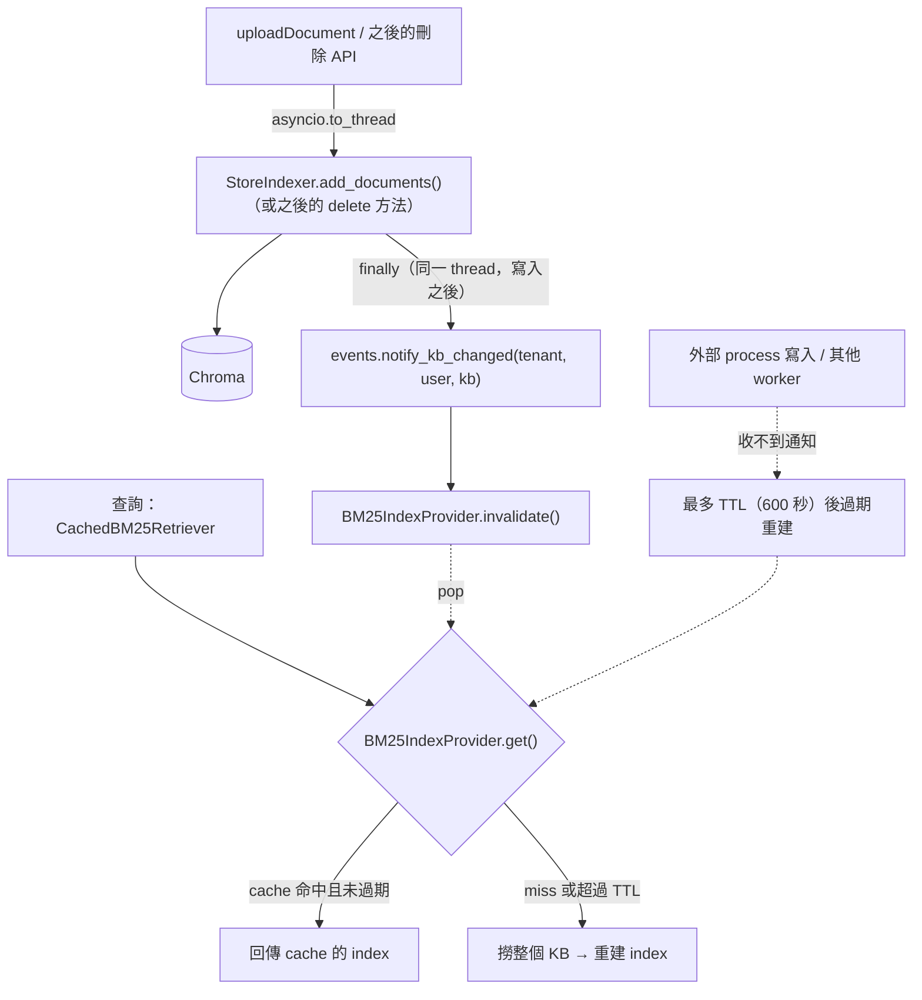
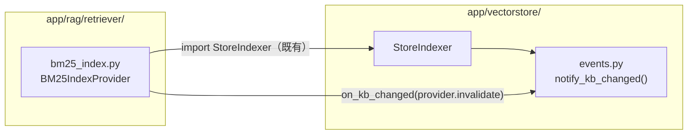

# BM25 cache 不再回舊資料：寫入自動失效 + TTL 保底

| | |
|---|---|
| Author | `Jason` |
| Created | 2026-10-09 |
| Branches | `master` |
| Base commit | `6f16238` |
| Sessions | `7db1d643-23f4-47f6-8786-3465b0e6cdb8` |

> 背景分析見 [`vectorstore-retriever-structure-20261009.md`](../../docs/vectorstore/vectorstore-retriever-structure-20261009.md) 的 `bm25_index.py` 段落與已知缺陷 3、4。
>
> **狀態：✅ 已完成（2026-10-09，未 commit）。** 測試 37 passed（原 30 + 新增 7 + 改寫）。
>
> 與計劃的差異：
> - 原 `tests/api/test_upload_indexing.py` 測的 helper 已刪除，整個檔案移除；它的情境（不卡 event loop、取消時仍在寫入後才失效）移到 `tests/vectorstore/test_store_indexer_events.py`，改用真的 `StoreIndexer` + 假 collection。
> - `built_at` 在**載入之前**取：index 只會被當成比實際舊，不會被當成比實際新。
>
> 實作時另外發現（與本計劃無關，未修）：`tests/scripts/test_migrate_collection_names.py` 偶發失敗（約 3%），
> 錯誤是 chromadb 1.5.8 in-memory `get()` 回 `InternalError: Error finding id`。改用 id 分頁、改成共用單一 `EphemeralClient` 都沒消除，root cause 未查明。

## Context

`app/rag/retriever/bm25_index.py` 的 `BM25IndexProvider` 依 `(tenant_id, user_id, knowledge_base_id)` cache 整個 KB 的 BM25 index，靠寫入端**手動**呼叫 `invalidate()` 失效。

正常的 upload 路徑沒有問題：`knowledgeBases.py` 的 `_write_chunks_and_invalidate_bm25()` 在同一個 worker thread 寫完才失效，`get()` 的 generation counter 也擋住了「建置期間發生寫入」的 race condition。但以下情況會長期回舊資料：

| 情況 | 舊資料會持續多久 | 影響 |
|---|---|---|
| 寫入沒經過 `invalidate()`（之後的刪除 API、管理工具；`scripts/migrate_collection_names.py` 直接寫 chromadb） | 直到 LRU 淘汰或重啟 | 新增：BM25 找不到新文件（dense 仍找得到，recall 下降） |
| 多 worker：`invalidate()` 只打得到處理 upload 的 worker | 同上 | 同上 |
| 刪除走了上面兩種路徑 | 同上 | **BM25 繼續回傳已刪除的內容**（錯誤結果） |

> 不會跨租戶：cache key 就是 tenant scope，舊 index 裡也只有同一個 scope 的文件。

**目標**

- **A**：所有經過 `StoreIndexer` 的寫入**自動**讓 BM25 cache 失效，寫入端不必記得手動呼叫。
- **B**：其餘漏網情況（外部 process、多 worker）靠 TTL **最終**恢復。

跨 process 立即一致（每次查詢比對 KB 版本）不在這次範圍，等 [`vectorstore-structure-fixes`](../deferred/vectorstore-structure-fixes-20261009.md) 的 Phase 6（多 worker）時再做。

## 目標流程

---

## A：`StoreIndexer` 寫入自動通知

`app/vectorstore/` 不能 import `app/rag/retriever/bm25_index.py`——後者已經 import `StoreIndexer`，會循環 import。所以用一個很小的通知點反轉依賴：vector store 層只負責「通知 KB 變了」，誰要聽由 retriever 層自己註冊。

1. **新增 `app/vectorstore/events.py`**
   - `on_kb_changed(listener)`：註冊 `Callable[[tenant_id, user_id, kb_id], None]`。內部存 `weakref.WeakMethod`（bound method），避免測試 `cache_clear()` 之後舊 provider 一直被引用而洩漏。
   - `notify_kb_changed(tenant_id, user_id, kb_id)`：依序呼叫所有還存活的 listener；單一 listener 丟例外要 log 後繼續，不能讓寫入失敗。
2. **`app/vectorstore/StoreIndexer.py` 的 `add_documents()`**
   - 寫入包 `try/finally`，`finally` 裡對本次寫入涉及的每個 `knowledge_base_id`（從合併後的 metadata 取、去重）呼叫 `notify_kb_changed(...)`。
   - 在同一個 thread、寫入之後執行，保留 Phase 2 的順序保證；寫入失敗也通知（Chroma 可能已有部分寫入）。
   - 之後新增的刪除方法照同一模式寫在 `StoreIndexer` 裡，就自動有失效。
3. **`app/rag/retriever/bm25_index.py` 的 `get_bm25_index_provider()`**：建立 provider 後呼叫 `on_kb_changed(provider.invalidate)`。provider 建立之前沒有 cache，不需要通知。
4. **`app/api/v1/endpoints/knowledgeBases.py`**：刪除 `_write_chunks_and_invalidate_bm25()` 與 `get_bm25_index_provider` 的 import，改成
   `await asyncio.to_thread(store.add_documents, chunking_list, tenant_id=..., user_id=..., metadata=metadata)`。失效改由 `StoreIndexer` 負責。

## B：TTL 保底

`BM25IndexProvider`：

- `__init__` 新增 `ttl_seconds: float | None = DEFAULT_TTL_SECONDS`（`600`），以及可注入的 `clock: Callable[[], float] = time.monotonic`（測試用）。
- `_indexes` 的值改成 `(index, built_at)`；`get()` 命中時若 `clock() - built_at > ttl_seconds`，視為 miss（pop 後照原流程重建）。`ttl_seconds=None` 表示不過期。
- generation counter、lock 外建置、LRU 上限的邏輯都不變。
- 更新模組 docstring 的「已知限制」：
  - 多 worker / 外部 process 的寫入，最多延遲 TTL 才反映。
  - 寫入路徑不必再手動 `invalidate()`，但**必須經過 `StoreIndexer`**。

TTL 的取捨：600 秒是推論值，未量測。越短越快恢復，但大 KB 重建（整個 KB 撈回記憶體 + tokenize）的次數越多。

---

## 測試

- **`StoreIndexer` 通知**（`tests/vectorstore/test_store_indexer_events.py`，新）：
  - `add_documents()` 寫完才通知，每個 kb 通知一次；寫入丟例外時仍通知。
  - listener 丟例外不影響寫入；被 GC 的 listener 不再被呼叫。
- **TTL**（`tests/rag/test_bm25_index.py`）：注入假 clock，TTL 內命中、過期後重建；`ttl_seconds=None` 不過期；`notify_kb_changed()` 會讓已註冊的 provider 失效。
- **upload**（原 `tests/api/test_upload_indexing.py`，已移除並併入 `test_store_indexer_events.py`）：helper 刪除後改寫。保留「寫入不在 event loop thread」與「request 取消時，失效仍在寫入完成之後」兩個情境，改用真的 `StoreIndexer` + 假 `collection_manager` + 註冊的假 listener。
- 全部：`.venv/Scripts/python.exe -m pytest -q`，預期原本 30 個 + 新增全部通過。

## 文件

- `docs/vectorstore/vectorstore-retriever-structure-20261009.md`：`bm25_index.py` 段落、ingestion 時序圖、已知缺陷 3、4 改寫。
- 本計劃：每完成一部分（A、B、測試、文件）就在該段加「狀態」行；全部完成後用 `git mv` 移到 `../finished/`。

## 異動檔案

| 檔案 | 部分 |
|---|---|
| `app/vectorstore/events.py`（新） | A |
| `app/vectorstore/StoreIndexer.py` | A |
| `app/rag/retriever/bm25_index.py` | A、B |
| `app/api/v1/endpoints/knowledgeBases.py` | A |
| `tests/vectorstore/test_store_indexer_events.py`（新） | 測試 |
| `tests/rag/test_bm25_index.py` | 測試 |
| `tests/api/test_upload_indexing.py`（刪除） | 測試 |
| `docs/vectorstore/vectorstore-retriever-structure-20261009.md` | 文件 |
