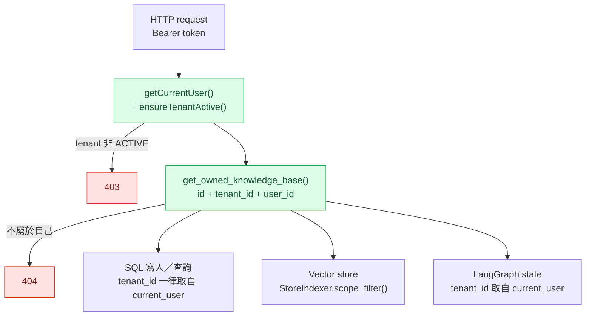
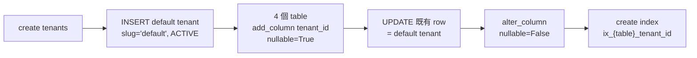
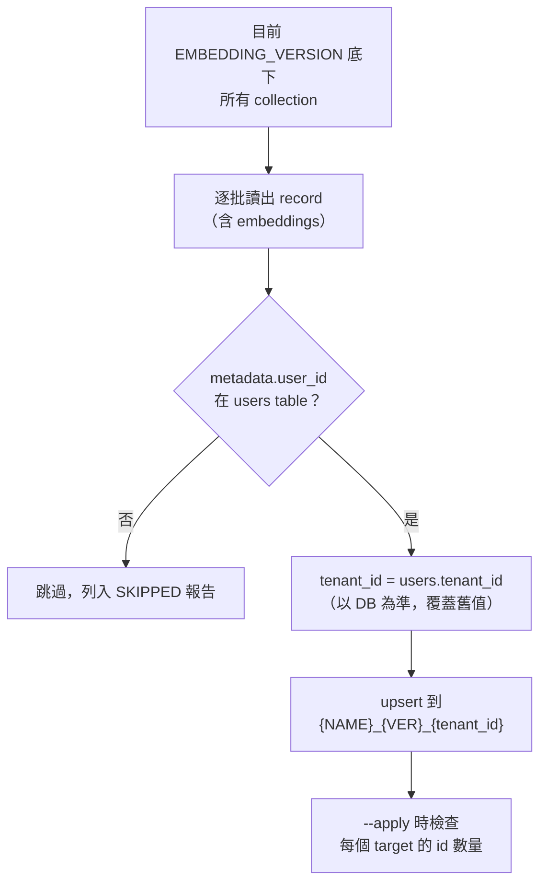
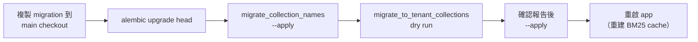

# 修正 `tenant_id` 漏填與 tenant scoping

> 建立日期：2026-10-14。Branch：`worktree-tenant-id-fixes`（base：master `42420cf`）。
> 查證日期：2026-10-14。Python 3.12.13、chromadb 1.5.9、SQLAlchemy 2.0.51、FastAPI 0.140.0、pytest 9.1.1。

## Context

`PARTITION_METHOD` 預設改成 3（每個 tenant 一個 collection）之後，vector store 這條路徑已經把 `tenant_id` 帶齊（`StoreIndexer.scope_filter()`、`Collection_manager`、BM25 cache key、retriever），但 DB 寫入、users endpoints、migration 和既有資料都還沒跟上。全面掃過 `app/`、`migrations/`、`scripts/` 後，依嚴重度分成四級：

| 級別 | 問題類型 | 結果 |
|---|---|---|
| 🔴 Critical | `tenant_id` 是 `nullable=False`，漏填會違反 NOT NULL，功能直接壞掉 | 寫入失敗 |
| 🟠 High | 查詢沒有用 tenant／ownership 過濾 | 可以跨 tenant 讀取或修改 |
| 🟡 Medium | 既有資料沒有遷移、auth 沒考慮 tenant | 舊資料查不到、帳號有歧義 |
| 🟢 Low | 命名與一致性 | 不影響安全 |

## 修正後的 tenant 邊界

原則：`tenant_id` 和 `user_id` 只能來自 `current_user`。Client 傳進來的 `knowledge_base_id` 一定要先經過 `get_owned_knowledge_base()` 驗證過，才能拿去用。

---

## 🔴 Critical：漏填 `tenant_id`

> **狀態：✅ 程式碼已完成（commit `341b4ba`）。🟡 Migration 已寫好，但還沒放進 main checkout。**

| # | 位置 | 修正 |
|---|---|---|
| C1 | `users.py` `register` | `UserCreate` 新增 `tenant_slug`，查 `tenants` table（必須是 ACTIVE 且未刪除），查不到就回 400 |
| C2 | `knowledgeBases.py` `createKnowledgeBase` | 補上 `tenant_id=current_user.tenant_id` |
| C3 | `chats.py` 兩筆 `AsistantMessage` | 補上 `tenant_id`。原本這段在 SSE stream 裡，會在 answer 已經送出後才失敗 |
| C4 | `knowledgeBases.py` `uploadDocument` 的 `Document` | 補上 `tenant_id` |
| C5 | Init migration 沒有 `tenants` table，也沒有 `tenant_id` column | 新增 migration `b6019841bba0_add_tenants.py` |

**Tenant slug** 是 `Tenant` model 原本就有的欄位，例如 `taiwan-mobile`，是比 UUID 好記、比 `name` 穩定的識別字串。Register 用它找出要加入的 tenant。

### C5 migration 的做法

`migrations/` 被 `.gitignore`，所以這支 migration **沒有進 git**，檔案目前在 worktree 的 `migrations/versions/b6019841bba0_add_tenants.py`。

4 個 table 是 `users`、`AsistantKnowledgeBases`、`AsistantMessages`、`documents`。先加 nullable column 再 backfill，最後才改成 NOT NULL，所以已經有資料的 DB 也能直接跑。

> ✅ 2026-10-14 已在 dev DB 執行，並在最後加上 `(tenant_id, username)` unique constraint。其他環境如果曾經手動加過 `tenant_id`，`add_column` 會失敗；某個 tenant 內有重複的 username 時，unique constraint 也會失敗。

---

## 🟠 High：缺少 tenant scoping

> **狀態：✅ 已完成（commit `341b4ba`）。Metadata branch 本身跑不起來的問題（table／column 名稱錯誤、raw SQL 用法）不在這個 plan 的範圍，會在另一個 branch 處理。**

| # | 問題 | 修正 |
|---|---|---|
| H1 | `GET /users` 撈出所有 tenant 的 user；`GET /user/{id}` 沒有 scope，而且參數 type 寫成 `int` | 兩者都加 `User.tenant_id == currUser.tenant_id`；參數改成 `UUID` |
| H2 | `/update`、`/email`、`/password` 用 body 裡的 `user.id` 找人，任何人都能改別人的帳號 | 新增 `ensure_self()`，不是本人就回 403 |
| H3 | Metadata branch 的 whitelisted SQL 只過濾 `knowledge_base_id` | 4 條 SQL 都加上 `tenant_id`、`user_id` 條件，參數一律從 state 覆蓋，不用 extractor 給的值 |
| H4 | 沒有任何地方驗證 `knowledge_base_id` 屬於 `current_user` | 新增 `app/services/knowledgeBaseService.py` 的 `get_owned_knowledge_base()`，接到 `/upload`、`/query`、`/chat` |

### 為什麼 H4 要另外開一個檔案

`/upload`、`/query` 在 `knowledgeBases.py`，`/chat` 在 `chats.py`。如果把檢查寫在其中一個 endpoint 檔，另一個 router 就得反過來 import 它。如果每個 endpoint 各寫一份，以後改其中一份時另外兩份會不一致。這和 `StoreIndexer.scope_filter()` 是同一個設計：tenant 邊界只在一個地方定義。

`/upload` 的檢查刻意放在 `try` **外面**，因為那個 `try` 的 `except Exception` 會把 404 變成 500。KB 不屬於自己時回 404 而不是 403，這樣不會透露那個 id 是否存在。

---

## 🟡 Medium：資料遷移與 auth

> **狀態：✅ 已完成（commit `3076535`）。**

### M1 + M2：Chroma 舊資料

兩個問題同時存在：

1. 舊的 chunk 沒有 `tenant_id` metadata，現在 `scope_filter()` 要求這個欄位，所以這些 chunk 會查不到。
2. 資料還留在 per-user（`{NAME}_{VER}_{user_id}`）或全域（`{NAME}_{VER}`）collection，但 app 現在只讀 `{NAME}_{VER}_{tenant_id}`。

新增 `scripts/migrate_to_tenant_collections.py`，一次處理這兩個問題：

- 預設是 dry run，加 `--apply` 才會寫入。
- 已經在正確 collection 的 record 會原地更新 metadata，所以可以重跑。
- 不重新 embed；來源 collection 保留，確認沒問題後再手動刪除。

### M3：Login 用 username 有歧義

`username` 不是 unique，不同 tenant 可以同名，原本的 `.first()` 會隨便挑一個。

- `UserLogin` 新增 optional 的 `tenant_slug`。用 username 登入時必須帶，否則回 400；用 email 登入不受影響，因為 email 全域 unique。
- `register` 和 `/update` 會擋掉「同一個 tenant 內重複的 username」。

### M4：檢查 tenant 狀態

`jwtService.py` 新增 `ensureTenantActive()`，tenant 不是 ACTIVE 或已刪除就回 403：

- **每個 request** 的 `getCurrentUser()` 都會檢查，所以停用 tenant 之前發出去的 token 也會立刻失效。
- Login 也會檢查。這個檢查放在密碼驗證**之後**，密碼錯的人看不到 tenant 的狀態。

---

## 驗證結果

| 項目 | 結果 |
|---|---|
| 改過的 modules `py_compile` 與 import | ✅ |
| `tests/scripts`（含新增 8 個 `test_migrate_to_tenant_collections.py`） | ✅ 13 passed |
| `tests/auth/test_tenant_scoping.py`（新增 17 個） | ✅ 17 passed |
| 全部 tests | ✅ 62 passed |
| Dev DB 套用 migration（`061f06c4ef78` → `31f17fb47de8`） | ✅ |
| `alembic check`：tenant 與 `summary` 相關的 schema 和 model 一致 | ✅ |

一開始全部 tests 是 32 passed、11 failed，失敗的都在 `tests/rag/`，原因是 `rank_bm25` 沒裝。把 `rank-bm25`、`flashrank` 加進 `pyproject.toml` 後，全部通過。

### Auth tests 的做法

測試環境沒有 `pytest-asyncio`，也沒有 `aiosqlite`。所以用 `asyncio.run` 直接呼叫 endpoint function，搭配一個假的 `AsyncSession`：它記下每一個送出的 statement，並回傳預先設定好的結果。測試檢查的是**送出了哪些 WHERE 條件**，也就是 tenant 邊界有沒有帶上，而不是查詢的結果。

做過一次 mutation check：拿掉 `get_users` 的 `tenant_id` filter 之後，`test_list_users_is_scoped_to_caller_tenant` 會失敗，確認 test 真的抓得到漏掉的 tenant 條件。

### Dev DB 套用前的狀態（2026-10-14 實測）

- 停在 `061f06c4ef78`，4 個 table 都沒有 `tenant_id`，`documents` 也沒有 `summary`。
- 資料：1 個 user、1 個 KB、1 份文件、0 則訊息，沒有重複的 username。
- 套用前先用 `alembic upgrade --sql` 看過產生的 SQL：兩支 migration 包在同一個 transaction 裡。

## 部署順序

- Script 要讀 `users.tenant_id` 和 `AsistantKnowledgeBases.tenant_id`，所以一定要先跑 migration。
- `migrate_to_tenant_collections` 只讀有 `EMBEDDING_VERSION` 段的 collection。舊格式的 `{NAME}_{user_id}` 要先用 `migrate_collection_names` 補上版本段。

### Dev 環境實際執行結果（2026-10-14）

部署時發現 script 原本沒考慮到兩種情況：

1. **Collection 是舊格式**：只有 `user_knowledge_base_{user_id}`，沒有 `_v1`。所以 `migrate_to_tenant_collections` 第一次 dry run 顯示 `nothing to migrate`，要先跑 `migrate_collection_names`。
2. **Chunk 的 metadata 只有 `knowledge_base_id`，沒有 `user_id`**：這是更早期 ingest 的資料。`scope_filter()` 本來就要求 `user_id`，所以這 4 筆在這次修改之前就已經查不到了。

因此 script 改成先用 `knowledge_base_id` 查 `AsistantKnowledgeBases`，找出擁有者，同時補上 `user_id` 和 `tenant_id`；查不到 KB 才退回用 `user_id` 查 `users`。如果 chunk 的 `user_id` 和 KB 擁有者不同，就跳過並列入報告，不把它歸給 KB 擁有者，否則會讓沒上傳過這份資料的 user 看到它。新增 2 個 tests 覆蓋這兩條路徑。

執行步驟與結果：

| 步驟 | 結果 |
|---|---|
| 備份 `chroma_data/`（386K） | ✅ 備份在 session 的 scratchpad |
| `migrate_collection_names --apply` | `user_knowledge_base_{user_id}` → `user_knowledge_base_v1_{user_id}`，4 筆 |
| `migrate_to_tenant_collections` dry run | 4 筆會搬到 `user_knowledge_base_v1_{tenant_id}`，0 筆跳過 |
| `migrate_to_tenant_collections --apply` | 4 筆，每筆都有 `user_id`、`tenant_id` |
| 用 app 的 `StoreIndexer.get_all_documents_in_kb()` 驗證 | 自己的 scope：4 筆；換一個 tenant_id：0 筆 |

另外，main checkout 的 `.venv` 裡 `psycopg2-binary` 只有 dist-info、沒有 package 目錄，`alembic current` 會報 `No module named 'psycopg2'`。用 `uv sync --reinstall-package psycopg2-binary` 修好。

舊的兩個 collection（`user_knowledge_base_{user_id}`、`user_knowledge_base_v1_{user_id}`）還留著，確認 app 正常後可以手動刪除。

---

## 待辦

> **狀態：全部完成（commit `f422db0`，2026-10-14 部署到 dev 環境）。**

- [x] **Migration 已在 dev DB 執行**，目前在 `31f17fb47de8 (head)`。兩支 migration 檔（`b6019841bba0_add_tenants.py`、`31f17fb47de8_add_documents_summary.py`）已複製到 main checkout 的 `migrations/versions/`。`migrations/` 被 gitignore，所以它們不在 git 裡。
- [x] **`(tenant_id, username)` unique constraint**：`User` model 加上 `uq_users_tenant_id_username`，migration `b6019841bba0` 也一起建。`register` 在 commit 時接住 `IntegrityError` 並回 400，處理兩個 request 同時註冊同名的情況。
- [x] **`documents.summary`**：DB 確實沒有這個 column，新增 migration `31f17fb47de8` 補上。這和 tenant 無關，所以分成另一支。
- [x] **Auth tests**：新增 `tests/auth/test_tenant_scoping.py`，共 17 個，涵蓋 H1、H2、H4、M3、M4 和 register 的 race condition。
- [x] **`pyproject.toml`**：加上 `rank-bm25==0.2.2`、`flashrank==0.2.10`，`uv.lock` 也一起更新。Main checkout 的 `.venv` 裡也沒有這兩個 package，而 `reranker.py` 在 module 層級就 import `flashrank`，所以之前的 app 很可能根本無法啟動（推論，未實測）。

### 新發現（不在這個 plan 的範圍）

`alembic check` 還報了幾個和 tenant 無關、原本就存在的差異：

- 4 個 status／role 欄位在 DB 是 PostgreSQL native ENUM，但 model 宣告 `native_enum=False`。
- DB 有 `ix_documents_status` 這個 index，model 沒有宣告。
- `checkpoint_*` 這幾個 table 由 LangGraph 管理，不在 model 裡，這是預期的。之後如果要用 autogenerate，`env.py` 需要設定 `include_object` 把它們排除，否則 autogenerate 會產生刪除這幾個 table 的指令。

### 🟢 Low（不影響安全）

> **狀態：L1、L3、L4 ✅ 已完成（commit `71b3225`）。L2 決定不改。**

- [x] **L1**：storage key 從 `users/{user_id}/...` 改成 `tenants/{tenant_id}/users/{user_id}/{kb_id}/...`，`upload_file()` 多了 `tenant_id` 參數。以後換成 S3 時，可以用 prefix 對單一 tenant 做 lifecycle 或刪除。已上傳的檔案不需要搬移，因為 `documents.storage_key` 存的是完整 key，`download_file()` 照 DB 裡的 key 去讀。
- [x] **L3**：`UserResponse`、`KnowledgeBaseCreateResponse`、`DocumentResponse` 都加上 `tenant_id`。
- [x] **L4**：`plans/in-progress/advanced-router-integration-20261015.md` 的 RouterContext 映射改成 `tenant_id = state.tenant_id`，並寫明真正的租戶邊界在哪三個地方。
- **L2 不改**：checkpointer `thread_id` 維持 `{user_id}::{kb_id}`。`user_id` 是全域唯一的 UUID，加上 tenant 也不會讓隔離更強。反而改了之後，現有對話會找不到原本的 checkpoint，等於所有對話記憶都會不見。
