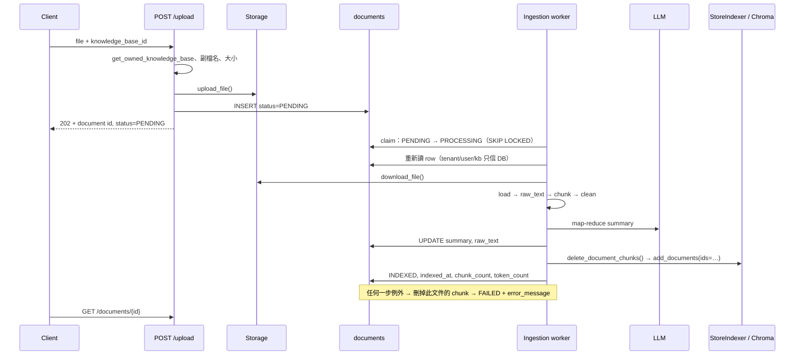
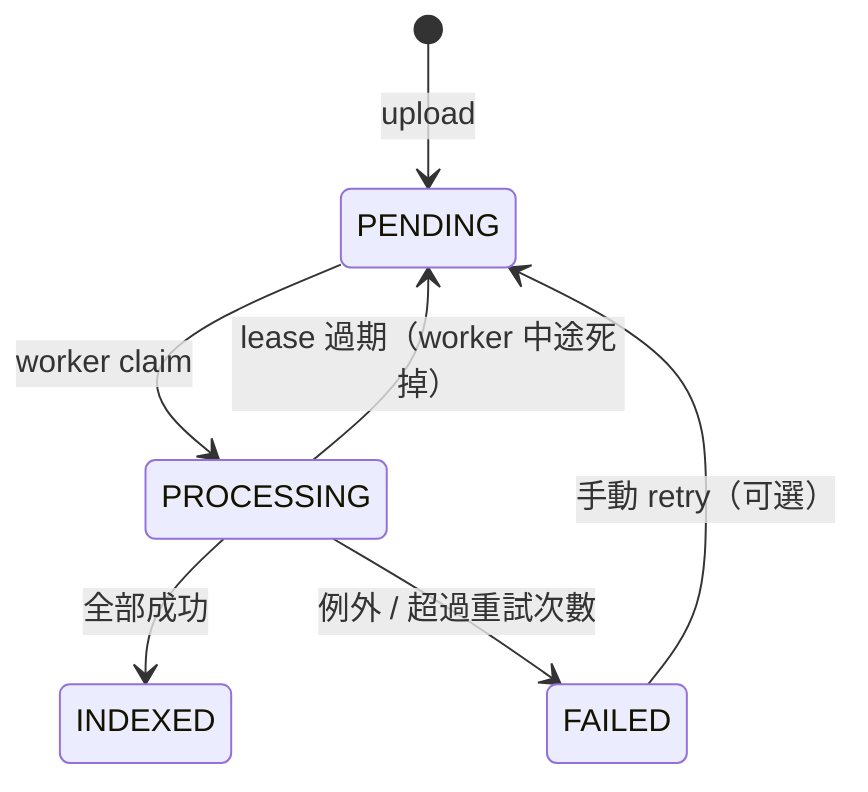
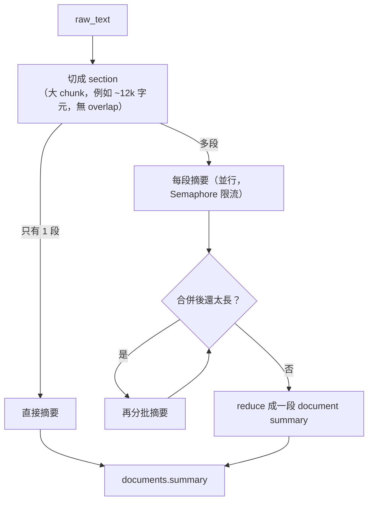
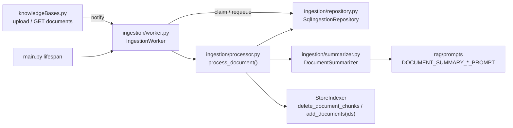

# Document ingestion 背景化 + document summary 產生

| | |
|---|---|
| Author | `LAPTOP-I592N3QF\user` |
| Created | 2026-10-14 |
| Branches | `worktree-feature-add-workers` |
| Base commit | `a73f407` |
| Sessions | — |

> 查證日期：2026-10-14。Python 3.12、chromadb 1.5.9、langchain-chroma 1.1.0、SQLAlchemy 2.0.51、FastAPI 0.140.0。
> 狀態：**程式碼與測試已完成（未 commit）。Dev DB migration 尚未執行，等確認，見「待辦」。**
> 決定事項：2026-10-14 全部照建議（Postgres queue + in-process worker、最後寫 Chroma、summary 失敗不擋、summary-only backfill、拿掉 docx、回 202、先不做 retry endpoint、migration 先給 SQL 再執行）。

## Context

`POST /api/v1/knowledgeBases/upload` 在同一個 request 裡跑完 load → chunk → embed → 寫 Chroma → 存檔 → 寫 `Document(status=INDEXED)`。使用者要等 embedding 全部跑完，`PENDING` / `PROCESSING` / `FAILED` 和 `error_message` 從沒被用到。`documents.summary` 也從沒被寫入，所以 GLOBAL 分支永遠回 `_NO_SUMMARIES_MESSAGE`。

---

## 現況調查（2026-10-14 實測）

### 任務描述 vs 實際狀態

任務描述第 3 節有兩項已經在 `tenant-id-fixes` plan 修好了，不需要再做：

| 項目 | 任務描述 | 實際狀態 |
|---|---|---|
| `Document.tenant_id` 沒填 | 未填 | ✅ 已修（`knowledgeBases.py` 的 `Document(...)` 有傳 `tenant_id`，C4） |
| Migration 落後 model | 只有 init | ✅ 已修。`migrations/` 被 `.gitignore`，所以在 worktree 看不到；main checkout 有 `b6019841bba0_add_tenants.py`、`31f17fb47de8_add_documents_summary.py` |
| `raw_text` 不是原文 | `"\n."` 串 chunk | ❌ 仍存在 |
| Chunk 沒有 `document_id` / 穩定 id | 沒有 | ❌ 仍存在 |
| Celery 只做一半 | 沒有依賴 | ❌ 仍存在。`app/workers/celery_logging.py` 在 module 層級 `import celery`，目前 import 它會直接失敗；沒有任何地方 import 它 |

Dev DB（唯讀查詢）：

- `documents` 已有 `tenant_id`（NOT NULL）、`summary`、`error_message`、`indexed_at`。
- `ingestionstatus` 是 PostgreSQL native ENUM，label 是 `PENDING,PROCESSING,INDEXED,FAILED`，和 model 一致，寫入新狀態不會出錯。
- 目前只有 1 份文件：`INDEXED`、`summary` NULL、`indexed_at` NULL。
- 已有 `ix_documents_status` index（model 沒宣告），可以直接拿來撈 `PENDING`。

### 其他新發現

1. **`DocumentResponse.page_count: int` 不是 Optional**。背景化後，剛建立的 `PENDING` row 還沒有 `page_count`，`model_validate` 會失敗。要改成 `Optional[int]`。
2. **`docx` 其實不支援**。Upload 的 `allowed_extension` 有 `docx`，但 `base_loader.load()` 只處理 `pdf` / `md`，`docx` 回 `None` → 400。`CLAUDE.md` 寫的 "Supported extensions: pdf, md, docx" 不正確。背景化後如果不在 upload 擋，`docx` 會變成 `FAILED`。
3. **Windows + psycopg async**：在獨立 process 裡用 `asyncio.run()` 連 DB 會報 `Psycopg cannot use the 'ProactorEventLoop'`（實測）。Uvicorn 自己有處理，但獨立 worker process 要自己指定 `SelectorEventLoop`。
4. **`langchain_chroma.Chroma.add_documents` 底層用 `upsert`**（`vectorstores.py:651-677`），沒傳 `ids` 時每次產生 `uuid4`。所以傳 deterministic id 就能讓重跑覆寫而不是新增。
5. **BM25 cache 只在同一個 process 內收到通知**；跨 process 的寫入靠 600 秒 TTL 保底（`bm25_index.py` docstring）。這會影響背景機制的選擇。
6. **Chroma 是 `PersistentClient`（本機 SQLite）**。兩個 process 同時開同一個 `chroma_data/` 寫入不是 chromadb 官方支援的用法（推論，未實測）。
7. **`clean_extracted_documents`** 有 import 但沒被呼叫。
8. **`fileStorage.py` 的 `download_file` 定義了兩次**（內容相同）。
9. 測試要用 `uv run --group dev python -m pytest`；直接 `pytest` 會 `No module named 'app'`。Baseline：**62 passed**。
10. 本機沒有 Redis；Docker Desktop 有裝但 daemon 沒開。

---

## 目標流程



### 狀態機



---

## 實作項目

### 1. Upload endpoint（`app/api/v1/endpoints/knowledgeBases.py`）

- 只做：`get_owned_knowledge_base` → 副檔名／大小驗證 → `upload_file()` → `INSERT Document(status=PENDING)` → 通知 worker → 回 **202**。
- 副檔名清單改成「loader 真的支援的」：`pdf`、`md`（`docx` 拿掉，見待決定事項 5）。
- `upload_file` 成功但 DB commit 失敗時，刪掉剛寫入的檔案，避免孤兒檔。
- 回應沿用 `DocumentUploadResponse`，`DocumentResponse.page_count` 改 `Optional[int]`，並加上 `error_message`、`indexed_at`。

### 2. 狀態查詢 endpoint

`GET /api/v1/knowledgeBases/documents/{document_id}`：

- `WHERE id = :id AND tenant_id = current_user.tenant_id AND user_id = current_user.id AND deleted_at IS NULL`。
- 查不到一律 404（和 `get_owned_knowledge_base` 一樣，不透露 id 是否存在）。
- 回傳 `DocumentResponse`（含 `status`、`error_message`、`chunk_count`、`indexed_at`、`has_summary`）。

### 3. Ingestion processor（新增 `app/ingestion/`）

和背景機制無關的核心邏輯，放在一個 function 裡，任何機制都呼叫它：

```python
async def process_document(document_id: UUID, *, deps: IngestionDeps) -> None
```

- **只接收 `document_id`**。`tenant_id` / `user_id` / `knowledge_base_id` / `storage_key` 一律從 DB 的 row 讀。
- `IngestionDeps` 注入 `session_factory`、`store_indexer`、`summarizer`、`download_file`，測試時換成 fake。
- `StoreIndexer.add_documents` 是 sync，用 `asyncio.to_thread` 包。
- 每一步失敗都要寫 `FAILED` + `error_message`（截斷到合理長度，例如 2000 字元），並 best-effort 刪掉這份文件已寫入的 chunk。

### 4. Chroma：可依文件刪除、可覆寫

`app/vectorstore/StoreIndexer.py`：

- Chunk metadata 新增 `document_id`（`str`，遵守 `docs/id-type-convention-20260827.md`）。
- `add_documents()` 新增 optional `ids` 參數，processor 傳 `f"{document_id}:{chunk_index}"`。
- 新增 `delete_document_chunks(tenant_id, user_id, knowledge_base_id, document_id)`：`where = scope_filter(...) 的 $and + {"document_id": document_id}`，刪除後一樣呼叫 `notify_kb_changed`。

重跑時的順序是「先刪這份文件的所有 chunk，再用 deterministic id upsert」。只靠 deterministic id 不夠：如果第二次切出來的 chunk 比較少，多出來的舊 chunk 會留著。

刪除條件同時帶 tenant / user / kb / document_id 四個 key，所以即使 `document_id` 被竄改，也刪不到別的 scope 的資料。

### 5. `raw_text` 改存原文

- `raw_text` = loader 輸出（每頁 `page_content`）經 `clean_extracted_documents()` 後，用 `"\n\n"` 串起來。
- 不再用 chunk 拼接，所以不會有 overlap 重複和開頭多一個 `.` 的問題。
- Summary 從 `raw_text` 產生，和設計文件 `docs/route/global/document-summary-storage-20261007.md` 一致。

### 6. Summary 產生（map-reduce）



- 用 `LLMFactory.get_model()`，不寫死 model name。
- Prompt 放 `app/rag/prompts/document_summary_prompt.py`，提供 `DOCUMENT_SUMMARY_MAP_PROMPT`、`DOCUMENT_SUMMARY_REDUCE_PROMPT`，在 `app/rag/prompts/__init__.py` re-export。
- 依設計文件的兩個低成本緩解：
  1. 目標長度隨文件大小縮放（用 `page_count` / 字數決定，例如 150～600 字）。
  2. Prompt 要求先列出「文件涵蓋的主題清單」，再寫摘要段落。
- Section 大小和每輪 batch 數做成參數，測試用小值驗證「長文件會走 map → reduce」。
- 只寫一個欄位（`UPDATE documents SET summary = …`），重跑就是覆寫，不會產生重複摘要。

### 7. 背景機制

依待決定事項 1 的結果實作。建議方案見下一節。

### 8. Migration

依背景機制選擇，可能需要新增欄位（例如 `attempt_count`、`processing_started_at`）。

- `migrations/` 被 gitignore，worktree 裡沒有。做法沿用上一個 plan：在 worktree 建 `migrations/versions/` 的新檔，寫完後複製到 main checkout。
- **不用 autogenerate 直接套用**。上一個 plan 已確認 autogenerate 會產生「刪掉 `checkpoint_*` table」和 native ENUM 差異的指令。改成手寫 migration，再用 `alembic upgrade --sql` 檢查產生的 SQL。
- Dev DB 的 `upgrade` 由你決定要不要跑（見待決定事項 6）。

### 9. 其他清理

- `fileStorage.py` 刪掉重複的 `download_file`，新增 `delete_file(storage_key)`（upload 失敗回滾用）。
- 更新 `CLAUDE.md` 的 "Document Ingestion" 一節。

---

## 測試計畫（`tests/ingestion/`）

沿用 `tests/auth` 的做法：沒有 `pytest-asyncio`，用 `asyncio.run`；DB 用 fake session 或 in-memory repository；Chroma 用 `EphemeralClient` + fake embedding；LLM 用 fake chat model。不打任何真實 API。

| 測試 | 驗證 |
|---|---|
| `test_success_path` | `PENDING → PROCESSING → INDEXED`，寫入 `indexed_at`、`chunk_count`、`summary` |
| `test_failure_path` | Embedding / loader 拋錯 → `FAILED` + `error_message`，Chroma 沒有殘留 chunk |
| `test_retry_no_duplicate_chunks` | 同一份文件跑兩次，chunk 數不變；第二次切得比較少時舊 chunk 也被刪掉 |
| `test_worker_uses_db_scope` | Task 只給 `document_id`；寫入的 metadata 全部來自 DB row |
| `test_tenant_isolation` | A 租戶的文件重跑，不會刪到或寫到 B 租戶同 kb_id／同 document_id 的 chunk |
| `test_long_document_map_reduce` | 長文件會呼叫多次 map + 1 次 reduce；短文件只呼叫 1 次 |
| `test_upload_returns_pending` | Upload 回 202、`status=PENDING`、沒有呼叫 embedding |
| `test_status_endpoint_scoped` | 查別人的 document id 回 404，WHERE 帶 tenant + user |
| 背景機制相關 | 依選擇而定（例如 claim 的 SQL 帶 `SKIP LOCKED`、lease 過期會被重新撈起） |

完成後跑 `uv run --group dev python -m pytest`，照實回報結果。

---

## 需要你決定的事項

### 1. 背景機制

| | A. `BackgroundTasks` / `asyncio.create_task` | B. Celery + Redis | C. Postgres 當 queue |
|---|---|---|---|
| Durability | ❌ process 重啟就遺失，row 卡在 `PENDING` / `PROCESSING` | ✅ broker 持久化（要設 `acks_late`） | ✅ 狀態就是 `documents.status`，重啟後重新撈 |
| Retry | 要自己寫 | ✅ 內建 `autoretry_for`、backoff | 自己寫，但只是 `attempt_count` + lease 過期重撈 |
| 新增基礎設施 | 無 | Redis（本機沒有、Docker 沒開）＋ worker process | 無 |
| Windows 開發 | ✅ | ⚠️ prefork pool 不支援 Windows，要 `--pool=solo` | ✅ |
| BM25 cache 失效 | ✅ 同 process，立即 | ⚠️ 跨 process，最多延遲 600 秒 | 看 worker 跑在哪（見下） |
| Chroma `PersistentClient` | ✅ 單一 process | ⚠️ API 和 worker 兩個 process 開同一個 SQLite 目錄 | 看 worker 跑在哪 |

**建議：C，worker 跑在 API process 裡（lifespan 啟動一個 asyncio loop）。**

- Durability 和 retry 由 `documents` table 本身提供：claim 用 `UPDATE … WHERE id = (SELECT id … WHERE status='PENDING' ORDER BY created_dt FOR UPDATE SKIP LOCKED LIMIT 1) RETURNING id`；`PROCESSING` 超過 lease 時間（例如 15 分鐘）視為 worker 死掉，重新變回 `PENDING`；`attempt_count` 超過上限（例如 3）就 `FAILED`。
- Worker 和 API 同 process，BM25 通知和 Chroma 單 process 寫入都維持現狀，不用處理跨 process 的問題。
- Upload 完用 `asyncio.Event` 叫醒 loop，平常 polling（例如 5 秒）只是保底。
- 需要一支 migration：加 `attempt_count`、`processing_started_at`。
- 之後要拆成獨立 process（或換 Celery）時，`process_document()` 不用改，只換外層的 loop。到那時要先解決 Chroma 改 client/server 模式。
- 代價：ingestion 和 API 搶同一個 process 的 CPU／event loop（embedding 在 thread 裡跑，影響有限）；多個 uvicorn worker 時每個都會跑一個 loop，`SKIP LOCKED` 保證不重複處理。

`app/workers/celery_logging.py`：選 C 的話保留不動（或刪除，看你偏好）；選 B 才會補 `celery_app.py`。

### 2. 處理中的文件是否可被檢索

| 選項 | 說明 | 缺點 |
|---|---|---|
| **A. 最後才寫 Chroma（建議）** | 順序：load → summary → 寫 Chroma → 立刻 `INDEXED`。可見但未 `INDEXED` 的時間只剩一次 DB commit。失敗時刪掉此文件的 chunk | 視窗不是 0；若 commit 失敗而刪 chunk 也失敗，會留下孤兒 chunk（下次 retry 會清掉） |
| B. Chunk metadata 加 `status`，retrieval filter 加 `status=INDEXED` | 完全不可見 | `INDEXED` 時要 update N 筆 metadata；dense 和 BM25 兩條路徑都要改 filter，漏一個就是靜默錯誤（設計文件第 3 點講的同一類 bug） |
| C. Retrieval 時用 SQL 查出 INDEXED 的 document_id 再過濾 | 完全不可見 | 每次檢索多一次 SQL，BM25 cache 也要跟著改 |

建議 A：不動任何既有 filter，處理中的 chunk 本身也是完整、正確的內容。

### 3. Summary 失敗的處理

- **A（建議）**：Summary 失敗只記 log，`summary` 留 NULL，文件照樣 `INDEXED`（LOOKUP 可用、GLOBAL 會略過這份）。`error_message` 寫上 `summary failed: …` 但 status 仍是 `INDEXED`。之後可以用事項 4 的 script 補。
- B：Summary 失敗整份 `FAILED`，chunk 也刪掉。一致性最強，但 LLM 暫時故障會讓文件完全不能用。

搭配事項 2-A 的順序，summary 在寫 Chroma 之前跑；retry 時如果 `summary` 已經有值就跳過，不重複花 LLM 成本。

### 4. 既有資料 backfill

Dev DB 只有 1 份 `INDEXED` 文件，它的 4 個 chunk 沒有 `document_id`，`raw_text` 也是舊格式。

- **A（建議）**：新增 `scripts/backfill_document_summaries.py`，對 `INDEXED AND summary IS NULL` 的文件從 storage 重讀原檔 → 重寫 `raw_text` → 產生 summary。預設 dry run，`--apply` 才寫入。**不碰 Chroma**。
- B：完全重跑 ingestion（設回 `PENDING`）。問題是舊 chunk 沒有 `document_id`，刪不掉，會變成重複 chunk；除非整個 KB 一起清掉重建。
- C：不做 backfill。

舊 chunk 沒有 `document_id` 這件事，A 也不會修；之後如果要做「刪除文件」功能，這些舊 chunk 要另外處理（列為已知限制）。

### 5. `docx`

- **A（建議）**：從允許清單拿掉，並修正 `CLAUDE.md`。
- B：這次順便補 docx loader（需要新依賴，例如 `docx2txt`）。

### 6. 其他小問題

- **Upload 回 202 還是 200？** 建議 202（語意上是「已接受，尚未處理完」）。Client 端如果有檢查 200 要一起改。
- **要不要加 `POST /documents/{id}/retry`**（`FAILED → PENDING`）？建議這次先不做，列為待辦。
- **Dev DB migration 誰跑？** 建議我寫好並用 `alembic upgrade --sql` 給你看，你確認後我再在 dev DB 執行（上一個 plan 的做法）。

---

## 實作結果



和計畫不同、或計畫沒寫到的地方：

- **重試策略**：處理中拋出例外一律直接 `FAILED`，不自動重試（loader 解析失敗這類錯誤重試也沒用；LLM 本身已有 `LLMFactory` 的 retry + fallback）。`attempt_count` / lease 只處理「worker 中途死掉」。
- **`StoreIndexer.add_documents` 的 metadata 合併順序改成 `doc.metadata | metadata`**：scope metadata 優先，loader 帶的同名 key 不能覆寫 `tenant_id` / `document_id`。
- **Upload 的 `HTTPException` 原本會被 `except Exception` 吞成 500**（例如副檔名錯誤的 400）。加了 `except HTTPException: raise`。
- **新增 composite index** `ix_documents_status_created_dt`，對應 claim 查詢的 `WHERE status ORDER BY created_dt`。Model 也宣告了，`alembic check` 不會報差異。
- **`count_tokens` 改成可注入**：tiktoken 第一次用 `cl100k_base` 時會下載 encoding，測試不能連網。
- 新增設定：`INGESTION_WORKER_ENABLED`、`INGESTION_POLL_INTERVAL_SECONDS`、`INGESTION_LEASE_SECONDS`（1800）、`INGESTION_MAX_ATTEMPTS`（3）、`SUMMARY_SECTION_CHARS`（12000）、`SUMMARY_BATCH_SIZE`（8）、`SUMMARY_MAX_CONCURRENCY`（4）。
- `app/workers/celery_logging.py` 保留不動。

### Migration `7c2e9a41d5b3_add_documents_ingestion_queue.py`

手寫，放在 worktree 的 `migrations/versions/`（gitignored）。`alembic upgrade 31f17fb47de8:7c2e9a41d5b3 --sql` 的輸出：

```sql
ALTER TABLE documents ADD COLUMN attempt_count INTEGER DEFAULT '0' NOT NULL;
ALTER TABLE documents ADD COLUMN processing_started_at TIMESTAMP WITH TIME ZONE;
CREATE INDEX ix_documents_status_created_dt ON documents (status, created_dt);
UPDATE alembic_version SET version_num='7c2e9a41d5b3' WHERE alembic_version.version_num = '31f17fb47de8';
```

### 驗證

| 項目 | 結果 |
|---|---|
| `tests/ingestion/`（新增 36 個） | ✅ 36 passed |
| 全部 tests（`uv run --group dev python -m pytest`） | ✅ 98 passed（baseline 62） |
| Mutation check：拿掉「先刪舊 chunk」、metadata 合併順序改回去、刪除條件只用 `document_id`、拿掉失敗時的 chunk 清除、summary 不檢查是否已存在 | ✅ 5 個都讓對應的測試失敗 |
| Dev Postgres 上的 queue SQL（在同一個 transaction 裡加欄位、插入測試 row，最後 **rollback**） | ✅ claim 拿到 attempt 1；queue 空時回 None；attempt 不符的 fenced write rowcount 0；lease 過期被退回 `PENDING`，重新 claim 後 attempt 2；attempt 相符的 fenced write rowcount 1。Rollback 後新欄位 0 個、documents 仍 1 筆 |

`tests/vectorstore/test_store_indexer_events.py` 的 `_SlowCollection.add_documents` 原本只接受 `docs`，改成和真正的 `Chroma.add_documents` 一樣接受 `ids`。

### 已知限制

- Dev DB 那份舊文件的 4 個 chunk 沒有 `document_id`，`delete_document_chunks()` 刪不到。之後做「刪除文件」功能要另外處理。
- Lease（1800 秒）必須比最長的單份 ingestion 還長，否則多個 uvicorn worker 時同一份文件可能被處理兩次（fencing 保證 DB 狀態正確，chunk 用相同 id 覆寫，但會多花一次 embedding / LLM 成本）。目前沒有 heartbeat。
- 多個 uvicorn worker 時，其他 process 的 BM25 cache 仍靠 600 秒 TTL 才會更新（和改動前一樣）。
- 沒有做 end-to-end 的真實 upload（真的 embedding / LLM），只有 fake 的單元測試和 SQL 驗證。

---

## 待辦

- [x] 決定事項確認（2026-10-14，全部照建議）
- [x] 實作
- [x] `tests/ingestion/` 全部通過 + 完整測試
- [x] 更新 `CLAUDE.md` 的 "Document Ingestion"
- [x] Dev DB 執行 `alembic upgrade head`：2026-10-14，`31f17fb47de8` → `7c2e9a41d5b3 (head)`
- [x] Migration 複製到 main checkout 的 `migrations/versions/`
- [x] `scripts.backfill_document_summaries` dry run：1 份候選（`99e62b9c…`，`Supporting Statement - Jason.pdf`）
- [ ] Backfill `--apply`（會呼叫 LLM）。原檔在 main checkout 的 `storages/`（舊格式 key `users/{user_id}/…`），`LOCAL_STORAGE_ROOT` 是相對路徑，所以要在 main checkout 跑，或把 `LOCAL_STORAGE_ROOT` 設成絕對路徑
- [ ] 啟動 app，用真實的 pdf / md 做一次 end-to-end upload，確認 `PENDING → INDEXED`，並確認 GLOBAL 分支讀得到 summary
- [ ] （之後）`POST /documents/{id}/retry`、ingestion heartbeat
