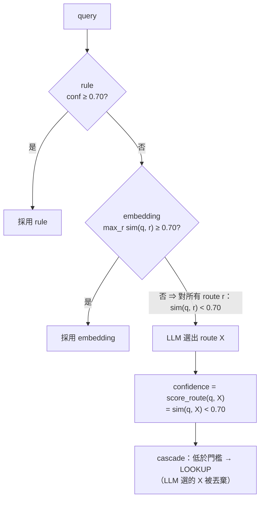
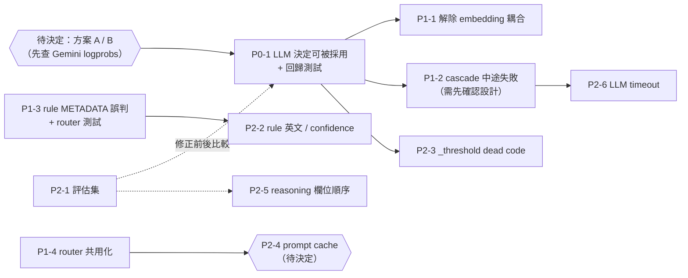

# Cascade router：LLM 層的決定永遠被丟棄

| | |
|---|---|
| Author | `Jason` |
| Created | 2026-10-15 |
| Branches | `master`<br>`worktree-feature-refactor-cascade` |
| Base commit | — |
| Sessions | `7016af64-bcf9-4458-9c65-39c74352bb1f`<br>`08386c13-baba-4cb7-b734-6b220ebc785e` |

> **狀態：P0-1、P1-1、P1-2、P2-3 已完成（2026-10-16，P0-1 採方案 A）；其餘未開始。**
> review META 分支時順帶發現，見 [review-meta-branch-20261015.md](../finished/review-meta-branch-20261015.md)。
> 查證日期：2026-10-15。§2 的結論已用假 embedding 模擬實測（Python 3.12.13，程式碼在 §2.2）；
> 真實 Gemini embedding 下的分佈、延遲數字**未實測**。
>
> 2026-10-16 更新：逐層解析 rule / embedding / LLM router 後，把三份文件找到的其他問題併入 §4
> （P1-3、P1-4、P2-2 ～ P2-6，以及 P2-1 的擴充）。各問題的細節與實測程式見：
> [rule-router](../../docs/route/cascade/rule-router-20261016.md)、
> [embedding-router](../../docs/route/cascade/embedding-router-20261016.md)、
> [llm-router](../../docs/route/cascade/llm-router-20261016.md)、
> [why-llm-layer-never-wins](../../docs/route/cascade/why-llm-layer-never-wins-20261016.md)。

## Context

`CascadeRouter`（`app/routing/router/cascade.py`）依序跑 rule → embedding → LLM，任一層
`confidence >= CONFIDENCE_THRESHOLD`（0.70）就短路；三層都不到門檻就保底 LOOKUP。設計意圖是：
rule / embedding 負責快速處理有把握的問題，**語意模糊的問題交給最準的 LLM 層**。

問題：LLM 層的 confidence 是用 embedding 相似度算的，而能走到 LLM 層的問題，embedding 相似度
一定已經低於門檻。所以 **LLM 層每次被呼叫都要花錢、增加延遲，但它的決定從來不會被採用**。
實際上 routing 只有三種結果：rule 命中、embedding 命中、LOOKUP 保底。

對照檔案：`app/routing/router/cascade.py`、`llm.py`、`embedding.py`、`fallback_chain.py`、`base.py`、
`app/routing/taxonomy.py`、`app/agent/graphs/routed_rag.py`（`RouterNode`、`select_branch`）。

---

## 1. 為什麼 LLM 層的決定不會被採用



逐步對照程式碼：

1. `EmbeddingRouter.route()`（`embedding.py:144-163`）的 confidence 是**所有 route 中最高的**相似度
   `max_r max_{example∈r} cos(q, example)`。
2. cascade 只有在這個值 < 0.70 時才會呼叫 LLM 層（`cascade.py:38-43`）。
3. `LLMRouter.route()`（`llm.py:114-115`）的 confidence 是 `score_route(q, X)`
   = `max_{example∈X} cos(q, example)`（`embedding.py:134-142`），也就是**某一個 route** 的相似度。
4. 某一個 route 的相似度 ≤ 所有 route 的最高相似度 < 0.70，所以 LLM 層的 confidence 必定 < 0.70。
5. cascade 回傳 `DEFAULT_ROUTE`（LOOKUP）。就算 cascade 放行，`select_branch()`（`routed_rag.py:146-150`）
   也會因為 confidence < 0.70 再強制改成 LOOKUP。

前提：cascade 的 embedding 層與 LLM 層的 scorer 用同一組範例、同一個 embedding 模型。
預設建構（`CascadeRouter()` → `EmbeddingRouter()` 與 `LLMRouter()` 內部的 `EmbeddingRouter()`）
就是這種情況，兩者都用 `ROUTE_EXAMPLES` 與 `text-embedding-004`。唯一的例外是 embedding API
對同一段文字回傳不同向量（推論，機率極低，未查證）。

### 1.1 Fallback chain 也有同樣問題，而且更糟

`FallbackChainRouter`（`fallback_chain.py`）在 cascade 丟例外時使用，順序是 LLM → embedding → rule。

- LLM 層成功時，confidence 一樣是 embedding 相似度。`RouterNode` 會直接用這個 decision，但
  `select_branch()` 低於 0.70 就改成 LOOKUP。所以 LLM 的決定只有在 embedding 相似度剛好 ≥ 0.70 時才會被採用，
  而這種情況 embedding 層本身就能判斷了。
- **故障耦合**：`LLMRouter` 算 confidence 時要呼叫 embedding API。如果故障的是 embedding API，
  LLM 層會跟著失敗，fallback 直接掉到 rule；如果故障的是 Gemini LLM，cascade 到 LLM 層才丟例外，
  前面已經跑過的 rule / embedding 結果全部浪費，fallback 又重跑一次。

---

## 2. 實測

### 2.1 結果

用假 embedding（每段文字以字串為 seed 產生 8 維 Gaussian 隨機向量）模擬 2000 個 query，對每個走到
LLM 層的 query，讓假 LLM 依序選擇 6 個 route，各跑一次完整的 `CascadeRouter`：

```
queries reaching LLM layer: 1015; non-LOOKUP LLM decisions that survived cascade: 0
```

1015 個 query × 5 個非 LOOKUP route = 5075 次 LLM 決定，**沒有一次被採用**。
隨機向量只用來產生「embedding 層沒把握」的情境；§1 的推導不依賴向量分佈，所以結論對真實 embedding 也成立。

### 2.2 重現程式

在 repo 根目錄執行（`sys.path.insert(0, ".")` 讓 `app` 可以 import）。修正時改寫成
`tests/routing/test_cascade_llm_layer.py` 的回歸測試（見 §4 P0-1 第 4 步）。

```python
import asyncio
import random
import sys

sys.path.insert(0, ".")
from app.routing.router.cascade import CascadeRouter
from app.routing.router.embedding import EmbeddingRouter
from app.routing.router.llm import LLMRouter, _LLMRouteOutput
from app.routing.router.rule import RuleRouter
from app.routing.taxonomy import Route, RouterContext


class FakeEmb:
    # 同一段文字永遠回傳同一個向量，模擬確定性的 embedding API
    def __init__(self):
        self.cache = {}

    async def embed(self, texts):
        out = []
        for t in texts:
            if t not in self.cache:
                rnd = random.Random(t)
                self.cache[t] = [rnd.gauss(0, 1) for _ in range(8)]
            out.append(self.cache[t])
        return out


class FakeLLM:
    # 永遠選指定的 route，模擬 with_structured_output 的回傳
    def __init__(self, route):
        self.route = route

    async def ainvoke(self, messages):
        return _LLMRouteOutput(route=self.route)


async def main():
    ctx = RouterContext(tenant_id="t", knowledge_base_id="k", resolved_history=[])
    emb = FakeEmb()
    reached_llm = llm_won = 0
    for i in range(2000):
        q = f"query {i}"
        e = EmbeddingRouter(embeddings=emb)
        if (await e.route(q, ctx)).confidence >= 0.70:
            continue  # embedding 層已短路，不會走到 LLM 層
        reached_llm += 1
        for r in Route:
            llm = LLMRouter(structured_model=FakeLLM(r), confidence_scorer=EmbeddingRouter(embeddings=emb))
            d = await CascadeRouter(rule=RuleRouter(), embedding=e, llm=llm).route(q, ctx)
            if d.route is r and r is not Route.LOOKUP:
                llm_won += 1
    print(f"queries reaching LLM layer: {reached_llm}; non-LOOKUP LLM decisions that survived cascade: {llm_won}")


asyncio.run(main())
```

---

## 3. 影響

- **準確度**：rule 沒命中、embedding 相似度又不到 0.70 的問題（換句話說、口語、長問句），全部被當成 LOOKUP。
  GLOBAL / METADATA / MULTI_HOP / NO_RETRIEVAL / META 只有在說法接近 `ROUTE_EXAMPLES` 例句時才會被分對。
- **成本與延遲**：這些問題每次都多一次 LLM 呼叫和一次 embedding 呼叫（`score_route`），結果卻不會改變。
  程式碼註解估計 LLM 層約 500ms（未實測）。
- **觀測誤導**：LangSmith 上看得到 LLM 層的 `reasoning`，容易以為 LLM 有參與決策。

---

## 4. 修正計畫

### [x] P0-1｜讓 LLM 層的決定真的能被採用

> **已完成（2026-10-16）：採方案 A。**
> - 決定理由：`google-genai` 2.8.0 SDK 有 `response_logprobs`，但專案使用的 `langchain_google_genai` 4.2.5
>   完全沒有處理 logprobs（套件內找不到 `logprob`）。方案 B 要繞過 LangChain 直接呼叫 SDK，並從 JSON 輸出拆出
>   route token 的 logprob；Gemini 2.5 flash 是否支援 logprobs 也未查證。依本節原定規則採 A。
> - 實作：`RouteDecision.accepted`（`taxonomy.py`）。rule 命中、embedding `confidence >= threshold`、LLM 成功回傳、
>   `NoOpRouter` 為 True；cascade 改看 `accepted` 短路，並移除不再使用的 `threshold` 參數；fallback chain 第一個回應的層
>   沒有 accepted 時改回 LOOKUP；`RouterNode` 對沒有 accepted 的決策寫入 LOOKUP；`select_branch()` 只看 route
>   （`route=""` 保底 LOOKUP）。`SpeculativeExecutor`（尚未接進 graph）一併改看 `accepted`，否則接上後會重現同一個 bug。
> - 版本：`rule-v3`、`embedding-v2`、`llm-v2`、`cascade-v2`、`fallback-chain-v2`、`speculative-v2`、`noop-v2`。
>   除了原定的三個，其他 router 的輸出也多了 `accepted`，一併遞增，避免 semantic cache 讀到沒有這個欄位的舊決策。
> - 測試：`tests/routing/test_cascade_llm_layer.py`，28 個測試全過；在修改前的程式碼上有 21 個失敗。
>   全部測試 223 passed（Python 3.12.13）。
> - §2.2 重現程式在修正後的輸出：`queries reaching LLM layer: 1015; non-LOOKUP LLM decisions that survived cascade: 5075`
>   （修正前是 0）。

根本原因是「用比較弱的 embedding 層去否決比較強的 LLM 層」。兩個方向：

| | 方案 A：LLM 是最後一層，結果直接採用 | 方案 B：改用 logprobs 當 confidence |
|---|---|---|
| 做法 | LLM 層成功回傳就採用它的 route，不再跟門檻比較；confidence 仍記錄 embedding 分數供觀測 | 從 LLM 輸出 route token 的 logprob 換算 confidence，維持「每層都跟門檻比較」 |
| 符合 `RouteDecision.confidence` 的規則？ | 符合（confidence 仍是 embedding 分數），但「confidence 決定是否採用」的語意改變 | 符合（docstring 明列 logprobs） |
| 前提 | 無 | Gemini 在 `with_structured_output` 下能否回傳 logprobs **未查證** |
| LLM 選錯時 | 直接走錯分支 | 低 logprob 時退回 LOOKUP |
| 實作量 | 小 | 中到大（要查 API、改 structured output 解析） |

**待決定**：A 或 B。建議先查 B 的前提；查不到可用的 logprobs 就採 A。

方案 A 的實作步驟（B 的步驟等查證後再補）：

1. **把「是否採用」的判斷集中在 router 層**：`RouteDecision` 新增 `accepted: bool`（或改由 cascade / fallback 回傳已套用門檻的結果），
   語意是「這個 route 可以直接分派」。
   - rule / embedding：`accepted = confidence >= threshold`。
   - LLM：成功回傳就 `accepted = True`。
2. **`select_branch()` 不再自己比門檻**：改看 `accepted`（或只看 route），避免 router 放行後又被 graph 層否決。
   `NoOpRouter` 回傳 `accepted=True`，ablation 行為不變。
3. **`FallbackChainRouter`**：低於門檻、且不是 LLM 層的結果，要退回 LOOKUP（目前是靠 `select_branch()` 兜底，第 2 步拿掉後要搬到這裡）。
4. **回歸測試** `tests/routing/test_cascade_llm_layer.py`：把 §2.2 改成測試，斷言 embedding 沒把握時，
   LLM 選的非 LOOKUP route 會被採用；另外測 fallback chain 的同一情境。
5. 遞增 `cascade.py`、`llm.py`、`fallback_chain.py` 的 `ROUTER_VERSION`（semantic cache / prompt cache 的 key 綁版本，會自然失效）。

> 附帶解決：目前 LLM 的 few-shot 與 confidence 用同一組 `ROUTE_EXAMPLES`，問題越不像範例（LLM 越有價值），
> confidence 反而越低（[llm-router](../../docs/route/cascade/llm-router-20261016.md) §3.6）。
> 方案 A 不再用 confidence 決定是否採用 LLM 結果，這個矛盾隨之消失；方案 B 也不再依賴範例句。

### [x] P1-1｜LLM 層不該依賴 embedding API 才能回傳

> **已完成（2026-10-16）**：`LLMRouter.route()` 把 `score_route()` 包在 `try/except`，失敗時記
> `llm router confidence scoring failed` warning（含 `exc_info`）並給 `confidence=0.0`，仍回傳 `accepted=True`。
> LLM 呼叫本身失敗仍然丟例外，交給 fallback chain。`ROUTER_VERSION` 未遞增：prompt 與成功時的輸出都沒變。
> 測試：`test_cascade_llm_layer.py` 新增 3 個（scorer 故障、embedding API 全掛時 fallback chain 採用 LLM、LLM 故障仍丟例外），
> 前兩個在修改前的程式碼上失敗；全部測試 226 passed。

採方案 A 後，LLM 層的 embedding 分數只用於觀測。`score_route()` 失敗時應該記錄後繼續（confidence 記 0.0），
不要讓整個 LLM 層丟例外，解除 §1.1 的故障耦合。

### [x] P1-2｜cascade 中途失敗時，不要整段重跑

> **已完成（2026-10-16）**：使用者同意改變設計後實作。
> - `CascadeRouter` 只攔 LLM 層的例外：記 `cascade llm layer failed, falling back to default route` warning（含 `exc_info`），
>   回傳 LOOKUP（`accepted=True`，confidence 沿用 embedding 層分數，`reasoning` 註明失敗與例外型別）。
>   LLM 失敗時 fallback chain 重跑也只會得到同樣的 LOOKUP，所以不再交給它。
> - rule / embedding 層的例外照舊往外丟，由 `RouterNode` 改走 fallback chain。
> - docstring 改寫為「故障復原原則上仍交給 fallback chain，唯一例外是 LLM 層」；`ROUTER_VERSION` → `cascade-v3`。
> - 取捨：LLM 失敗不再寫進 `state.trace`（原本 `RouterNode` 會記 `router failed ..., degrading to fallback_chain`），
>   只留在 log 與 `RouteDecision.reasoning`。沒有用 `last_degradations` 這類 instance 狀態，因為 P1-4 共用 router instance 後會有 race condition
>   （`FallbackChainRouter.last_degradations` 已有這個問題，見 P1-4）。
> - 測試：`test_cascade_llm_layer.py` 改寫 1 個、新增 4 個，其中 2 個在修改前的程式碼上失敗；全部測試 230 passed。

LLM 層丟例外時，`RouterNode` 改走 fallback chain，rule / embedding 又重跑一次。可以讓 cascade 自己 catch
LLM 層的例外並回傳 embedding 層的結果（低於門檻就 LOOKUP），只有 rule / embedding 也失敗時才交給 fallback chain。

> 這條會改變 `cascade.py` docstring 裡「信心不足」與「故障復原」刻意分開的設計，修之前要先確認是否接受。

### [ ] P1-3｜Rule：METADATA pattern 太寬，誤判後無法修正

細節：[rule-router](../../docs/route/cascade/rule-router-20261016.md) §4、§5。

`_METADATA_PATTERNS`（`rule.py:25-34`）裡的 `版本(號)?` 與日期格式 `\d{4}[-/年]\d{1,2}` 沒有錨定，query 出現「版本」或任何日期就命中，
而且一律給 0.95，cascade 直接短路，embedding / LLM 層沒有機會修正。實測誤判（2026-10-16，Python 3.12.13）：

- 「新版本的退款政策有什麼改變」→ METADATA
- 「2026年1月的營收是多少」→ METADATA
- 「合約 2025/12 到期後怎麼續約」→ METADATA

步驟：

1. 比照 `meta_intents.py` 的做法，把這兩條 pattern 錨定在「文件 / 檔案 / 這份」等指向文件屬性的字，或改成必須和屬性詞同時出現。
2. 新增 `tests/routing/test_rule_router.py`：上面三條誤判、rule-router §4 的正確案例都要涵蓋。目前**沒有 METADATA pattern 的 router 測試**。
3. 遞增 `rule.py` 的 `ROUTER_VERSION`。

### [ ] P1-4｜Router instance 每次請求重建，快取全部失效

細節：[embedding-router](../../docs/route/cascade/embedding-router-20261016.md) §3.1、§3.2，
[llm-router](../../docs/route/cascade/llm-router-20261016.md) §3.3。

`chats.py:38` 的 `Depends(get_compiled_graph)` 每次請求都重新 build graph，連帶 new 出 `RouterNode` → `CascadeRouter` /
`FallbackChainRouter` → `EmbeddingRouter` / `LLMRouter`。結果：

- `EmbeddingRouter._ensure_example_vectors()` 的「只算一次」只在單次請求內有效。以假 embedding 實測 3 次請求：
  embedding 層短路時 embed 111 段文字（共用 instance 只要 39 段）；走到 LLM 層時 222 段（共用只要 78 段）。
- `LLMRouter` 內部的 confidence scorer 是另一個 `EmbeddingRouter`，36 句範例再 embed 一次。
- 同一次請求走到 LLM 層時，query 本身被 embed 兩次（`route()` 與 `score_route()` 各一次）。
- `LLMRouter.route()` 每次呼叫都 new 一個 `ChatGoogleGenerativeAI` 再包 `with_structured_output`。

步驟：

1. router（或至少 `EmbeddingRouter` 的範例向量）改成 process 級共用，例如 module-level singleton 或在 lifespan 建立後注入。
   cascade 與 fallback chain、`LLMRouter` 的 scorer 共用同一個 `EmbeddingRouter`。
2. 同一次請求內重用 query vector（例如 `EmbeddingRouter` 內以 query 為 key 的小型快取，或把 vector 放進 `RouteDecision` 傳給下一層）。
3. `LLMRouter` 的 structured model 在建構時建立一次；有 `cached_content` 時才需要另外建。
4. 測試：用計數用的假 embedding 斷言 N 次請求只 embed 一次範例集（可改寫 embedding-router §5 的程式）。

> 推論：graph 每次請求重建本身也有成本，但不在本 plan 範圍；本條只處理 router 的共用。

> 注意（2026-10-16 補）：`FallbackChainRouter.last_degradations` 是 instance 狀態，每次 `route()` 開頭清空、過程中寫入，
> `RouterNode` 事後再讀。router instance 改成跨請求共用後，並行請求會互相覆蓋（race condition）。
> 共用化之前要先把降級紀錄改成隨 `RouteDecision` 回傳，或由 `route()` 回傳一個 result 物件。

### [ ] P2-1｜建立 routing 評估集

修正前後都沒有數據可以比較「只用 LLM」、「修好的 cascade」的準確率與延遲。`taxonomy.py` docstring 提到的
`eval/annotator_agreement.py` 在 repo 裡**不存在**。建議：

- 收集至少數十條真實問題並標註 route（6 類都要有，特別是不像 `ROUTE_EXAMPLES` 例句的說法）。
- 量測：各層命中比例、整體準確率、P50 / P95 延遲、每請求 LLM 呼叫次數。
- 有數據後再決定要不要簡化成只用 LLM（`with_structured_output`）。
- 用同一份評估集回答以下目前沒有數據的問題（[embedding-router](../../docs/route/cascade/embedding-router-20261016.md) §3.4、§3.5）：
  - 0.70 門檻在真實 Gemini embedding 下偏嚴還是偏鬆。
  - 要不要加 margin 判斷（第一名與第二名差距太小時視為沒把握）。
  - 例句設計：LOOKUP「這份合約的付款條件是什麼？」與 MULTI_HOP「這兩份合約的付款條件哪裡不一樣？」字面幾乎相同，是否造成誤判；
    META / METADATA 例句多數已被 rule 層攔下，是否該換成換句話說的版本。

### [ ] P2-2｜Rule：英文 METADATA 覆蓋不足、confidence 寫死

細節：[rule-router](../../docs/route/cascade/rule-router-20261016.md) §5。

- METADATA 的英文 pattern 只有 `file type`；實測「who wrote this document」、「when was this uploaded」都落到 LOOKUP 0.0。
  補英文 pattern（同樣要錨定），並加進 P1-3 的測試。
- 所有命中一律 0.95：「作者是誰」這種強訊號與「剛好有個日期」這種弱訊號分數相同。P1-3 錨定後若仍有弱 pattern，考慮給較低分數讓 cascade 往下走。

### [x] P2-3｜Embedding：`self._threshold` 是 dead code

> **已完成（2026-10-16）**：隨 P0-1 解決，`EmbeddingRouter.route()` 用 `self._threshold` 設定 `accepted`。

`EmbeddingRouter.__init__` 存了 `threshold`（`embedding.py:116`），整個 class 都沒有讀它，實際比門檻的是 cascade。
刪掉參數，或改成真的由 router 回傳是否通過（若 P0-1 採方案 A 的 `accepted`，可在這裡設定）。

### [ ] P2-4｜LLM：prompt cache 從未接上

細節：[llm-router](../../docs/route/cascade/llm-router-20261016.md) §3.2。

`app/` 沒有任何地方建立 `PromptCache(...)`，`cascade.py:33`、`fallback_chain.py:32` 都是 `LLMRouter()`，
所以 `prompt_cache` 永遠是 `None`。`prompt_cache.py` docstring 也承認 `_FIXED_PREFIX`（實測 1422 字元）大概率不到
Gemini explicit caching 的最小 token 門檻（未查證）。

> 注意：[advanced-router-integration-20261016.md](advanced-router-integration-20261016.md) M-INT3 依 ADR 寫「`_FIXED_PREFIX` + prompt caching 不動」。
> 決定前要先確認 ADR 的意圖是「保留功能」還是「保留程式碼」。

**待決定**：(a) 查證最小 token 門檻，夠的話在 router 共用化（P1-4）時接上；(b) 不夠就刪除或明確標成未啟用，
改依 Gemini implicit caching。

### [ ] P2-5｜LLM：structured output 先輸出 route、後輸出 reasoning

`_LLMRouteOutput` 欄位順序實測為 `['route', 'reasoning']`，模型先決定再解釋，reasoning 對判斷沒有幫助（推論）。
把 `reasoning` 移到前面（並設為必填）讓模型先想再答，用 P2-1 的評估集比較準確率與延遲後再決定。改動要遞增 `llm.py` 的 `ROUTER_VERSION`。

### [ ] P2-6｜LLM：Gemini 呼叫沒有 timeout

`LLMRouter.route()` 呼叫 Gemini 沒有設逾時，延遲沒有上限（推論）。設定 timeout，逾時丟例外，
交給既有的 fallback 路徑（或 P1-2 決定後由 cascade 自己處理）。

---

## 不在本 plan 範圍

- `LLMRouter._default_model_factory` 寫死 `gemini-2.5-flash`、`GeminiEmbeddingsClient` 寫死 `text-embedding-004`，
  沒有走 `LLMFactory` / `EmbeddingFactory` 與 `.env` 設定（`CLAUDE.md` 的 `EMBEDDING_MODEL` 是 `gemini-embedding-001`）。
  改走 `EmbeddingFactory` 時一併檢查：`GeminiEmbeddingsClient.embed()` 對 query 也用 `aembed_documents`（document task type），
  對相似度分數的影響未查證。
- `SpeculativeExecutor`（`speculative.py`）尚未接進 graph，不受影響。

## 建議執行順序



P1-3、P1-4 與 P0-1 互不依賴，可以平行做。
