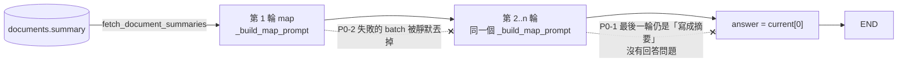
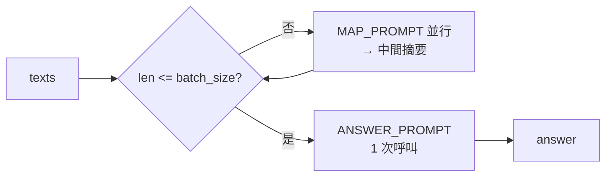

# Code review：`app/routing/branches/global_summary.py`

| | |
|---|---|
| Author | `LAPTOP-I592N3QF\user` |
| Created | 2026-10-19 |
| Branches | `master` |
| Base commit | `8f37bf2` |
| Sessions | `ec0a432b-1d27-49db-8fe0-b374d0cce51d` `a37ab315-a48b-4f04-ac24-1762b2b336eb` |

> 狀態：**P0-1、P0-2 已完成**（未 commit，`tests/routing/test_global_summary_branch.py` 覆蓋），其餘項目尚未開始。

## Context

Review 對象是 `app/routing/branches/global_summary.py`（GLOBAL 分支）。它處理「整個知識庫在講什麼」這類問題：
從 `documents.summary` 撈出所有文件摘要，用 map-reduce 合併成一個答案，不經過 Chroma。
`documents.summary` 由 ingestion 的 `app/ingestion/summarizer.py` 產生（每份 300–1500 字元，開頭是 `Topics:` 行）。

對照檔案：`app/routing/branches/common.py`、`app/agent/state.py`、`app/agent/graphs/routed_rag.py`、
`app/agent/nodes/generator.py`、`app/llm/factory.py`、`app/models/document.py`、`app/rag/prompts/document_summary_prompt.py`。

已確認沒問題的部分：

- tenant scope 用 `enforce_knowledge_base_id(state)` 強制取得，SQL 同時 filter `tenant_id`、`user_id`、`knowledge_base_id`、`status=INDEXED`、`deleted_at IS NULL`。
- `batch_size >= 2` 保證每輪 `current` 會變短，loop 一定會結束。
- `GlobalSummaryBranch` 是 leaf node，`routed_rag.py:183` 直接接到 `END`，所以 `answer` 就是使用者最後看到的內容。

### Review 時的更正

對話中的初版 review 有一項是錯的，這份 plan 已經拿掉：

- ~~`LLMFactory.get_model()` 每個 batch 都 construct 一次~~：`LLMFactory.get_model()` 有 `_resilient_model_cache`（`factory.py:24`），重複呼叫拿到的是同一個 instance，不需要修。
- 同一段程式碼也說明了 P0-2 的觸發條件：model 有 `with_fallbacks`（兩個 fallback），所以單一 batch 要三個 model 都失敗才會丟出 exception。P0-2 比較少發生，但一發生就是靜默的。

---

## 發現清單（依嚴重度排序）

### [x] P0-1｜最後一輪只產出「摘要」，沒有回答問題

`_map_reduce()` 每一輪都用 `_build_map_prompt()`（`global_summary.py:26-31`），prompt 是：

> 請針對問題「{query}」，從這些摘要中萃取相關重點，**寫成一段精簡摘要**。

所以最後一輪的輸出也只是中間摘要，被直接當成 `answer` 回傳。文件只有 1 份時更明顯：第一輪就把「摘要的摘要」當成答案。
另外，`chat_history` 完全沒有用到，不過 `resolved_query` 已經是 resolver 改寫過的獨立問題，所以這點影響不大。

**修法**：

1. 在 `app/rag/prompts/` 新增 `global_summary_prompt.py`，定義兩個 `ChatPromptTemplate` constant，並從 `app/rag/prompts/__init__.py` export：
   - `GLOBAL_SUMMARY_MAP_PROMPT`：只保留和問題相關的重點，不回答問題，保留文件名稱以便引用。
   - `GLOBAL_SUMMARY_ANSWER_PROMPT`：根據摘要直接回答問題；資訊不足時要明說；回答語言和問題相同；只能使用提供的內容。
2. `_map_reduce()` 改成：只要 `len(current) <= batch_size`，就直接用 `ANSWER_PROMPT` 做最後一次呼叫，這次呼叫也包含只有 1 份文件的情況。其餘輪次用 `MAP_PROMPT`。拿掉 `first_pass` flag。
3. 刪掉 `_build_map_prompt()`。依照專案慣例，prompt 改用 `prompt.format_messages(...)`，和 `summarizer.py:88` 相同。
4. 遞增 `ROUTER_VERSION` → `global-summary-v2`。

### [x] P0-2｜部分 batch 失敗時靜默丟掉文件

`global_summary.py:103-106`：`gather(..., return_exceptions=True)` 之後只保留 `str` 結果。只要不是全部失敗，失敗的 batch 代表的文件就從答案裡消失，沒有 log，也沒寫進 `trace`。
`return_exceptions=True` 也會把 `CancelledError` 當成一般結果收進來，然後一樣被過濾掉。

**修法**：

1. 收集 exception。`CancelledError` 要 re-raise，不能吞掉。其他 exception 用 structlog 記錄（`batch_index`、`kb_id`、exception type）。
2. 失敗比例 > 50%（門檻做成 `__init__` 參數 `max_failure_ratio`）就 raise；否則繼續，並把失敗數累計到回傳值裡。
3. `__call__` 在 `trace` 寫入 `failed_batches=N`。`N > 0` 時，在 `answer` 結尾加一句提示，告訴使用者部分文件沒有納入。

> 決策待確認：失敗比例門檻預設 50% 是否合適？還是任何失敗都直接 raise？

#### P0-2 實作結果（2026-10-19，未 commit）

- `GlobalSummaryBranch.__init__` 新增 `max_failure_ratio=0.5`，超出 `[0, 1]` 範圍時 raise `ValueError`。
- `_map_reduce()` 回傳 `(answer, failed_batches)`。每一輪中：
  - 不是 `Exception` 的 `BaseException`（`CancelledError`、`KeyboardInterrupt`）一律 re-raise。修法第 1 點原本只寫了 `CancelledError`，實作時擴大到所有非 `Exception`。
  - `Exception` 用 `logger.warning("global_summary.map_batch_failed", batch_index, knowledge_base_id, error_type, error)` 記錄。
  - 全部失敗時 raise `"all map batches failed"`；失敗比例 > `max_failure_ratio` 時 raise `"{n}/{total} map batches failed"`。
  - 最後的 ANSWER call 失敗時直接 raise，不做部分容錯。
- `__call__` 在 `trace` 寫入 `failed_batches=N`；`N > 0` 時在 `answer` 結尾加上 `_PARTIAL_FAILURE_NOTICE`。
- 測試：`tests/routing/test_global_summary_branch.py` 新增 7 個測試，涵蓋部分失敗、無失敗、超過門檻、全部失敗、`CancelledError` / `KeyboardInterrupt` 向上傳遞，以及非法 ratio。實測 `tests/` 全部 300 passed（Python 3.12，`uv run --group dev python -m pytest`）。
- 門檻暫定預設 50%，仍待確認（見「待確認決策」第 1 點）。

### [ ] P1-1｜沒有 cost / budget 上限，也沒有更新 budget counter

LLM 呼叫次數隨文件數線性成長（50 份 → 8 次，500 份 → 72 次），沒有上限。
`state.token_count` / `tool_calls_count` 沒有更新，而 `generator.py:33-34`、`finalizer.py:72` 都有更新。

**修法**：

1. `__init__` 加 `max_documents`（預設 200）。超過時只取前 N 份（排序見 P1-3），並在 `trace` 和 `answer` 註明「只納入 N / 總數 份」。
2. 每次 LLM 呼叫累加 `response.usage_metadata["total_tokens"]`，寫法比照 `generator.py:28`。`__call__` 回傳 `"token_count": state.token_count + total`。

> 決策待確認：`max_documents` 預設值，以及超過上限時要截斷還是直接拒絕。

### [ ] P1-2｜Citation 顯示 UUID 而不是檔名

`Chunk` 沒有設定 `source`，所以 `format_citations()`（`common.py:35`）會 fallback 成 `chunk_id`，也就是 document UUID。
`metadata={"id": doc.id}` 放的是 `uuid.UUID` 物件，混進會被 checkpoint 序列化的 state 裡。

**修法**：select 時加上 `Document.filename`，並設定 `source=doc.filename`、`metadata={"document_id": str(doc.id)}`。key 改名成 `document_id`，和 ingestion 寫進 Chroma 的 chunk metadata 一致。MAP prompt 的每段摘要前面加上 `[filename]`，讓答案可以指出是哪份文件。

### [ ] P1-3｜沒有 `ORDER BY`，答案不穩定

沒有排序時，Postgres 回傳的順序不固定，batch 分組會跟著變，同一個問題可能得到不同答案。截斷時（P1-1）也需要固定順序。

**修法**：`.order_by(Document.created_dt, Document.id)`。

### [ ] P2-1｜`guard_size` 只限制單一 request，不是全域上限

`asyncio.Semaphore` 在每次 `_map_reduce()` 裡新建，而 `global_summary_node` 是 module-level 共用 instance。多個 request 同時進來時，總並發數是 `10 × N`，和註解「Max: 10 process at the same time」不符。

**修法**：把 semaphore 建在 `__init__`，讓所有 request 共用；註解改成「整個 process 的上限」。
注意：semaphore 要在 event loop 裡建立。Python 3.10+ 的 `asyncio.Semaphore` 第一次使用時才綁定 loop，所以在 module import 時建立沒問題（推論，實作時要測）。

### [ ] P2-2｜空字串 summary 也會送進 LLM

filter 只排除 `NULL`。`doc.summary or ""`（`:45`）在 `is_not(None)` 之後是多餘的。

**修法**：加上 `Document.summary != ""`，並刪掉 `or ""`。

### [ ] P2-3｜Style

- `:48` docstring 內容錯誤，括號也沒閉合。改成：「GLOBAL 分支的 node 實作（原名 `lobal_summary_node` 是 typo）。」
- `:80-86` 是懸空的 string literal，移進 `_map_reduce()` 當 docstring，並在 P0-1 改完後更新呼叫次數的例子。
- Import 順序改成 stdlib（`asyncio`、`uuid`）→ third-party（`sqlalchemy`）→ local，`TYPE_CHECKING` block 放最後。
- `:92-95` 多縮排一層，`:44` 有 trailing whitespace，`:57`、`:88` 冒號後面有多餘空白，`:33` 參數的冒號後面少了空白。
- `_NO_SUMMARIES_MESSAGE` 提到「ingestion pipeline」，這是內部用語，不適合給終端使用者看。改成：「這個知識庫目前沒有已完成處理的文件摘要，請稍後再試，或確認文件已上傳成功。」

---

## 實作順序

1. P2-3 style 先做，讓之後的 diff 乾淨。
2. P1-2、P1-3、P2-2：都是 `fetch_document_summaries()` 的 query，一起改。
3. P0-1：新增 prompt，改寫 `_map_reduce()`。
4. P0-2、P1-1、P2-1：都在 `_map_reduce()` 的錯誤處理、計數和並發控制裡。

每一步都跑 `uv run --group dev python -m pytest`。

## 測試計畫

新增 `tests/routing/test_global_summary_branch.py`。用 fake LLM（記錄收到的 prompt，回傳固定 `AIMessage` 和 `usage_metadata`），並 monkeypatch `fetch_document_summaries`，不打 DB 和 Gemini。

| 測試 | 驗證 |
|---|---|
| 1 份文件 | 只呼叫 1 次，且用的是 `ANSWER_PROMPT` |
| `batch_size` 份文件 | 只呼叫 1 次 `ANSWER_PROMPT`，沒有 map |
| 50 份、`batch_size=8` | 7 次 MAP + 1 次 ANSWER；最後一次一定是 ANSWER |
| 部分 batch raise | 結果仍然有 answer；`trace` 含 `failed_batches=1`；answer 帶有提示 |
| 超過 `max_failure_ratio` | raise |
| `CancelledError` | 向上傳遞，不被吞掉 |
| `max_documents` 截斷 | 只處理前 N 份，`trace` 有註明 |
| token 累計 | 回傳的 `token_count` = 原值 + 所有呼叫的 `total_tokens` 總和 |
| 並發上限 | 兩個 request 同時跑，觀察到的最大並發數 ≤ `guard_size` |
| citation | `documents[i].source == filename`，`metadata["document_id"]` 是 `str` |

`fetch_document_summaries()` 的 SQL filter（tenant scope、排序、空字串）另外用 DB 整合測試驗證。如果 `tests/` 目前沒有 DB fixture，這部分改成在 dev DB 手動驗證，並記錄在這份 plan。

## 待確認決策

1. P0-2：失敗比例門檻（預設 50%），或是任何失敗都 raise。
2. P1-1：`max_documents` 預設值（建議 200），以及超過時截斷或拒絕。
3. P0-1：ANSWER prompt 要不要帶 `chat_history`（建議不帶，因為 `resolved_query` 已經是獨立問題）。
